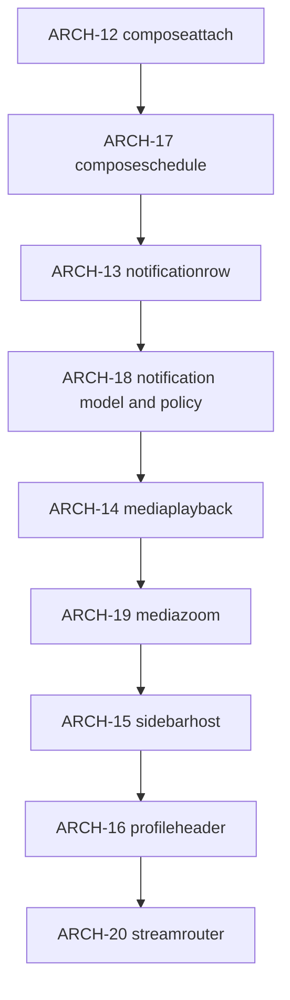

# ARCH structural debt — next seams

Roadmap after Thermo’s code-quality pass (`2064d2e` baseline + concrete
bug fixes). Complements `Docs/IMPROVEMENTS.md` ARCH-01…11: those seams
stopped halfway, and the declared `EXCEPTIONS` in `src/test-file-size.py`
now read like a license to keep growing the leftovers.

**Goal:** one named seam at a time, each module under or honestly
re-justified against `LIMIT = 800`, in the same style as ARCH-01…03 and
ARCH-06 (extract → `install_data` → update `EXCEPTIONS` reason → tests
green). No big-bang rewrite. `_on_stream_event` moved only with a
`PlaceHost`-style indirection (ARCH-20).

**Out of this plan’s wave:** admin tool packing, `pages.py` toolkit
sprawl, `fedicollections` dialogs, finishing ARCH-04 entity adoption,
and Catch Up *features*. Catch Up near-ceiling modules are a
**standing guardrail** (below), not a parallel rewrite.

---

## Current pressure (production)

| Module | Lines | Notes |
|--------|------:|-------|
| `compose.py` | ~1744 | ARCH-12+17 extracted attach/schedule; still over LIMIT |
| `window.py` | ~1818 | ARCH-15 extracted sidebarhost, ARCH-20 the stream router; session and stream lifecycle remain |
| `notifications.py` | ~490 | ARCH-13+18 extracted rows/model/policy; page only |
| `admin.py` | 1814 | Explicit “readability, not a seam” — Phase N |
| `mediaviewer.py` | 514 | ARCH-14+19 extracted playback and ZoomPicture; Phase 1c extracted chrome construction to `mediaviewerchrome.py` (316) and export/drag to `mediaexport.py` (302). No longer a file-size exception |
| `profile.py` | ~915 | ARCH-16 extracted profileheader; tabs/extras remain |
| `mastodon.py` | 1328 | Coherent transport — leave |
| `pages.py` | 1363 | Shared toolkit — Phase N. `PagedList`'s interface was settled on its own (IMPROVEMENTS CLEAN-08) and grew the file by about 90 lines, and the request scope's adoption by `PagedList` and `StateStack` about 25 more; the sprawl is untouched |
| `fedicollections.py` | 1086 | Feature pack — Phase N |
| `hashtags.py` | 802 | Marginal |

Catch Up (hard fail over 800, no EXCEPTION):

| Module | Lines | Headroom |
|--------|------:|---------:|
| `catchup/rank.py` | 788 | 12 |
| `catchup/tiles_render.py` | 785 | 15 |
| `catchup/rank_text.py` | 779 | 21 |
| `catchup/digest.py` | 760 | 40 |

---

## Sequencing (Decision)

Do **one PR / one seam** in this order. Later IDs start only after the
previous seam is installed, file-size reason updated, and the named
regression tests pass. ARCH-17…19 are part of the wave (not optional):
each finishes the donor that ARCH-12…14 open.

---

## ARCH-12 — `composeattach.py` (first cut)

**Status:** done — `composeattach.py` holds `AttachmentRow`,
`ComposeAttachments`, and the paste/media helpers; `compose.py` keeps
thin wrappers. compose ~2019 lines (was ~2501); new module under 800.

**From:** `compose.py` (`BabbleComposeView` ~1887 lines).  
**Extract:** `AttachmentRow`, attach / paste / drop / screenshot paths,
and the module-level paste/media helpers that only those paths use.  
**Keep in compose (at the time):** draft machine, options (CW/poll/lang),
schedule / modes, posting / `UploadRound`, reply/edit/quote entry points
(schedule and modes later moved by ARCH-17).  
**Pattern:** sibling of `composeupload.py` / `composequote.py` — a
focused object or thin helpers the view owns, not a second dialog.

**Verify:** `compose widgets`, focused cases in `test-compose.py` that
touch attachments/paste; `file size rule` (compose still EXCEPTION, but
reason cites ARCH-12).  
**Success:** compose drops by ~400–500 lines; new module under 800 and
on `install_data`.

---

## ARCH-21 — `composetransition.py` (candidate 5)

**Status:** done — mode transitions are frozen `Transition` values in
`composetransition.py` (stdlib-only; module-boundary R10); the view applies
them through `begin()`; `ComposeSchedule` is schedule chrome only. See
`Docs/architecture-candidates-5-7-plan.md` §4. The compose EXCEPTION reason
cites ARCH-17 and this work.

## ARCH-17 — `composeschedule.py`

**Status:** done — `composeschedule.py` holds `_ScheduledReplacement`,
`scheduled_content`, `ComposeSchedule` (reply/mention/edit/redraft/quote/
scheduled entry and schedule banner/picker chrome); `compose.py` keeps
thin forwards. compose ~1744 lines; new module under 800. EXCEPTION
reason cites ARCH-12 and ARCH-17.

**From:** `compose.py` after ARCH-12.  
**Extract:** schedule UI and mode entry points that are not the post
itself — `_scheduled_content`, `start_scheduled`, schedule banners /
pickers wiring, and the reply/edit/quote/thread `start_*` scaffolding
that only sets mode + chrome (not `send_status`).  
**Keep in compose:** draft snapshot/restore, options (CW/poll/lang),
`send_status` / `_complete_post` / `UploadRound` orchestration.  
**Pattern:** same sibling style as `composeattach`; the dialog remains
one widget that *owns* schedule state, with the extracted module holding
the mode transitions and scheduled-payload shaping.

**Verify:** `compose widgets`, `schedule dialog`, compose cases for
reply/edit/schedule; `file size rule`.  
**Success:** compose EXCEPTION reason cites ARCH-12 and ARCH-17; if the
donor falls to ≤ 800, drop the EXCEPTION entry. New module under 800.

---

## ARCH-13 — `notificationrow.py`

**Status:** done — `notificationrow.py` holds `ColumnLayout` /
`ColumnBox` / `make_date_heading`, `NotificationFactory`,
`NotificationPost` and `NotificationRow`; `notifications.py` keeps the
model, page and policy dialog. notifications ~1181 lines (was ~1987);
new module under 800. EXCEPTION reason cites ARCH-13.

**From:** `notifications.py`.  
**Extract:** `NotificationRow`, `NotificationPost`, and the small
Column/button helpers only they use (~720 lines — fits under LIMIT).  
**Keep:** `NotificationsPage` shell, model, policy dialog (until
ARCH-18), ctrl mixin usage.  
**Pattern:** same shape as ARCH-06 `statusrow.py`.

**Verify:** `notifications render`, `notifications` error tests if they
touch rows; `timeline memory` if it frees notification rows; `file size
rule`.  
**Success:** notifications EXCEPTION reason cites ARCH-13; row module
under 800.

---

## ARCH-18 — `notificationmodel.py` + `notificationpolicy.py`

**Status:** done — `notificationmodel.py` holds `NotificationItem`,
`NotificationModel`, and title/detail helpers; `notificationpolicy.py`
holds `NotificationPolicyDialog` and `present_notification_policy`;
`notifications.py` keeps the page and request list (~490 lines, was
~1181). EXCEPTION for notifications dropped (≤ 800). Both new modules
under 800.

**From:** `notifications.py` after ARCH-13.  
**Extract (one PR, two modules):**

1. **`notificationmodel.py`** — `NotificationItem`, `NotificationModel`,
   and title/detail helpers that only the model/rows need for list
   data (not page chrome).
2. **`notificationpolicy.py`** — `NotificationPolicyDialog` and
   `present_*` helpers that open it; page calls into this module the
   way it already calls `notificationctrl` for fetch.

**Keep:** `NotificationsPage` shell + `NotificationController` usage.  
**Pattern:** finish the ARCH-06-style pack (data / row / page / policy).

**Verify:** `notifications render`, policy/prefs paths if covered,
`timeline memory`; `file size rule`.  
**Success:** notifications donor ≤ 800 (drop EXCEPTION) or EXCEPTION
reason names ARCH-13 and ARCH-18 with an honest page-only remainder;
both new modules under 800.

---

## ARCH-14 — `mediaplayback.py`

**Status:** done — `mediaplayback.py` holds `download`/`_Download`,
`release_media`, `_system_state`, and the `MediaPlayback` mixin
(stream start/audio/gifv/inhibit/unload); `mediaviewer.py` keeps chrome,
`ZoomPicture` and `present_media` (~1284 lines, was ~1694). New module
under 800. EXCEPTION reason cites ARCH-14 (zoom is ARCH-19).

**From:** `mediaviewer.py`.  
**Extract:** `_Download`, stream start/audio/gifv/inhibit/unload paths
that own GstPlay / `Gtk.MediaFile` lifetime.  
**Keep:** chrome (`_build`, chrome updates), `ZoomPicture` (until
ARCH-19), `present_media`.  
**Hard rule:** preserve `release_media` order pinned by
`test-mediaviewer-teardown.py` — do not clear `MediaStream` while
`Gtk.Video` lives.

**Verify:** `mediaviewer teardown`, media viewer tests; `file size rule`.  
**Success:** playback concern has one owner; MediaViewer no longer mixes
download pipeline with chrome in the same class body.

---

## ARCH-19 — `mediazoom.py`

**Status:** done — `mediazoom.py` holds `ZoomPicture` and the
`ZOOM_STEP`/`MAX_SCALE` constants it alone uses; `mediaviewer.py` keeps
chrome, attachment navigation, DnD providers and the wiring that
constructs `ZoomPicture` for images (~1058 lines, was ~1284). New
module under 800. EXCEPTION reason cites ARCH-14 and ARCH-19
(chrome-only remainder).

**From:** `mediaviewer.py` after ARCH-14.  
**Extract:** `ZoomPicture` and the free zoom/pan/drag helpers that only
it uses.  
**Keep:** viewer chrome, attachment navigation, wiring that constructs
`ZoomPicture` for image attachments.  
**Pattern:** pure widget extract; no GstPlay (that stayed in
`mediaplayback`).

**Verify:** media viewer tests (zoom/pan/drag if present),
`mediaviewer teardown` still green; `file size rule`.  
**Success:** mediaviewer donor ≤ 800 (drop EXCEPTION) or EXCEPTION
reason names ARCH-14 and ARCH-19 with chrome-only remainder; zoom
module under 800.

---

## ARCH-15 — `sidebarhost.py`

**Status:** done — `sidebarhost.py` holds rebuild, mode/visibility
sync, pinned append/load and the overlay/rail runtime state;
`window.py` keeps template widgets, `_restricted_public_places`,
stream dispatch (later moved by ARCH-20) and thin forwards (~1925 lines,
was ~2161).
`navigation.py` and `sidebarhost.py` are in `SEAMS`. EXCEPTION text
no longer names “sidebar widgets” as an unsplit blob. New module
under 800.

**From:** `window.py` (~L1362–1630 sync/rebuild/pinned).  
**Extract:** an object that takes the window’s settings / navigation /
rail / control callbacks and owns `_refresh_sidebar`,
`_sync_sidebar_mode` / `_sync_sidebar_visibility`, pinned append/load.  
**Do not extract:** `_on_stream_event` (page-container ownership;
documented window exception then; ARCH-20 later moved it behind a
host of callables).  
**Pattern:** one level above `sidebarmode` / `sidebarrail` /
`sidebarcontrol`.

**Verify:** `translucent sidebar`, `sidebar` / `sidebar state` tests,
`navigation window`, `breakpoints` if geometry-sensitive; `file size
rule`. Consider adding `navigation.py` to `SEAMS` if it must stay under
800 (today it is ungarded relative to prose).  
**Success:** window EXCEPTION text no longer claims “sidebar widgets”
as an unsplit blob; host module under 800.

---

## ARCH-16 — `profileheader.py`

**Status:** done — `profileheader.py` holds `HeaderCache`, chip/count
helpers and `ProfileHeader` (refresh / stats / fields / badges);
`profile.py` keeps tabs, extras, note/mute dialogs and thin forwards
(~915 lines, was ~1391). EXCEPTION cites ARCH-16. New module under 800.

**From:** `profile.py` (`ProfilePage` ~927).  
**Extract:** `refresh_header` / fields / badges / banner / stats
construction into helpers or a small `ProfileHeader` the page calls.  
**Keep:** tabs, relationship UI wiring that still calls
`ProfileActions`, note/mute dialogs owned by the page.

**Verify:** `thread profile render` (needs Xvfb), profile relationship
tests; `file size rule`.  
**Success:** profile EXCEPTION cites ARCH-16; page class meaningfully
under ~700 if possible, or still EXCEPTION with an honest remainder.

---

## ARCH-20 — `streamrouter.py`

**Status:** done — `streamrouter.py` (252 lines) holds the stream
router: which streams the built places want (`wanted_streams`,
`place_streams`), which timeline pages exist (`timeline_pages`) and who
receives each event (`route`, over the declared `ROUTES` table, the
deliberately ignored events included). It reaches pages through a
`StreamHost` of callables, as `navigation` does through `PlaceHost`, and
holds no page, window or client. `navigation.py` gains
`stream_places()` and `place_timelines()` so the `list:` / `tag:` key
format stays there. `window.py` keeps the lifecycle (socket start and
stop, polling fallback, reconnect catch-up, background status) and hands
each event over (~1818 lines, was ~1925). `streamrouter.py` is in
`SEAMS`.

**Follow-up fix:** the first cut delivered a `delete` and a
`status.update` to the local and federated pages twice, because
`timeline_pages()` listed the public pages and `place_timelines()`
listed the same pages again as built places. The public-pages term is
gone, and with it the host's `public_pages` callable: the router asks
`place('local')` / `place('federated')`, which is the same page (the
public pages were a filtered view of the built places). Each page now
receives each of those two events once: home first, then the built
places in build order; the conversations place hears `delete` last.

**From:** `window.py` (`_sync_streaming`'s `wanted`, `_place_streams`,
`_timeline_pages`, `_on_stream_event`).  
**Keep:** `StreamingManager` wiring, `live-updates`, polling,
`_on_stream_connection_changed`, `_schedule_background_status`.  
**Pattern:** `PlaceHost`-style indirection; routing declared as data.

**Verify:** `stream dispatch` (the router with plain recorders and the
wanted-streams mapping), `stream events` (the table against the
documented set), `navigation`, `navigation window` (one event through
the real window); `file size rule`.

## Phase N (explicitly deferred)

- **`admin.py`:** split by tool page only when a tool must change in
  isolation; today’s EXCEPTION stands until then.
- **`pages.py`:** do not carve paging/`call_api` early; unify silent
  `admin.send` / `fedicollections._send_api` only as a small helper
  PR, not as a file-size drive.
- **`pages.py`, `PagedList` follow-ups (open, not scheduled):** a guard
  for a plain bound-method hook of the owning page (DEF-09), two
  reach-ins that want an operation, `empty_action=` and the empty icon
  and description through `AccountListPage` (DEF-10), and a list that
  stays on the loading page when a hook raises (DEF-11, still open after
  the request scope below). All three are in `IMPROVEMENTS.md`.
- **Request scope (`refactor/request-scope`, first step done):**
  `src/requestscope.py` is adopted by `PagedList` and `StateStack` (thread,
  filters, edit history, collection page); `call_api` is for writes and for
  reads whose answer is always wanted, and a read whose owner has a scope
  takes its callback from the scope's ticket and calls the api module
  directly. Behaviour changes, with before and after, and the open items
  QA found are in `IMPROVEMENTS.md` (section 2.2). One family per change
  from here, in this order: timelines
  and notifications (`PagedPosts`), search and typeahead, profile, admin and
  Wrapped, the composer's state epochs, then the error helpers that are
  not silent on CANCELLED (`summarize_error`, `summarize_error_markup`,
  `ToastDialog.error`). A write is never cancelled. `blueskythread.py` keeps
  its own `bluesky.cancel`. Existing scopes (`pluginsupport.Scope`,
  `catchup.fetch.CatchUpRun`, `auth.py`) could converge on the vocabulary
  (`close()` / `closed`), not now.
- **`fedicollections.py` / `hashtags.py` / `mastodon.py`:** leave unless
  they grow or a feature forces a seam. `hashtags.py` is at 802 lines
  against the limit of 800 as a declared exception: the next deletion of
  two or more lines must remove its entry in `src/test-file-size.py`.
- **Stream dispatch table:** done as ARCH-20, with the dependency
  inversion this entry once said it was not.

---

## Standing guardrail — Catch Up

Before any Catch Up feature that adds net lines to `rank.py`,
`tiles_render.py`, or `rank_text.py`, land a micro-seam first so the
module stays under 800. The file-size test will fail the undeclared
overflow; do not add Catch Up to `EXCEPTIONS`.

---

## Per-seam checklist

1. Extract to a new `src/<name>.py` with SPDX header; match existing
   import/`connect_weak` style.
2. Add to `src/meson.build` `install_data` (and `po/POTFILES.in` if
   new translatable strings move).
3. Rewrite the donor’s `EXCEPTIONS` reason to name this ARCH-ID (or
   drop the entry if the donor falls ≤ 800).
4. Run `file size rule` plus the feature tests listed above under
   headless mutter 1280×1024.
5. Append a one-line status to this file and to the ARCH table in
   `Docs/IMPROVEMENTS.md` when the seam lands.

---

## First implementation slice

**Start with ARCH-12 only.** Do not open ARCH-17 (or later) in the same
PR. After ARCH-12 merges, continue in order: 17 → 13 → 18 → 14 → 19 →
15 → 16.
