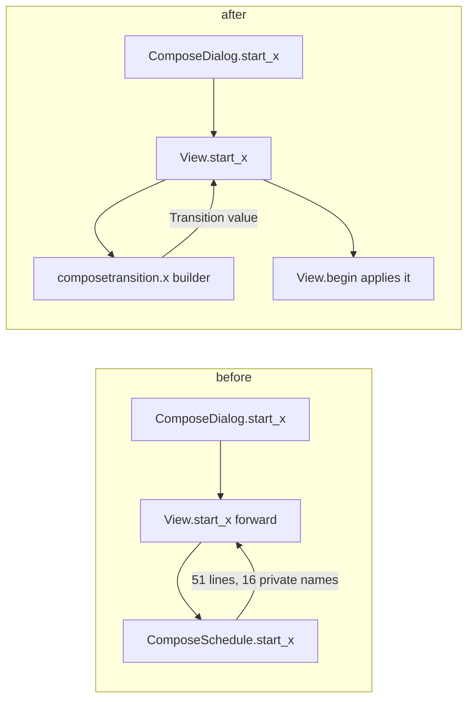
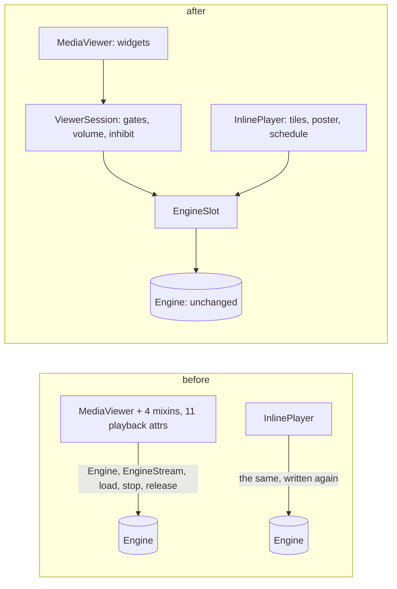

# Architecture candidates 5 to 7: plan

*Three more deepenings from the architecture review: compose mode
transitions as data, a playback session behind the media viewer, and a
named image decode interface.*

Status: draft for the maintainer's decisions. Nothing in this document is
started. Date: 2026-11-13. Written against `origin/main` at `49fe204`
(contains `575719f`, PR #113).

A working note under the documentation policy: it is the project's record
of what is planned, so it carries no identification block and has no
Brazilian Portuguese edition (policy sections 3.4 and 3.5).

Vocabulary, as used in the architecture review: module, interface,
implementation, depth, seam, adapter, leverage, locality, and the deletion
test (if deleting a module makes its complexity reappear in N callers, it
earns its keep; if the complexity only moves, it was shallow). The
project's own terms are in `Docs/glossary.md`.

## 1. Purpose and status

The architecture review proposed seven refactors that turn shallow modules
into deep ones. Four are merged:

| # | Candidate | Module | PR |
|---|---|---|---|
| 1 | Media policy | `src/mediapolicy.py` | #109 |
| 2 | Stream-event router | `src/streamrouter.py` | #110, follow-up fix #111 |
| 3 | `PagedList` interface | `src/pages.py` | #112 |
| 4 | Request scope, first step | `src/requestscope.py` | #113 |

This document plans the other three, in the order the review numbered
them, and recommends a different order for doing them (section 3):

- **5.** Compose mode transitions as data (`composeschedule.py`).
- **6.** A playback session behind the media viewer's mixins.
- **7.** Name the image decode interface (`mediacache.py`).

Every fact below was read from a file in this worktree or counted with
`rg`; section 7 lists what rests on reading alone or could not be
confirmed. Line numbers are those of `49fe204`.

## 2. How this work is delivered

These are the rules candidates 1 to 4 settled on. Each candidate's plan
applies them.

**Delivery model.** Each change is delivered by a Dev agent in its own git
worktree, verified by a QA agent, reviewed by a Tech Lead agent, and
accepted by the main session, which re-runs the key evidence itself.
Subagents run on Sonnet. The maintainer decides the design questions
before a Dev starts (each candidate's "Decisions" section), and decides
publication (push, pull request, merge) for each change.

**Budget.** The maintainer's usage limit is the binding constraint.
What worked or was adopted:

- one agent at a time;
- one fix round per change: QA and the Tech Lead review the same commit,
  and the Dev fixes both sets of findings once;
- briefs scoped to the diff for re-checks;
- a fresh small agent for a five-line follow-up, not a resumed large one;
- no parallel branches that touch the same files.

**Evidence that settles arguments.**

- A differential check: the base's code and the new code are driven
  through the same scripted inputs, and requests issued, visible state and
  call logs are compared. QA writes it independently of the Dev.
- A mutation test for every new test: a deliberate break of the product
  code must fail a named check.
- Check counts (`ok -` lines) before and after, so no assertion is lost.
- `api golden` unchanged (`git diff origin/main...HEAD -- src/golden` is
  empty) as the proof that nothing changed on the wire.
- GObject weak-ref checks that pages and dialogs are freed.

**Neutral means neutral.** A refactor is behaviour-neutral unless a
behaviour change is listed with before and after and approved. Each of
candidates 2, 3 and 4 surfaced pre-existing bugs; they were recorded (DEF
rows in `Docs/IMPROVEMENTS.md`) or fixed in a separate small change, never
folded in silently. Where this plan has seen an oddity it says so, and
does not decide it.

**Rules of the house.**

- Tracked files are changed only with the edit tools, never by a script or
  `sed`.
- Every `src/test-*.py` selects `GSETTINGS_BACKEND=memory` before it
  imports `gi` (`settings isolation`).
- A new module goes in `src/meson.build`'s install list (`file size rule`
  checks it); a new test is registered there too.
- The suite runs under headless mutter at 1280x1024 with `-j1`:
  `XDG_RUNTIME_DIR=$(mktemp -d) dbus-run-session -- mutter --headless
  --wayland --no-x11 --virtual-monitor 1280x1024 -- meson test -C build -j1`.
- Known flakes on unmodified main: `plugin panel`, `reading position`,
  `translucent sidebar`; and on CI `media progressive` (a teardown hang)
  and `media inline`. A red CI job on a test the change does not touch is
  re-run once and reported.
- `main` is merged into a branch, never rebased, never force-pushed.
- The documentation policy governs every document touched, including the
  bilingual rule for formal items.

**Interface discipline.**

- No operation without a caller (an unused `call_api(ticket=)` was added
  and removed in candidate 4).
- A rule that callers can get wrong silently is made structural
  (`Ticket.callback`).
- A helper that takes a handler refuses, with a `TypeError`, the kinds
  that would pin a widget (`mediapolicy.connect_changes`).
- Hooks stored on a long-lived object must not hold their page.

## 3. Recommended order

**7 (rename only), then 5, then 6 (phases 1 and 2 only; phase 3 after a
decision).** One at a time, as section 2 says.

| Step | Why here | Depends on |
|---|---|---|
| 7, phase 1 | Mechanical, behaviour-free, cheapest, and provable by an `ast` comparison. | The maintainer disposing of two stale branches that edit `mediacache.py` (below). |
| 5, phase 1 | Real depth gain, and the wire is pinned by `compose transactions` (a real HTTP server) and `api golden`. No open branch overlaps. It must land before the request scope reaches the composer's state epochs (`Docs/arch-structural-debt-plan.md`, "Request scope"), or that family would edit the transition preamble twice. | Nothing. |
| 6, phases 1 and 2 | Small and mechanical (move `download`; share the engine start). Phase 2 touches the inline player, so it carries the bench gate in `PERFORMANCE.md`. | A measured flake rate for `media progressive` and `media inline` on main (section 6.3). |
| 6, phase 3 | The only phase that moves state. Highest risk. | A decision on the teardown hang, and the preconditions in section 6.3. |

**Overlap with open branches** (`git for-each-ref refs/remotes/origin
--no-merged origin/main`, `gh pr list --state open`, checked 2026-11-13):

| Branch | Last commit | Touches | Matters to |
|---|---|---|---|
| `fix/avatar-decode-failure-stranded` | 2026-11-06 | `src/mediacache.py`, `src/test-avatarcache.py` (one commit; merges cleanly into main by `git merge-tree`) | 7 |
| `fix/avatar-image-fetcher-plugin-lifecycle` | 2026-11-05 | `src/imagecache.py`, `src/mediacache.py`, `src/mediaviewer.py`, `src/pluginhost.py`, tests, bench/v2, docs (six commits; conflicts with main in `imagecache.py`, `mediacache.py` and `mediaviewer.py`) | 7, 6 |
| `perf/inline-mem-gate` | 2026-11-10 | `bench/compare.py`, `bench/timeline_bench.py`, `bench/limits-inline.json`, `bench/inline_cycles.py`, `autoresearch.sh`, `CLAUDE.md`, `PERFORMANCE.md` (one commit) | 6 (the bench gate) |
| PR #114 `fix/reply-filter-guard` (and `ccr-6b99fe12-rtl8w1`, same files) | 2026-11-13 | `homefilters.py`, `notificationctrl.py`, `pages.py`, `timelinepage.py`, docs | none of 5, 6, 7 |

The two avatar branches are the only things standing in front of
candidate 7. The maintainer should merge or discard them first (decision
D7-1).

## 4. Candidate 5: compose mode transitions as data

### 4.1 Today

**The files.** `src/compose.py` 1755 lines (a declared file-size
exception, `src/test-file-size.py`); `composeschedule.py` 395;
`composeattach.py` 648; `composeupload.py` 267; `composequote.py` 169;
`drafts.py` 213.

**The reach-in, recounted.** `composeschedule.py` has 51 lines that touch
`view._...`, over 16 distinct names (the review's numbers hold):

| Name on the view | Lines | Name | Lines |
|---|---|---|---|
| `_draft_stack` | 6 | `_load_thread` | 2 |
| `_clear_submission_mode` | 6 | `_capture_state` | 2 |
| `_accept_transition` | 6 | `_show_error` | 1 |
| `_finish_begin` | 5 | `_select_poll_duration` | 1 |
| `_set_buffer` | 4 | `_select_language` | 1 |
| `_select_visibility` | 4 | `_posting` | 1 |
| `_replacement` | 4 | `_scheduled_fields`, `_pending_media_ids` | 3 each |
| `_select_default_poll_duration` | 2 | | |

It also reads or writes 19 public names (`buffer`, `scheduled_at`,
`in_reply_to_id`, `spoiler_entry`, `poll_entries`, `cw_toggle`,
`poll_toggle`, `editing_id`, `quoted_status_id`, `scheduled_id`,
`scheduled_on_done`, `post_button`, `poll_add`, `attach`, and the methods
`update_compose_state`, `clear_attachments`, `poll_limits`,
`on_poll_add_choice`, `is_empty`). The module's docstring says the view
"owns the draft state and chrome widgets" and that this module "shapes
the mode transitions"; in practice the module performs them.

**The counter-example works as claimed.** `ComposeAttachments`
(`composeattach.py:269`) takes seven keyword callables in its constructor
(`on_changed`, `on_toast`, `on_error`, `is_posting`, `is_frozen`,
`on_add_toast`, `on_paste_text`; built at `compose.py:332-340`, with
lambdas so a wrapped helper is what gets called), then `bind(...)` for the
chrome, and never imports or holds the view.

**`composequote.py` is not a transition module.** It is the paste-to-quote
flow, written as a mixin (`QuotePaste`, `composequote.py:26`) that reads
11 names of the view it is mixed into (its docstring lists them), four of
which are state that lives only for it: `_pre_paste_offset`,
`_paste_serial`, `_in_programmatic_insert`, `_quote_state_generation`. It
is the media viewer's problem (state owned by the host, behaviour in a
mixin) in miniature, and is out of this candidate (decision D5-2).

**The seven transitions.** Six are in `ComposeSchedule`; a seventh,
`prefill_text`, is written in the view (`compose.py:937`) and repeats the
same preamble. What each does to the draft (read from the code, not run):

| Transition | Stack after | Buffer | CW | Visibility | Attachments, poll | Other state set | Later async |
|---|---|---|---|---|---|---|---|
| `start_reply(id, handle, vis, parent)` | `[previous]` | `'@h '` (a new message with a non-empty draft keeps it, and keeps the stack) | from `parent` only, else untouched | always set | untouched | `in_reply_to_id` | `_load_thread(id)` |
| `start_mention(account, direct)` | `[previous]` | `'@acct '` | untouched | `direct` only if asked | untouched | `in_reply_to_id=None` | none |
| `start_edit(status)` | `[]` | status text | from status | from status | cleared, existing media shown as rows | `editing_id`; `sensitive` carried in `_scheduled_fields` | `_load_thread(id, status, editing=True)` |
| `start_redraft(status)` | `[]` | status text | from status | from status | cleared; ids kept in `_pending_media_ids` | `sensitive` as above | none |
| `start_quote(status)` | `[]` | untouched | untouched | untouched | untouched | `quoted_status_id` | none |
| `start_scheduled(s, draft, on_done)` | `[]` | params text | from params | from params | cleared, then filled from params, with a poll | scheduled id, time, callback, `quoted_status_id`, language, `_scheduled_fields` | none |
| `prefill_text(text)` (in the view) | `[previous]` only if the composer is not empty, else untouched | the text | untouched | untouched | untouched | `in_reply_to_id=None` | none |

Every one begins with `_accept_transition()` (returning `False` on a
refusal) and calls `_clear_submission_mode()` before it writes anything,
and every one ends in `_finish_begin()` (`update_compose_state()` then
`grab_focus()`; edit and redraft share `_load_status_draft`, which makes
the call). `start_scheduled` can also refuse after the accept, before it
touches anything, when `scheduled_content` rejects the payload (a toast and
`False`). In `composeschedule.py` the textual preamble appears 6 times
(accept), 6 (clear) and 5 (finish), and `prefill_text` repeats it in the
view.

**What the preamble helpers do** (`compose.py:751-799`):

- `_accept_transition` refuses, with a toast, while a scheduled
  replacement is pending ("Remove the original scheduled post...") or a
  post is being sent ("Finish sending this post first.").
- `_clear_submission_mode` clears `editing_id`, `quoted_status_id`,
  `scheduled_id`, `scheduled_at`, `scheduled_on_done`,
  `_pending_media_ids` and `_scheduled_fields`; bumps
  `_quote_state_generation`; drops `_pre_paste_offset`; and sets the
  thread to `None` (`_set_thread`, which bumps `_thread_generation`). It
  returns `False` and does nothing while a replacement is pending.
- `_finish_begin` is `update_compose_state()` and `text_view.grab_focus()`.
- `_capture_state` snapshots a `_ComposeState`: the `Draft`
  (`snapshot()`), the five submission ids, the media ids (pending plus the
  uploaded ids of existing rows), a deep copy of `_scheduled_fields`, and
  the thread.

**The draft stack.** `_draft_stack` is a list that every writer sets to
`[]` or to a one-element list, so it holds at most one `_ComposeState`
(`compose.py:260`; writers at `composeschedule.py:174,178,211,270,281,332`,
`compose.py:893,946,1580-1581,1746`). It is pushed by reply, mention and
non-empty `prefill_text`/`restore_stashing`; it is read by
`update_compose_state` (the Cancel Reply banner shows while it is
non-empty), popped by `pop_reply_state`, and consumed by `reset`
(`predecessor` is restored after the draft is cleared). `start_edit`,
`start_redraft`, `start_quote` and `start_scheduled` set it to `[]`, which
silently discards a stacked draft. `abandon_session` clears it.

**Asynchronous work inside a transition, and its guards.**

| Work | Started by | Guard | Bumped by |
|---|---|---|---|
| Fetch the status, then its context, to number a thread (`_load_thread`, `compose.py:820`) | reply, edit | `_thread_generation`, checked in `current()` | every `_set_thread`: `_clear_submission_mode`, `pop_reply_state`, `_restore_state`, `_complete_post`, `abandon_session`, the answer itself |
| Resolve a pasted post link into a quote (`composequote.py:90`) | a paste | `_quote_state_generation` | `_clear_submission_mode` |
| Uploads of one Post click (`composeupload.py:93`) | Post | `UploadRound.generation` | `abandon()` from `reset` and `abandon_session` |

The first two epochs are bumped only by `_clear_submission_mode` and
`_set_thread`; the third is bumped by neither a transition nor
`_clear_submission_mode` (a transition cannot run while a post is on its
way, because `_accept_transition` refuses). This is the family the request
scope survey listed as not fitting the scope as it is: the answers apply
to a composer that is still open, but "still wanted" depends on a state
epoch, not on a page's life. It is why candidate 5 should come first.

**Forwards in `compose.py`.** 19 one-line forwards on the view and 7 on
`ComposeDialog`. Outside callers, searched by name and by string:

| Forward | Outside code callers | Template (`.ui`) | Tests |
|---|---|---|---|
| `ComposeDialog.start_reply` | `window.py:1215`, `conversations.py:266` | none (the composer is built in code) | `test-compose.py` (9 lines), `test-compose-transactions.py` (8, on the view) |
| `ComposeDialog.start_mention` | `profileactions.py:166`, `statusmenu.py:592` | none | existence only (`test-compose.py:1054`); **no test calls it** |
| `ComposeDialog.start_edit`, `.start_redraft`, `.start_quote` | **by string**: `statusactions._open_composer` does `getattr(dialog, method)(status)` (`statusactions.py:226`) from `statusmenu.py:469,496` and `statusactions.py:505` | none | `start_edit` 11 calls on the view (3 + 8), `start_redraft` 1, `start_quote` 6 |
| `ComposeDialog.start_scheduled` | `scheduled.py:439` | none | 10 calls on the view |
| view `prefill_text`, `restore_stashing`, `add_attachment_files` | `main.py:99`, `pluginmenu.py:53`; `window.py:640`; `window.py:1237` | none | yes |
| view `start_*` (6) | only the dialog | none | the tests call the view |
| view `is_timed`, `on_schedule_clicked`, `_on_schedule_picked`, `on_schedule_clear` | none | none | tests only (5 lines, `test-compose.py:1095-1143`) |
| view `attachment_limit`, `media_filter`, `on_remove_attachment`, `on_files_selected` | none | none | tests only (16 lines in `test-compose.py`) |
| view `clear_attachments`, `attachments`, `add_attachment_path`, `_set_attach_sensitive` | none (internal callers in `compose.py` and `composeschedule.py`; `add_attachment_path` also in `test-instance-limits.py`) | none | yes |

`ComposeDialog.start_*` must stay: six modules reach them (`window`,
`conversations`, `profileactions`, `statusmenu`, `statusactions`,
`scheduled`), three of the entry points by a
string that a search for `start_edit(` does not find, and
`test-compose.py:1054` pins their existence ("the composer contract other
modules rely on"). The deletable forwards are the view's 4 schedule-chrome
and 4 attachment forwards that only tests call: 8 one-line methods, 21 test
lines to retarget (`view.modes.<x>` and `view.attach.<x>`).

**Tests that cover this.**

| Test (meson name) | Size | Needs display | What it pins |
|---|---|---|---|
| `compose widgets` (`test-compose.py`, 3199 lines) | 451 `ok -` lines, 55 s | yes; asserts geometry (`:942-962`), so 1280x1024 | the widget: restore, attachments, schedule picker, prefill, thread mode, the contract names |
| `compose transactions` (`test-compose-transactions.py`, 650 lines) | 63 `ok -`, 3.6 s | yes; real HTTP server | 32 lines call `start_*` on the view; edit/quote/schedule/reply routing and the wire; late thread answers; stacking; refusals while sending; unsupported scheduled settings |
| `schedule dialog` | 10 `ok -` | yes | the picker's spin rows |
| `api golden` (`test-api-golden.py:1591`) | | yes | builds a view with a pending `_ScheduledReplacement` |
| `feature gates` (`test-feature-gates.py`) | | yes | one `start_edit` |

(Counts from a run of this worktree on 2026-11-13, one run each.) Between
them the 12 + 32 `start_*` calls cover reply (8 + 8), edit (3 + 8), quote
(6), scheduled (1 + 9) and redraft (1). **No test calls `start_mention`.**
Two tests reach into the view's `_draft_stack` (once) and `_capture_state`
(six times).

**Oddities seen while reading** (not run; for QA's differential to confirm
before anything is recorded, and none to be changed in this work):

1. `start_reply` replaces the text, content warning and visibility but
   never clears attachments or the poll; the stacked `previous` holds
   them, and so does the reply.
2. `start_edit`, `start_redraft`, `start_quote` and `start_scheduled` set
   the stack to `[]`, so starting any of them while a reply banner is up
   silently discards the stacked draft.
3. A new message (`start_reply(None, '')`) over a non-empty draft clears
   the submission mode (an edit id, say) but leaves the edit's text in the
   buffer, and stacks a `previous` that still has the edit id.
4. `start_edit` and `start_redraft` do not set the language
   (`start_scheduled` does).
5. `statusactions._open_composer` calls `window.present_composer()` after
   `getattr(dialog, method)(status)` without looking at the `False` a
   refused transition returns (the refusal toast is shown on the composer's
   own overlay, which is presented anyway).

### 4.2 The deepening

**Target shape (proposal; names are not decided).**

- **`src/composetransition.py`** (new, pure): a frozen `Transition` value
  and one builder per transition (`reply`, `mention`, `edit`, `redraft`,
  `quote`, `scheduled`, `prefill`), plus `scheduled_content` moved from
  `composeschedule.py`. It imports only the standard library, so it can be
  checked by `module boundary` like `src/api/*.py`, and tested with no
  display.
- **`BabbleComposeView.begin(transition)`** (in the view): the one entry
  point that applies a `Transition`. It owns the preamble once: accept (or
  refuse), capture the previous state when the transition stashes, clear
  the submission mode (which bumps both epochs), write the described
  fields, set the stack, finish, then start the thread lookup the
  description asks for.
- **`ComposeSchedule`** stays, as the schedule chrome only (`bind`,
  `is_timed`, the picker handlers, `update_chrome`; about 125 lines). Its
  six `start_*` go.
- **The view's `start_*` and `ComposeDialog`'s** remain as the public
  names (decision D5-2 explains why), each now two lines:
  `return self.begin(composetransition.reply(...))`.

**What a description contains.** One frozen dataclass, because the six
transitions differ by values, not by shape. A field either carries a value
or the sentinel `KEEP` ("leave what is there"):

| Field | Values | Used by |
|---|---|---|
| `stack` | `PUSH`, `PUSH_IF_NOT_EMPTY`, `CLEAR` | PUSH: reply, mention; PUSH_IF_NOT_EMPTY: new message, prefill; CLEAR: edit, redraft, quote, scheduled |
| `text` | `KEEP` or a string (cursor at the end) | all but quote and the new-message case |
| `cw` | `KEEP` or `(active, text)` | reply with a parent, edit, redraft, scheduled |
| `visibility`, `language` | `KEEP` or a code | reply, mention, edit, redraft, scheduled |
| `media` | `KEEP`, or `(clear, pending_ids, existing_rows_to_show)` | edit, redraft, scheduled |
| `poll` | `KEEP`, `CLEAR`, or options, expiry and flags | edit, redraft, scheduled |
| `in_reply_to_id`, `quoted_status_id`, `editing_id`, `scheduled` (id, time, callback) | the value they take after the clear (`None` is the clear) | per transition |
| `scheduled_fields` | extra fields carried to the post (`sensitive`, `quote_approval_policy`, poll flags) | edit, redraft, scheduled |
| `thread_lookup` | none, or `(status_id, status_or_None, editing)` | reply, edit |

`thread_lookup` is a request, not a result: the description cannot hold an
answer that has not arrived. `begin` starts the lookup after
`_finish_begin`, exactly where `start_reply` and `start_edit` do it today,
and the answer still applies through `_load_thread`'s own guard
(`_thread_generation`), which `begin`'s clear has already bumped. The
asynchronous parts are therefore unchanged and stay in the view; only the
decision "does this transition start a lookup" becomes data.

**The refusal paths.** `_accept_transition` stays in `begin` (it needs
toasts and the view's flags). A builder that cannot build
(`start_scheduled` with unsupported settings) raises a plain exception
(proposal: `UnsupportedSettings`) so the module needs no `gi`; `begin`'s
caller shows the same toast ("Could not edit scheduled post", "The server
returned unsupported post settings.") before anything is touched, as
today. The strings stay in `compose.py`/`composeschedule.py`, which are
both in `po/POTFILES.in`.

**What stays in the view, and why.** The apply step. Giving it to a
separate applier would need about 15 callables (buffer, cursor, CW,
visibility, language, attachments, poll, five ids, stack, thread, focus),
which is the same coupling written differently: the deletion test would
say it moved. `ComposeAttachments` could take callables because the tray
touches a small, closed set of the view; a transition touches all of it.
The view keeps `_capture_state`, `_ComposeState`, `_set_buffer`,
`_select_*`, `_load_thread`, and the preamble helpers as private details of
`begin`.

**Is the deepening real?** `begin(transition)` is one operation on one
value and hides the refusal, the capture-before-clear order, the epoch
bumps, the stack policy, the finish and the lookup: that is leverage the
six copies never had. The locality gain is that "what does Quote do to the
composer" is a 12-line builder and a table row, readable and testable
without a display. The honest limit: `compose.py` grows by about 50 lines
(it is already an exception) and the fields `begin` writes are still the
view's private ones; they are now written in one place inside the view,
where being private is correct, instead of from another module.



### 4.3 Decisions for the maintainer

**D5-1. Where does `apply` live?** Options: (a) in the view as
`begin(transition)`; (b) in an applier object that takes explicit
callables like `ComposeAttachments`. Recommend (a): the transition touches
every field the view owns, so (b) needs about 15 callables and moves the
coupling without removing it.

**D5-2. How many transitions, and does `QuotePaste` come along?**
Options: (a) the six `start_*`; (b) the six plus `prefill_text`, which is
written in the view but repeats the preamble and has two outside callers
(`main.py:99`, `pluginmenu.py:53`); (c) also `restore_stashing`,
`pop_reply_state`, `reset` and `_complete_post`'s thread chaining, the
other writers of the same state. Recommend (b). The rest restore or reset
rather than begin; folding them in widens the diff past what one review
can hold. `QuotePaste` is a different shape (a mixin over paste events)
and stays; the same treatment as the media viewer's mixins could be
considered after candidate 6.

**D5-3. Is the transitions module free of `gi`?** Options: (a) yes, with a
plain exception for a refused payload, so it joins `module boundary` and
its tests need no display; (b) keep `GLib.Error` as `scheduled_content`
does today. Recommend (a). The cost is the view mapping the exception to
the existing toast.

**D5-4. Does `ComposeSchedule` survive?** Options: (a) it stays as the
schedule chrome, and the view's attribute `modes` is renamed (it is
referenced only in `compose.py`); (b) the chrome moves into the view and
the module goes. Recommend (a): the chrome is bound to two widgets and has
its own handlers, and `_ScheduledReplacement` is imported by
`test-api-golden.py` from `src.compose`.

**D5-5. Delete the forwards no outside caller uses?** The 8 test-only
forwards in section 4.1. Options: yes, in phase 2, with tests retargeted
to `view.modes`/`view.attach`; or leave them. Recommend yes, as a separate
small phase, since the review asked for it and it is mechanical; it can be
dropped without affecting phase 1.

**D5-6. The oddities in 4.1.** Options: record them as DEF rows after QA
confirms them, or ignore. Recommend record; change nothing here.

### 4.4 Phases

**Phase 1: transitions as data.** Behaviour-neutral.

- *Scope.* New `src/composetransition.py` (about 280 lines, of which
  `scheduled_content` is 87 moved); `composeschedule.py` falls from 395 to
  about 125 lines; `compose.py` gains `begin` (about 55 lines) and loses
  about 10 (`prefill_text`); `src/meson.build` (module and test);
  `src/test-file-size.py` (the `compose.py` reason cites ARCH-17 and this
  work); a new `src/test-compose-transition.py` (about 200 lines, no
  display); `src/test-module-boundary.py` gains a rule for the new module;
  `Docs/glossary.md`, `CLAUDE.md`, `Docs/arch-structural-debt-plan.md`,
  `Docs/IMPROVEMENTS.md`. Chapter 12 of the manual lists
  `src/composeschedule.py` in its traceability table (4 - Writing, both
  editions); a new module belongs there (the version bump that edit
  needs is not decided here; see section 7).
- *Out of scope.* Any of the oddities; `QuotePaste`; the forwards;
  `restore_stashing`, `reset`, `pop_reply_state`.
- *Size.* About +560 and -300 lines in about 9 files (estimate from the
  line counts of what moves).

**Phase 2: delete the 8 test-only forwards.** Neutral. About -16 product
lines and 21 test lines retargeted, in `compose.py` and `test-compose.py`.
Optional.

**Phase 3 (not planned).** The other writers of the state (D5-2 option c).
Only if phase 1 shows the pattern holds and the maintainer asks.

### 4.5 Tests

**Regression net.** `compose widgets` (451 `ok -`), `compose transactions`
(63), `schedule dialog` (10), `api golden` (unchanged diff), `feature
gates`, `plugin panel` and `oauth callback` (their fakes of
`prefill_text`), `module boundary`, `ui strings`, `file size rule`,
`settings isolation`, `documentation`.

**New tests.**

- `compose transition` (no display): each builder returns the field table
  of section 4.2 for representative inputs; `scheduled` refuses each bad
  payload of `compose transactions` (the bad polls, the unknown language)
  without a view; a table asserting which fields each transition leaves as
  `KEEP`, so a new transition must declare them.
- A direct test of `start_mention`, which has none today (plain and
  direct).
- A free-check: build a view, run each transition, drop the view and
  dialog, and assert both are collected (GObject weak-ref notify), since
  `begin` must not pin the view.

**The differential check QA builds.** One script, run twice in two
processes (the base tree in a worktree of `origin/main`, then the branch,
because two trees cannot both be `src`), writing a JSON log each; the two
logs are diffed. For each of the 7 transitions, from each of the starting
states {empty; text only; text, attachments and a poll; a reply stacked;
an edit in progress; a thread under way; a scheduled entry loaded; a
replacement pending; a post being sent}, it runs the transition and
records: buffer text and cursor offset, CW toggle and text, visibility
index, language code, poll toggle, entries, duration and flags,
attachments (paths, alt, uploaded ids), `_pending_media_ids`,
`_scheduled_fields`, `_capture_state()` of the stack, the five ids, the
thread, the dialog title, the banners, the Post label, the toasts raised,
and (against the local HTTP server of `compose transactions`) the wire
requests of a following Post. Then the late-answer cases: the thread or
quote answer arriving after a second transition.

**Mutations that must fail a named check.**

| Mutation | Expected to fail |
|---|---|
| `begin` skips `_clear_submission_mode` | `compose transactions`: "schedule to reply clears all old submission targets" |
| `begin` captures `previous` after the clear | the differential, and the "cancel restores prior edit text and routing" check |
| the reply builder drops its `thread_lookup` | "reply to post 5 previews the end of post 5" |
| the clear no longer bumps `_quote_state_generation` | a new test in `compose transition`/`compose widgets` for a stale quote paste (Dev to confirm which check exists) |
| the thread generation is not bumped before the lookup | "late thread answer after ... is ignored" |
| `scheduled` validates after the clear | "unsupported scheduled poll refuses without mutation" |
| the DM builder omits `direct` | a new `compose transition` check |

### 4.6 Acceptance criteria

1. `rg -n 'view\._' src/composeschedule.py src/composetransition.py`
   prints nothing.
2. `rg -n 'def start_' src/composeschedule.py` prints nothing; each of
   the view's seven entry methods is at most four lines.
3. `src/composetransition.py` imports only the standard library, and
   `module boundary` fails when a `gi` import is added to it (checked with
   a mutation).
4. The differential logs are identical for every transition and starting
   state, except any behaviour change listed with before and after.
5. `git diff origin/main...HEAD -- src/golden` is empty; `po/*.po` and
   `po/babble.pot` are unchanged (no msgid added, removed or edited).
6. `compose widgets` and `compose transactions` each print at least as
   many `ok -` lines as the baseline (451, 63); the new tests print at
   least their own count; the mutations in 4.5 each fail their check.
7. The composer dialog is freed after the transitions (weak-ref notify).
8. `file size rule`: every module stays under 800 lines except the
   declared exceptions.

### 4.7 Definition of done

Dev, QA and Tech Lead signed off; the main session's full-suite run under
mutter at 1280x1024 (`-j1`) with the known flakes named; CI green;
`CLAUDE.md` (the architecture bullet naming the composer's modules),
`Docs/glossary.md` ("Composer transition", "draft stack"),
`Docs/arch-structural-debt-plan.md`, `Docs/IMPROVEMENTS.md` (new ARCH row;
DEF rows for confirmed oddities) updated; the manual's chapter 12 table
checked; the maintainer's publication decision.

### 4.8 Risks and stop conditions

- The differential shows any difference not on the approved list: stop,
  report the case.
- Capturing `previous` after the clear, or the order of stack, thread and
  focus, changes a visible state: stop. These orders are the traps.
- `begin` needs more than the view's existing private methods (a new
  coupling to something outside the view): stop and rethink D5-1.
- `compose.py` grows by more than about 80 lines: stop, since the point is
  locality, not relocation.
- A hidden caller of `start_*` by string turns up beyond the three in
  `statusmenu.py` and `statusactions.py`: add it to the list, do not rename.

### 4.9 Cost

Phase 1: Dev 1 round, QA 1 (writes the differential), Tech Lead 1, one fix
round, the main session's acceptance run: 4 to 5 agent runs, two of them
heavy (the Dev and QA). Phase 2: Dev plus one combined review, 2 to 3 light
runs. Cheapest sequencing: ship phase 1 alone, then phase 2 only if asked.
Run `compose widgets` once per round (55 s), not per edit.

## 5. Candidate 6: a playback session behind the media viewer

### 5.1 Today

**The shape.** `MediaViewer(RemoteGate, MediaPlayback, MediaExport,
MediaViewerChrome, Adw.Bin)` (`mediaviewer.py:127`). File sizes:
`mediaviewer.py` 543 (no longer a file-size exception), `mediaplayback.py`
563, `mediaexport.py` 310, `mediaviewerchrome.py` 312, `remotemedia.py`
165, `mediaengine.py` 580, `mediastream.py` 305, `mediainline.py` 664.
No mixin has a second user: `rg` finds `RemoteGate`, `MediaPlayback`,
`MediaExport` and `MediaViewerChrome` used only by `MediaViewer`. Deleting
a mixin would move its methods into `MediaViewer` (543 plus the 165 of
`remotemedia.py` is about 700): no complexity would reappear in a caller.
They are a file split for the 800-line rule (ARCH-14 and the chrome and
export splits in `Docs/arch-structural-debt-plan.md`).

**State, and who touches it.** `MediaViewer.__init__` (`:145-183`) creates
most of it; the playback attributes are class defaults on the mixin
(`mediaplayback.py:214-229`).

| State | Created | Read or written by |
|---|---|---|
| `attachments`, `index`, `status_url`, `window` | `__init__` | viewer, chrome, export |
| `_cancellable` | `__init__` | viewer (`_cancel_loads`, `_show_image`); playback (the preview loads) |
| `_downloads` | `__init__` | viewer (`_cancel_loads`); export (2) |
| `_first_focus` | `__init__` | viewer (`_on_texture`), playback (`_show_deferred`, `_on_stream_prepared`) |
| `_closed` | `__init__` | viewer, `RemoteGate` (2), export (3) |
| `_stream`, `_stream_kind`, `_inhibit_app`, `_inhibit_cookie` | `__init__` | **playback only** |
| `_engine`, `_autoplayed`, `_buffering_timeout`, `_gate_paused`, `_gate_connected`, `_gate_open`, `_loaded_volume` | class defaults in `MediaPlayback` | **playback only** |
| `_remote_allowed`, `_remote_token`, `_remote_actions` | `__init__` | `RemoteGate` only |
| `_local_files` | `__init__` | export only |
| `_we_fullscreened`, `_fullscreen_handler` | `__init__` | viewer only |

So 11 attributes belong to the playback concern, initialised in two places
and touched by one mixin, plus the engine's lifetime calls in
`MediaViewer.close()`. `RemoteGate` names other mixins' methods by string:
`_remote_actions = {'show': '_show_loaded', 'save': '_save_dialog',
'open-with': '_open_with_download'}` (`mediaviewer.py:174-176`);
`_show_loaded` is in `MediaViewer`, the other two in `MediaExport`
(`mediaexport.py:198,252`), and `RemoteGate` calls `_show_loading`,
`_show_error` and `_notify` from the other two. Five call sites ask the
gate (`mediaviewer.py:264`, `mediaplayback.py:311,353`,
`mediaexport.py:195,249`).

`mediaplayback.py` also holds `download` and `_Download` (`:62-187`, 126
lines of libsoup file download for Save As and Open With), which has
nothing to do with playback; `mediaexport.py` imports it from there
(`mediaexport.py:32`), and two tests patch `mediaplayback.download`.

**The playback state machine, as it exists.**

```
show_index -> _cancel_loads, _unload_media (stop, keep the engine)
  image:   _gate_remote('show') -> _show_loaded -> _show_image
  av:      _show_stream: mediapolicy.stream_deferral
             DEFER_NEVER / DEFER_METERED -> 'deferred' page, Load button
             else _gate_remote('show') -> _show_loaded -> _start_stream
_start_stream: 'loading' page; lazily import mediaengine and EngineStream;
  engine = Engine(user_agent) if none; stream = EngineStream(engine);
  engine.load(url); build the widget by kind:
    gifv:  loop, mute, Gtk.Picture, click handler, loop gate connected
    video: Gtk.Video, remembered volume
    audio: cover + Gtk.MediaControls, remembered volume
  connect notify::error, prepared, playing, ended, buffering
  prepared (once; autoplay is True on every branch) -> 'media' page;
    gifv plays only if the loop gate is open, else held (_gate_paused)
  playing/ended -> idle inhibition on for video and audio only
  buffering -> a 1 s timeout shows the spinner
  error -> error page, inhibition off
close: _cancel_loads, _unload_media, _release_engine (deferred),
  mediainline.viewer_closed
```

Signals: `Engine` sends events to its owner by `owner._engine_event(...)`;
`EngineStream` sets itself as owner in its constructor (`mediastream.py:103`),
clears it in `detach()`, and `Engine.stop()` also sets `owner = None`
(`mediaengine.py:477`). The loop gate is the media policy's
(`mediapolicy.may_loop`), reconnected once per viewer through
`mediapolicy.connect_changes`. `autoplay` is passed to
`_on_stream_prepared` as `True` in all three branches (`:396,409,413`): a
parameter that never varies.

**The engine protocol, and every call site.**

| Call | Meaning | Call sites |
|---|---|---|
| `Engine(user_agent=, gl=)` | one GstPlay and its sink | viewer `_start_stream` (`mediaplayback.py:365`, `gl=True`); inline `_start` (`mediainline.py:487`, `gl=False`) |
| `EngineStream(engine)` | takes ownership of events; applies the stream's audio to the engine | the same two |
| `engine.load(url)` | `set_uri` + `pause`, or wait for a stop in flight | the same two, **after** the stream exists |
| `stream.pause(); stream.detach()` then `engine.stop()` | end of one media, keep the GstPlay | viewer `release_media` + `_unload_media` (`mediaplayback.py:190,282-292`); inline `_stop_active` (`mediainline.py:560`) |
| `engine.release()` | stop, wait for `STOPPED`, drop from an idle; kept in `_releasing` meanwhile | viewer `_release_engine` (`:298`); inline `_release_engine` (`:596`) |
| `mediaengine.shutdown_all()` | at quit, stop all and turn the main context until `STOPPED` | `BabbleApplication.do_shutdown` |
| `mediaengine.warm_up()` | `Gst.init` | inline `_on_warm_step` |

**The duplicated start, side by side.**

| | Viewer `_start_stream` | Inline `InlinePlayer._start` |
|---|---|---|
| Imports | `mediaengine`, `EngineStream` inside a `try` | the same |
| Engine | `Engine(user_agent=mastodon.user_agent())` if none | the same plus `gl=False` |
| Stream | `EngineStream(self._engine)` then `engine.load(url)` | the same order |
| Failure | `(ImportError, ValueError, RuntimeError)` shows the error page | the same tuple sets `_unavailable` and releases the engine |
| Loop, mute | gifv only | always |
| Prepared | autoplay once; the loop gate may hold a gifv | `stream.play()` once |
| Signals | error, prepared, playing, ended, buffering | error, prepared, `invalidate-contents` |
| Stop | `pause`, `detach`, `engine.stop()` | the same three |
| Release | immediately on close | after `RELEASE_DELAY_MS` without a candidate, or at once on unmap, close or viewer open |

The shared core is the `try` block (7 lines in each), the stop sequence
(3 lines) and the release (3 lines). What must stay different: `gl`, the
failure response, kind handling, the signals, the release schedule, the
poster and tile logic of the inline player, and everything about widgets.
The ordering inside the shared core is an invariant: the stream is made
before `load`, because the stream becomes the owner that receives the
first events.

**The inline path's gate.** `PERFORMANCE.md` ("Timeline limits for inline
playback", "STOP CONDITION"): an inline-playback change must pass
`bench/compare.py` against a baseline of main measured on the same
machine, with `bench/limits-inline.json`; if it fails it gets one
optimisation pass, else the work stops. Inline playback ships off by
default behind `inline-animated-media` because it still fails that gate.
At most one engine per window is a design limit.

**Tests.** One run of this worktree, headless mutter, 1280x1024, `-j1`:

| Test | `ok -` lines | Time | Meson timeout | Notes |
|---|---|---|---|---|
| `media engine` | 47 | 15.3 s | 180 | the engine alone |
| `media stream` | 42 | 4.6 s | 180 | `EngineStream` |
| `media progressive` | 51 | 12.9 s | 180 | the real viewer, 44 references to `viewer._stream`; **hangs in `Engine._drop` on CI, twice** (from the brief; not re-observed here) |
| `remote media` | 51 | 12.3 s | 180 | the gate and the dialog |
| `media settings` | 57 | 2.9 s | 180 | |
| `media policy` | 59 | 0.1 s | 60 | no display |
| `media inline` | 83 | 18.0 s | 300 | the inline player; failed once on CI ("another tile plays after the scroll", from the brief) |
| `media quit` | 11 | 8.7 s | 300 | quit while playing |
| `mediaviewer teardown` | 21 | 10.7 s | 300 | the real `present_media()`, 50 cycles |
| `viewer entry points` | 53 | 0.3 s | 90 | |
| `media limits`, `mediaviewer helpers`, `mediabox keyboard` | 58, 3, 4 | under 0.2 s each | 60 | |

The tests reach into the viewer's playback state 65 times, written as
`viewer._stream` (56), `viewer._engine` (5), `viewer._on_gifv_clicked` (3)
and `viewer._buffering_timeout` (1); other variable names were not counted.
The 250-cycle viewer crash gate that `PERFORMANCE.md` cites
(`e3b_viewer.py`, 5 x 50 cycles) is **not in the repository**.

**What the teardown branch is.** `fix/gstplay-teardown-race` (the local
copy at `ca35115`, 2026-10-17, "Do not free a playing video's stream under
the widget that plays it") is not pending work. The remote branch's tip is
`bfa459d` (2026-10-18); both are ancestors of `origin/main`, and the pull
request merged as #34 (`559b074`, 2026-10-18). Its subject was the old
design, a `Gtk.Video` over a `Gtk.MediaFile`. That design was replaced by
the engine (`84d3e99`, 2026-11-09; PR #92, 2026-11-10), whose
`Engine.release()` waits for `STOPPED`. Nothing in the repository
diagnoses the CI hang in `Engine._drop`; I found no branch for it.

### 5.2 The deepening

**Target shape (proposal).** Three levels, each separately mergeable:

1. **Engine slot** (shared). A small object that owns "at most one engine,
   made lazily, and the one live stream": `start(url, ...)` makes the
   engine if needed, builds the `EngineStream` and calls `load` in the
   right order, and raises one named error when GStreamer or the sink is
   unavailable; `stop()` is pause, detach, `engine.stop()`; `release()`
   hands the engine to its deferred release. It decides nothing about
   policy, widgets or timing. Both the viewer and the inline player use it.
   Deletion test: the order invariant, the lazy import and the three-step
   stop would otherwise be written in two places, which they are today.
2. **Viewer session** (viewer only). The state machine of 5.1 as an object
   the viewer owns: kind, autoplay once, the loop gate and its pause flag,
   remembered volume, idle inhibition, the buffering delay, and the
   signals on the stream. It reports to the viewer through a few callbacks
   (ready, failed, buffering shown or hidden) held weakly. The viewer
   keeps what is a widget: building `Gtk.Video`, the GIFV picture and the
   audio view, the stack pages, focus, the error page, the deferred page.
3. **Inline sharing the session** is *not* proposed. After level 1 the
   inline player and the viewer share only the slot; their state machines
   differ in what they do on prepare (play against gate and autoplay), on
   frames (the inline poster swap), on stop, and on release timing.

`RemoteGate` is not part of playback (it serves images and exports too).
If its string-named actions are to go, it becomes a small object with
explicit callables, as a separate optional phase.



`mediaengine.py` and `mediastream.py` are not changed by any phase: the
release protocol that `CLAUDE.md` records ("never drop an engine
directly") stays where it is, and the slot only calls it.

### 5.3 Decisions for the maintainer

**D6-1. Wait for the teardown hang?** Options: (a) wait until it is
diagnosed; (b) proceed with phases 1 and 2 now, and hold phase 3 until
either a diagnosis or a measured flake rate and a committed crash gate
exist; (c) never. Recommend (b). Phases 1 and 2 do not change the release
protocol, but QA cannot tell a regression from the existing flake without
a baseline: run `media progressive` and `media inline` at least 20 times
each on unmodified main in the CI image and record the failure count.
Phase 3 moves the state that decides when `stop()` and `release()` are
called, so it needs more: that baseline, the 250-cycle crash gate
committed (the `e3b_viewer.py` of `PERFORMANCE.md` is not in the repo),
and the maintainer's word on the hang.

**D6-2. Does phase 2 include the inline player?** Options: (a) both, so
the slot has two callers and passes the deletion test; (b) viewer only.
Recommend (a), and accept that it then triggers the `PERFORMANCE.md` stop
condition: run `bench/compare.py` against main with
`--limits bench/limits-inline.json`, five runs each. (b) leaves a
one-caller helper, which is the shallow shape this work exists to remove.
`perf/inline-mem-gate` (unmerged) changes the same bench files; ask the
maintainer whether it lands first.

**D6-3. Where does `download` go?** Options: `mediaexport.py` (its only
caller; 310 to about 436 lines), or a new `mediadownload.py`. Recommend
`mediaexport.py`: one caller, one module, and two tests retarget from
`mediaplayback.download`.

**D6-4. Is the session a plain object or a GObject?** Recommend a plain
Python object that holds the viewer through the callbacks it is given, with
the stream signals connected through `pages.connect_weak` as today, and
that refuses a lambda, a partial or a closure with a `TypeError` (the
`connect_changes` rule), so it cannot pin the viewer.

**D6-5. Should the tests keep reading `viewer._stream`?** Options: retarget
the 65 references to `viewer.session.stream` (and `.engine`); or keep
`_stream`/`_engine` as properties forwarding to the session. Recommend
retarget: a property only tests call is an operation without a caller.

**D6-6. The remote gate object (phase 4).** Options: do it, or leave
`RemoteGate` as a mixin. Recommend leave it until phase 3 is merged and
stable, then decide.

### 5.4 Phases

**Phase 1: move `download` out of `mediaplayback.py`.** Neutral. `mediaplayback.py`
falls by about 126 lines to about 437; `mediaexport.py` gains them; two tests
retarget. Proof: `ast.dump` of `download`, `_Download` and `_check_status`
equal before and after. Stop: any body differs.

**Phase 2: the engine slot, used by both.** Neutral. New module
(about 70 lines); `mediaplayback._start_stream`, `_unload_media` and
`_release_engine` and `mediainline._start`, `_stop_active` and
`_release_engine` lose about 14 and 14 lines; a new `media slot` test
(about 120 lines, no display, a recording stand-in for `Engine` passed in
by the caller); install list. About +230 and -150 lines in 7 files.
Out of scope: `_engine` and `_stream` remain attributes of their owners
(the slot holds the engine, the owner reads it through the slot only where
a test does today). Acceptance and the stop condition are in 5.6 and 5.8.

**Phase 3: the viewer session.** Neutral. New module (about 260 lines);
`mediaplayback.py` falls to about 170 lines of widget construction (or
folds into `mediaviewer.py`, which would reach about 640); `mediaviewer.py`
loses the four playback attributes of `__init__`; the 65 test references
retarget; a new `media session` test (about 200 lines) with a stand-in
stream. About +500 and -250 lines in 12 files. The viewer keeps ownership
of the lifetime calls exactly as `close()` has them today.

**Phase 4 (optional): the remote gate as an object.** Neutral. About 60
lines, five call sites. Only after phase 3 is stable.

### 5.5 Tests

**Regression net.** All of the table in 5.1, in particular `mediaviewer
teardown`, `media quit`, `media progressive`, `media inline`, `remote
media`, `media settings`, `viewer entry points`, `media policy`, plus
`module boundary`.

**New tests.** `media slot` (phase 2): the order stream-before-load, a
failed start leaves no engine behind, `stop()` keeps the engine,
`release()` clears the reference once, a second `start()` reuses the
engine. `media session` (phase 3): prepare plays once and not again; a
gate closed holds a GIFV and a gate opened resumes only what the gate
paused; volume is saved only when it changed and above the floor; the
inhibition is dropped on every path that stops or errors; the buffering
spinner appears after the delay and not before; each callback is held
weakly (the viewer is freed after the session has run).

**The differential check QA builds.** Phase 2 and 3: a script that drives
the real `present_media()` through a scripted sequence (open a video; go
next; open a GIFV; toggle the gate; pause the GIFV by a click; go back;
change volume; close; reopen; quit) against the existing media fixture
server, run in the base tree and the branch, writing one log of (engine
calls with their order: `load`, `stop`, `release`, `start`, `pause`),
(stack of the viewer: visible page, spinner, buttons), (inhibition
cookie), (settings written), (requests the fixture saw). Logs are diffed.
For phase 2, the same on the inline player: scroll a fixture timeline so
tile 1 then tile 2 plays, hide the window, open the viewer, close it.
Wrap `Engine` in a recording subclass for the log; do not patch a
function.

**Mutations that must fail a named check.**

| Mutation | Expected to fail |
|---|---|
| the slot calls `load` before constructing the stream | `media slot`, and `media stream`/`media progressive` first-event checks |
| the slot's `stop()` calls `release()` | `media slot`; `mediaviewer teardown` ("keeps the engine") |
| the session drops the inhibition only on `ended`, not on error | `media session`; `media progressive` |
| autoplay on every prepare, not the first | "a stream prepared again must not restart a paused video" |
| the session holds the viewer strongly | the new free check (the viewer is collected after the session ran) |
| the gate paused flag is not cleared by a click | `media settings` |
| `release()` is called while a stop is pending, without waiting | `media quit` and `mediaviewer teardown` (expected to fail only intermittently: that is the point of a 50-cycle test) |

### 5.6 Acceptance criteria

1. Phase 1: `ast.dump` of every moved body is equal; `rg -n 'download'
   src/mediaplayback.py` finds no definition.
2. Phase 2: `rg -n 'EngineStream\(|Engine\(' src` finds them only in the
   slot (and in tests); the engine start, stop and release sequences are
   written once; `mediaengine.py` and `mediastream.py` are byte-identical
   to main (`git diff origin/main...HEAD -- src/mediaengine.py
   src/mediastream.py` is empty).
3. Phase 3: no module other than the session reads or writes the 11
   attributes of 5.1; `rg -n '_gate_paused|_loaded_volume|_inhibit_'
   src/mediaviewer.py src/mediaplayback.py` is empty.
4. The differential logs are identical.
5. `mediaviewer teardown` passes 5 consecutive runs and `media progressive`
   and `media inline` pass at least the baseline rate measured under D6-1,
   run in the CI image.
6. `bench/compare.py` against main with `--limits bench/limits-inline.json`
   passes where main's own re-run does (phase 2 and 3); the result is
   reported, not summarised.
7. `ok -` counts do not fall: 47, 42, 51, 51, 57, 59, 83, 11, 21, 53 for
   the ten tests of 5.1 (plus the new tests' own).
8. `git diff origin/main...HEAD -- src/golden po` is empty (no wire or
   string change).

### 5.7 Definition of done

Dev, QA and Tech Lead signed off; the main session's own full-suite run
and a 50-cycle `mediaviewer teardown`; CI green (a red `media progressive`
or `media inline` is re-run once and reported against the D6-1 baseline);
`CLAUDE.md`'s "Tearing a video down" and "Inline GIFVs" paragraphs, which
name `mediaplayback._start_stream`, updated; `Docs/glossary.md` (a
"playback session" entry), `Docs/arch-structural-debt-plan.md`,
`Docs/IMPROVEMENTS.md` and `PERFORMANCE.md` (the phase 2 bench result)
updated; the manual's chapter 12 traceability table (Media row) checked;
the maintainer's publication decision.

### 5.8 Risks and stop conditions

- Any difference in engine call order in the differential: stop. The
  teardown order is the measured, unexplained crash.
- Any new crash, SIGABRT or critical in 50 `mediaviewer teardown` cycles
  that main does not show: stop at once and report; do not iterate.
- The bench gate fails after one optimisation pass (the `PERFORMANCE.md`
  rule): the phase stops. Inline playback is already off by default.
- A flake rate on main so high (for example more than one failure in five
  runs) that QA cannot read a result: stop and ask for the diagnosis
  first (D6-1).
- Phase 3 needs a change to `mediaengine.py` or `mediastream.py`: stop.
  That is a different, riskier change.
- The session must hold the viewer strongly to work: stop; the weak-hook
  rule is the point.

### 5.9 Cost

Phase 1: one Dev, one combined review: 2 to 3 light runs. Phase 2: 4 to 5
runs, one of them the bench comparison (each side `BENCH_RUNS=5` of
`./autoresearch.sh`, nothing else running; the cost is wall time, not
tokens), plus the teardown cycles. Phase 3: 5 to 6 runs, heavy, with a
second QA pass on the cycles. Before any of it, a cheap preliminary: a Dev
run to measure the flake rate on main (D6-1). Cheapest sequencing: phase 1
now (it is a move); phases 2 and 3 only after D6-1 is answered, and phase 3
only if phase 2 shows the slot was worth it.

## 6. Candidate 7: name the image decode interface

### 6.1 Today

**`src/mediacache.py`** is 426 lines and holds six things, in this order:

| Lines | What | Used outside the module |
|---|---|---|
| 30-99 | `AvatarCache` (a class of classmethods over `imagecache`) | 27 production modules, 9 tests, 1 bench file |
| 102-113 | `StatusBody` (a 12-line configured `InlineEmojiText`) | `statusrow.py` (module level), `statusviews.py` (lazy), 1 test |
| 116-263 | decode policy: `_display_scale`, header sniffing (`_peek_bytes`, `_jpeg_pixel_size`, `_image_pixel_size`), `_decode_budget_factor`, `_decode_covering` | `_decode_covering`: `test-imagedecode.py`, 3 bench files; `MAX_DECODE_PIXELS`/`MAX_DECODE_DIMENSION`: the same test |
| 266-303 | `_decode_async` (a worker-thread `Gio.Task`) | 3 production modules (`profileheader.py`, `mediaviewer.py`, `textemoji.py`), tests only in docstrings, 2 bench files |
| 306-355 | `_BrokenImage`, `log_media_failure`, `_show_broken` | `log_media_failure`: `profileheader.py`; the other two: none |
| 358-425 | `_media_decode_for_key`, `_TextureCache` | `_TextureCache`: 10 production modules, 6 tests, 1 bench file |

The module has no docstring: the string at line 21 (`"""Avatar and media
decode, and the two texture caches."""`) is an expression after the
imports, not a module docstring.

**The underscore names that are the interface.** `_TextureCache` is
imported by 10 production modules (`blueskycard`, `blueskythread`,
`catchup/rows`, `catchup/tiles_render`, `composeattach`, `explore`,
`mediabox`, `mediaopen`, `scheduled`, `statusactions`); `_decode_async` by
3 (`profileheader`, `mediaviewer`, `textemoji`); no module is in both, so
13 production modules reach across the module boundary through a name that
says "private". The review said about 15; the count is 13, with 6 tests
and the bench harness (`bench/v2/timeline_bench2.py` replaces
`mediacache._decode_async` and `._decode_covering` on the module and calls
`_image_pixel_size`). Occurrences: `_TextureCache` 41 lines in 21 files,
`_decode_async` 26 in 11, `_decode_covering` 23 in 9 (these include the
documents, which are historical records).

**Is it deep by behaviour?** Yes. `AvatarCache.load(avatar, account)` hides
the choice between `avatar` and `avatar_static`, clearing the previous
image, cancelling the previous request owned by that widget, a shared
fetcher made lazily with the 96 px decode cap, the failure log, the
cancel guard, and the "failure leaves the initials and is not cached" rule.
`_TextureCache.load(url, picture, cover=None)` hides the `(url, cover)`
key, the cancel of the picture's previous request, the shared fetcher and
the broken-image paintable. `_decode_async` hides the worker thread, the
display scale read on the main thread, the header sniff that picks
`Gdk.Texture.new_from_bytes` or `GdkPixbuf` with a size cap, and the
pixel and dimension budget for untrusted bytes. The interfaces are one to
three arguments over about 190 lines of policy. The label is wrong, not
the depth.

**`imagecache.py`** (475 lines) is a different matter and needs nothing:
`Store`, `Fetcher`, `session`, `get_message` and `CANCELLED` are public;
the only private names are its own (`_Request`, `_session`). Its
docstring says decoding is injected, which is why `Fetcher` takes a
`decode` callable.

**Does `StatusBody` belong?** No. It is a 12-line subclass of
`textemoji.InlineEmojiText` with two CSS classes; nothing in it concerns
avatars, textures or decoding. It is why `mediacache.py` imports
`textemoji` (line 19), and importing that pulls in `pages` and `mastodon`:
`python -X importtime -c "from src import mediacache"` (one run) shows
`src.textemoji` at 22.2 ms cumulative, of which `src.pages` is 18.3 ms and
`src.mastodon` 7.5 ms. `mediacache` also imports `timelinebase` (0.9 ms,
which imports `pages`, `statustext` and `filterrules`) for two integers,
`AVATAR_DECODE_SIZE` and `MEDIA_TEXTURE_CACHE_SIZE`.

**Lazy imports.** 20 indented `from .mediacache import ...` lines in 18
modules: `AvatarCache` 13 sites in 11 modules, `_TextureCache` 4,
`_decode_async` 2 (`textemoji.py:159`, `mediaviewer.py:103`),
`StatusBody` 1. None has a comment giving its reason. Two follow from the
import graph and can be read: `textemoji.py` imports `pages` at its top
(`textemoji.py:29`) and `mediacache` imports `textemoji`, so a top-level
`from .mediacache import _decode_async` in `textemoji` is a cycle, and
`pages.py:1047` imports `AvatarCache` lazily for the same reason
(`mediacache` reaches `pages` through `textemoji` and `timelinebase`).
The reason for the other 18 sites is not established (cycle, startup cost
or habit); see section 7.

**Tests.** `avatar cache` (5 `ok -`, `test-avatarcache.py`: the waiter
lifecycle of `AvatarCache.load`/`cancel` over a stand-in fetcher), `image
decode` (9, `test-imagedecode.py`: `_decode_covering` and the two budget
constants), `image cache` (30, `test-imagecache.py`: `Fetcher` and
`Store`; it mentions the underscore names only in docstrings). I found no
test that drives `_TextureCache.load`, `_show_broken` or `StatusBody`'s
construction for real: four tests replace `_TextureCache.load` with a fake
(`test-a11y`, `test-bluesky-card`, `test-boost-card`, `test-catchup-grid`),
`test-timeline-memory` uses its `store`, and `test-imagecache` mentions it
in a docstring; `bench/v2` drives them for real.

### 6.2 The deepening

Two steps, the second optional.

**Step 1: make the used names public, keep the module.** `_TextureCache`
to `TextureCache`, `_decode_async` to `decode_async`, `_decode_covering`
to `decode_covering`. The things only `mediacache` uses (`_BrokenImage`,
`_show_broken`, `_display_scale`, `_peek_bytes`, `_jpeg_pixel_size`,
`_image_pixel_size`, `_decode_budget_factor`, `_media_decode_for_key`) stay
private, and `_image_pixel_size` stays private (only a bench replaces it).
`AvatarCache.load/cancel/store`, `log_media_failure` and `StatusBody` keep
their names. No alias is left behind. This is purely a rename: no
behaviour, no new module, no new test needed beyond the existing ones.

**Step 2 (only if wanted): split along the cycle.** `src/imagedecode.py`
(the decode policy, `decode_async` and the two budget constants; about
190 lines, needing only `Gdk`, `GdkPixbuf`, `Gio`, `GLib`, `GObject`);
`StatusBody` into `textemoji.py` (which already owns `InlineEmojiText`);
`mediacache.py` keeps the two caches, `_BrokenImage` and the failure log
(about 200 lines). Payoff: the lazy `_decode_async` imports in
`textemoji.py` and `mediaviewer.py` can become top-level (2 sites);
`mediacache` stops importing `textemoji`. The 18 other lazy sites remain
until the `timelinebase` import is also cut (move the two integers next to
the caches), and whether those sites exist for a cycle or for startup cost
must be measured first. The bench harness patches module attributes
(`mediacache._decode_async`), and a patch applies to the module a name is
looked up in, so the split changes where the bench must patch.

Deletion test on the split: `imagedecode` would be a module whose removal
puts the budget and sniffing policy back into three callers, so it earns
its keep; `mediacache` after the split is two thin class wrappers over
`imagecache` plus a placeholder, and is closer to shallow than it is now.
That is the honest reason step 2 is optional: it buys cleaner imports and
loses a little depth.

### 6.3 Decisions for the maintainer

**D7-1. The two stale branches.** `fix/avatar-decode-failure-stranded` (one
commit, "Stop a failed image decode from stranding its URL in flight",
merges cleanly) and `fix/avatar-image-fetcher-plugin-lifecycle` (six
commits, conflicts with main in three of the files this candidate edits).
Options: merge, rebase them, or discard. Recommend deciding before a Dev
starts; a rename on top of an unmerged edit to the same file is the exact
collision the rules forbid.

**D7-2. Rename only, or rename and split?** Recommend step 1 only. Step 2
only if the maintainer wants the import cycle gone and accepts the thinner
`mediacache`; if wanted, measure the 18 unexplained lazy imports first.

**D7-3. Public names.** `TextureCache`, `decode_async`, `decode_covering`.
`decode_covering` is public only because `test-imagedecode.py` and the
bench drive it synchronously; the alternative is for that test to drive
`decode_async`, which makes it asynchronous for no gain. Recommend public.

**D7-4. The historical documents.** `PERFORMANCE.md`,
`Docs/performance-profiling.md`, `Docs/timeline-pipeline.md` and
`Docs/IMPROVEMENTS.md` name the old identifiers. Recommend leaving them:
they are records of measurements, and their line references are already
stale. Update only `CLAUDE.md` and `Docs/glossary.md` if they name them.

### 6.4 Phases

**Phase 1: the rename.** Neutral by construction.

- *Scope.* `src/mediacache.py` and its 13 production importers (10 + 3),
  6 test files, and `bench/v2/timeline_bench2.py` (plus the
  `fixture_server2.py` docstring mention): 24 files name one of the three
  identifiers (counted with `rg -l` over `src`, `bench` and `plugins`,
  excluding Markdown), under 90 lines (the occurrence counts of 41, 26 and
  23 lines include the historical documents, which are left alone): about 30
  files (the sum of the occurrence counts above, less the document hits).
- *Out of scope.* Moving anything; any lazy import; `imagecache.py`.
- *Proof.* QA's `ast` comparison: every function, class and method body
  in every touched file, base against branch, with the three names mapped,
  is `ast.dump`-equal; the only differences are `Name`, `Attribute`,
  `ImportFrom` and docstring tokens. Run in a scratch directory, not
  committed.

**Phase 2: the split (optional).** Neutral. About +190/-190 lines in 7
files plus the bench harness. Only after D7-2 says yes.

### 6.5 Tests

**Regression net.** `avatar cache`, `image decode`, `image cache`,
`timeline memory`, `a11y readback`, `bluesky card`, `boost card`, `catchup
grid`, `mediabox keyboard`, `searchprovider`, `wrapped styles`, `prefetch`,
and the bench harness's self-check (`bench/v2` runs against a fixture).
The `ok -` counts of the three direct tests (30, 5, 9) must not fall.

**New tests.** None for step 1. For step 2, a test that `import
src.imagedecode` pulls in neither `pages` nor `textemoji` (the property the
split exists for), shown to fail when an import is added.

**Mutations.** Step 1 has no new behaviour; the proof is the `ast`
comparison, and the mutation is applied to the proof itself: change one
character in a moved body and QA's comparison must report it.

### 6.6 Acceptance criteria

1. `rg -n '_TextureCache|_decode_async|_decode_covering' src bench plugins
   --glob '!*.md'` prints nothing (the historical documents are exempt,
   D7-4).
2. The `ast` comparison reports zero differences other than the three
   renames.
3. `git diff origin/main...HEAD -- src/golden po` is empty;
   `git diff --stat` shows no file in `src/` outside the importers listed
   above.
4. The `ok -` counts of `avatar cache`, `image decode`, `image cache` and
   `timeline memory` are not lower than the baseline.
5. For step 2 only: `rg -n 'textemoji|pages' src/imagedecode.py` prints
   nothing, and `python -X importtime -c "import src.imagedecode"` does
   not list `src.pages`.

### 6.7 Definition of done

Dev, QA and Tech Lead signed off (for a rename, one combined review is
enough); the main session's own run of the regression net and of `ruff
check src/`; CI green; `CLAUDE.md` and `Docs/glossary.md` updated where
they name the identifiers; the maintainer's publication decision.

### 6.8 Risks and stop conditions

- A patch target is missed: a test or the bench replaces
  `mediacache._TextureCache.load` and keeps working only because the class
  is the same object. Stop if any test begins to load a real image.
- A name outside `src/` and `bench/` uses the old identifier (a plugin, a
  script): add it; do not leave an alias.
- Step 2: the new module pulls in `pages` or `textemoji` after all, or an
  import cycle appears: stop and drop the split.

### 6.9 Cost

Step 1: one Dev run (mechanical), one QA run (the `ast` comparison and the
regression net), one combined review: 3 light runs. Step 2: 4 runs if
asked. Cheapest sequencing: step 1 first and alone; it also leaves the
tree ready for candidates 5 and 6, which each import one of the renamed
names.

## 7. Not verified

Things this document rests on reading, or could not confirm:

- **CI flakes.** `media progressive` hanging inside `mediaengine._drop` and
  `media inline` failing once on "another tile plays after the scroll" are
  taken from the brief for this document. I read no CI log for them. (The
  one failing CI run I glanced at, on PR #114, failed `home filters`,
  unrelated.)
- **One run.** The `ok -` counts and times in 4.1, 5.1 and 6.1 are one run
  of 20 tests under headless mutter at 1280x1024 on this worktree, all
  passing. I did not run the full suite, and did not measure any flake
  rate.
- **The oddities in 4.1** were read from the code, not run. Number 5 (the
  composer is presented after a refused transition) is inferred from
  `window.present_composer()` following `getattr(dialog, method)(status)`
  without checking its return value.
- **Which tests would fail** under each mutation are expectations from
  reading the check names; the Dev confirms each, and the mutation table
  for the quote epoch has no named check yet.
- **Line estimates** are from the line counts of what moves plus a guess
  for new code; they are not measured.
- **The 18 other lazy imports of `mediacache`** other than the two explained by
  the import graph: the reason is not established. The `importtime` figures
  are one run.
- **`e3b_viewer.py`**, the 250-cycle crash gate, is described only by
  `PERFORMANCE.md`; it is not in the repository, so its method is not
  checked here.
- **`bench/compare.py`** was not run. `perf/inline-mem-gate` was not
  read beyond its file list and subject.
- **`fix/gstplay-teardown-race`.** I read the commit message and file
  statistics of `ca35115` and its ancestry on `origin/main`, not its full
  diff, and I did not modify the other worktree.
- **The manual's chapter 12 traceability table** (both editions) lists
  `src/composeschedule.py` and the media modules. Whether a change to that
  table is a MINOR or MAJOR bump of the manual under policy section 4.2 is
  not decided here, and `src/test-docs.py` does not appear to check the
  table (not read in full).
- **GObject weak-ref coverage of the composer.** I did not find an existing
  free-check for `BabbleComposeView`; I did not search exhaustively.
- **Reach-in by string.** Three composer entry points are called by string
  name (`statusactions._open_composer`). A grep for other `getattr` calls
  on the dialog found none; a dynamic call built another way would not
  show.

## 8. What is deliberately not planned here

So this document is not mistaken for the whole backlog. Each is recorded
where it lives:

- **`PagedList` follow-ups DEF-09, DEF-10, DEF-11:** `Docs/IMPROVEMENTS.md`
  (section 2.2 and the DEF table); also `Docs/arch-structural-debt-plan.md`,
  "Phase N".
- **The remaining request-scope families**, in the order the debt plan
  gives: timelines and notifications (`PagedPosts`), search and typeahead,
  profile, admin and Wrapped, the composer's state epochs, then the error
  helpers; and the open items QA found in candidate 4 (the conversations
  page freed only after `gc.collect()`, `instance_info_async` coalescing,
  the transport's retry timer): `Docs/IMPROVEMENTS.md`, section 2.2.
- **Convergence of the existing scopes** (`pluginsupport.Scope`,
  `catchup.fetch.CatchUpRun`, `auth.py`) on `close()`/`closed`: the debt
  plan, "Request scope".
- **The CI flakes** (`plugin panel`, `reading position`, `translucent
  sidebar`, `media progressive`, `media inline`): the memory notes and
  `CLAUDE.md`; no diagnosis exists for the last two.
- **`admin.py`, `pages.py`, `fedicollections.py`, `hashtags.py`,
  `mastodon.py`** size and splitting: the debt plan, "Phase N".
- **The Catch Up near-ceiling modules:** the debt plan, "Standing
  guardrail".
- **The api layer's phase 5 (compliance fixes):** `Docs/api-layer-plan.md`.
- **`QuotePaste` as a seam, and `RemoteGate` as an object:** noted above
  (D5-2, D6-6) and not scheduled.
