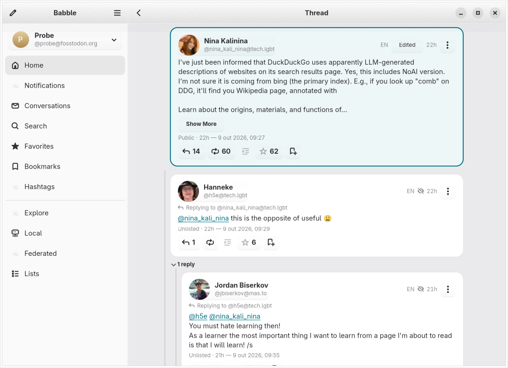

# What Babble does

The full feature inventory. The [README](../README.md) has the short version.

## Reading

- Home, Local and Federated timelines, updated live over streaming.
- Explore: trending posts, hashtags and news, plus people you might want to
  follow.
- Threads with the focused post in the middle, and profiles with their posts.
- Notifications, with a Mentions filter for when you only care who's talking
  to you.
- Direct messages, bookmarks, favorites, lists, followed hashtags, and saved
  multi-hashtag timelines.
- Quote posts, edit history, and who boosted or favorited something.
- Custom emoji inline wherever a `:shortcode:` turns up, and a media viewer
  with zoom, video, audio and alt text.
- Instance announcements, with reactions.
- Your yearly #Wrapstodon, if your server has one for you.

## Catch Up

- From its own sidebar place: pick a time range, page back through the home
  timeline to it, and read the result two ways — a bento grid of the most
  relevant posts, links and hashtags, or a compact list of every post.
- A run is saved as an unchanging snapshot that is only rebuilt when you
  choose a new period.

## Writing

- Media uploads (paste, drag, or take a screenshot right from the composer),
  content warnings, polls, quotes and language selection.
- Spell checking as you type.
- `@mention` suggestions as you type.
- Drafts, and scheduled posts for when you'd rather say it tomorrow.

## Keeping things tidy

- More than one account, even on different servers.
- Server-side filters, mutes, blocks, blocked domains and follow requests.
- Reporting accounts and posts.
- Profile editing.
- Collections (curated account recommendations) on Mastodon 4.6+.
- An admin dashboard for moderators (it asks for admin permissions
  separately, only when you open it).

## A note on versioned features

Some features need a recent server, and Babble hides them rather than
showing something that would fail:

- **Collections** need Mastodon 4.6+.
- **Profile tabs** (Featured / Media) need Mastodon 4.6+; the alt text on
  your avatar and header needs 4.6.1+.
- **Explore link timelines** need Mastodon 4.3+.
- **Restricted public timelines** — the local, federated, hashtag and
  trending-link feeds a server can close to most accounts — need 4.5+, and
  honour the "View live and topic feeds" role permission.

Where a feed exists on an older server, or the server says nothing, Babble
treats it as open. See [Mastodon API compatibility](mastodon-compat.md) for
the full list and the reasoning.
