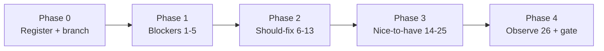

# Babble — remediation plan for `Docs/gnome-review.md`

*Plan only. Do not treat this file as a status register; land work and mark
status in `Docs/IMPROVEMENTS.md` (new IDs under a third-pass section).*

**Source audit:** `Docs/gnome-review.md` at revision `1c0bfcb`, 2026-10-16.  
**Skills guiding the fixes:** `gnome-app-architecture` (async, secrets, leaks),
`gtk4-libadwaita-ui` (widgets, breakpoints, a11y), `gnome-hig-review`
(pointer/keyboard, menus, writing style), `gnome-app-packaging` (CI, Flatpak
lint, metainfo).  
**Repo rules that constrain every change:** tests for behaviour
(`CLAUDE.md`), `pages.connect_weak` for signal cycles, 800-line file size,
capability gating unchanged, no Flathub PR/manifest authored by an agent
(`gnome-app-packaging` AI policy).

Anchors below were re-checked against the current tree before planning.
Re-check again before coding — the review says the tree moves.

---

## Goals and non-goals

**Goals**

1. Stop data loss and lock-out (findings 1–2).
2. Restore keyboard parity for media (finding 3).
3. Make CI able to fail (findings 4–5).
4. Clear the Should-fix list that users or a11y tools hit every session
   (findings 6–13).
5. Batch Nice-to-have polish without mixing tiers in one PR.

**Non-goals**

- Re-running a full HIG audit (that is what produced the report).
- Flathub submission PR text, exceptions, or a Flathub-bound manifest
  (human-only per packaging skill).
- DEF-07 / DEF-08 from the previous pass (Devel profile, screenshot
  re-curation) unless a Nice-to-have item naturally overlaps (#24).
- Finding 26 (GDK frame-timings warning): observe / bisect only; do not
  "fix" by silencing it.

---

## Principles for every fix

| Principle | Source |
|---|---|
| One `GCancellable` per owner **per operation**; cancelled objects stay cancelled | `async-and-concurrency.md` §Cancellation |
| Distinguish "no secret" from "cannot read secret"; never delete on `GError` | architecture SKILL rule 9; Errors section |
| Treat `G_IO_ERROR_CANCELLED` as silent; never retry cancelled work | same |
| Never block the main loop (`Secret.Service.get_sync` is a D-Bus sync call) | architecture rule 6 |
| Every pointer action has a keyboard path; icon-only controls need name + tooltip | HIG pointer-touch; `accessibility-review.md` §1 |
| Access keys unique per menu; underscore in the label *is* the mnemonic | HIG menus; `keyboard.md` §5 |
| Prefer existing in-repo patterns over new widgets | catchupgrid `_Tile`, audio `Gtk.Button` in mediabox, `Adw.BreakpointBin` in profile |
| CI must not hide suite failure; Flatpak lint without `--user-exceptions` | packaging `ci.md` / `flathub-and-circle.md` |
| Register new work as `HIG-*` / `A11Y-*` / `PKG-*` / `ARCH-*` rows in IMPROVEMENTS | house register |

---

## Phasing overview



| Phase | Findings | Suggested PR shape | Risk |
|---|---|---|---|
| 0 | — | Docs-only: register IDs in IMPROVEMENTS | none |
| 1a | 1, 2, 9 | Auth + keyring + cancel/retry | high — login/data |
| 1b | 3 | Mediabox keyboard | medium — a11y |
| 1c | 4, 5 | CI only | low, CI-gated |
| 2a | 6, 7, 10, 11, 14, 15 | Keyboard / adaptive / menus | medium — UX |
| 2b | 8, 12, 13 | Async secrets, deprecations, leaks | medium |
| 3 | 16–25 | Polish batch(es) | low |
| 4 | 26 | Optional bisect; close the gate | low |

Do **not** mix Phase 1a (session correctness) with CSS/menu polish in one
commit. CI fixes (1c) can land in parallel with 1a/1b.

---

## Phase 0 — Register and branch

1. Append a section to `Docs/IMPROVEMENTS.md`, e.g.
   `## GNOME review 2026-10-16 (third pass, post-0.2.0)`, with one row per
   finding (`ARCH-10`… / `A11Y-10`… / `PKG-10`… — pick the next free IDs).
2. Branch from current tip (review was on `gnome-HIG-polish` @ `1c0bfcb`).
3. Build in a clean user-writable tree (`/tmp` if `build/` stays root-owned),
   as the review notes.

---

## Phase 1 — Blockers

### 1. Login dead after switch/sign-out — `ARCH-*`

**Evidence (current):** `LoginFlow.__init__` creates one cancellable
(`auth.py:153`); `cancel()` cancels it and calls `restart()` (`:231-241`);
`begin()` does **not** replace the cancellable (`:208-213`); every later
request reuses `_cancellable` (`:271,463,517,537,559,596,612`). Window tears
down via `cancel()` on switch/sign-out (`window.py:467,608`).

**Preferred fix (report + skill):** recreate in `begin()`:

```python
def begin(self):
    self._attempt += 1
    self._pending_code = None
    self.stop_loopback()
    self._cancellable = Gio.Cancellable()
    return self._attempt
```

`cancel()` keeps cancelling the old object, then `restart()` → `begin()`
installs a fresh one. Callers that hold a reference to the old cancellable
still see cancellation; new logins get a live one.

**Alternative (only if begin-rebuild races):** rebuild `self.auth =
LoginFlow(...)` in `_teardown_session` / `_sign_out_to_login` and re-wire
signals with `connect_weak` (ties to finding 13). Prefer the `begin()` fix —
smaller surface.

**Tests (required):**

- Unit: after `flow.cancel()`, `start_login(...)` must not pass a cancelled
  cancellable (assert `not flow._cancellable.is_cancelled()` post-`begin`,
  or stub `register_app_async` and assert cancellable state).
- Extend OAuth stubs so they honour the cancellable
  (`test-oauth-loopback.py` currently ignores it — review proof).
- Optional integration: cancel then login against `bench/fixture_server.py`
  (the review's pre-cancelled probe).

**Acceptance:** account switch → login again succeeds without restart;
sign-out of last account → login again succeeds.

---

### 2. Unreadable keyring deletes account + Catch-Up — `ARCH-*`

**Evidence (current):** `load_secret_async` swallows `GLib.Error` → `None`
(`mastodon.py:305-310`); docstring calls that deliberate (`:300-302`).
`window.py:336-341` treats `None` under `login_only` as gone and calls
`remove_account` → `accounts.forget_account` → `catchupstore.delete_account`
(`accounts.py:150-157`).

**Fix (callback contract change):**

1. Change `load_secret_async` to `callback(secret_or_None, error_or_None)`
   (or a small result object). Propagate `GLib.Error` from `lookup_finish`.
2. Distinguish:
   - `secret is None` and `error is None` → genuinely absent → current
     "signed out" / remove path OK.
   - `error` set → keep the account; banner/toast: keyring unavailable /
     unlock and try again; do **not** call `remove_account`.
3. Update every caller (`mastodon.py` wrappers around `:886`, `:920`, and
   `window.py:loaded`). Grep for `load_secret_async` / `loaded(token)`.
4. Rewrite the docstring: unreadable ≠ signed out.

**Tests:**

- Mock `lookup_finish` raising a non-cancelled `GLib.Error` → account list
  and catch-up store unchanged; toast/banner path invoked.
- Absent entry still removes on `login_only` restore (preserve intentional
  "token gone" behaviour for the non-error case).
- Cancelled lookup stays silent (no toast, no delete).

**Acceptance:** dismissing the keyring unlock prompt at startup does not
wipe GSettings accounts or Catch-Up snapshots.

---

### 3. Attachments pointer-only — `A11Y-*`

**Evidence (current):** image/video tiles are `Gtk.Overlay` +
`GtkGestureClick` only (`mediabox.py:686-696`); ALT footnotes same
(`:712`); overflow menu has no media action; audio path already uses
`Gtk.Button` (`:723-741`).

**Preferred fix:** follow `catchupgrid._Tile` (`catchupgrid.py:441-454`):

- `focusable=True`
- accessible role (e.g. `BUTTON` or `LIST_ITEM` — match semantics; button
  is clearer for "opens viewer")
- accessible label from description / "Attachment N" / media kind
- `Gtk.EventControllerKey` for Return / KP_Enter → `_open(index)`
- Keep click + drag behaviour; claim the sequence as today

**Alternative:** wrap tile content in a flat `Gtk.Button` (matches audio
row). Slightly more layout churn with overlays (GIF/play badges).

Also make footnotes keyboard-reachable (focusable label or button that
expands description — same click handler).

Optional follow-up: `statusmenu.MENU_ACTIONS` entry "Open Media" when
attachments exist; not required if tiles are focusable in-row.

**Tests:** widget constructed with a fixture attachment asserts
`get_focusable()`, role, and key controller present; activate key path
calls into viewer stub.

**Acceptance:** Tab to a tile, Return opens the viewer; Orca announces a
name.

---

### 4. Suite exit discarded by `| tee` — `PKG-*`

**Evidence (current):** `.github/workflows/ci.yml:71` —
`meson test … | tee ci.log`, no `pipefail`, no workflow `defaults.run.shell`.

**Fix (pick one, prefer first):**

```yaml
run: |
  set -o pipefail
  xvfb-run -a dbus-run-session -- \
    meson test -C build -j1 --print-errorlogs 2>&1 | tee ci.log
```

or `exit ${PIPESTATUS[0]}` after the pipeline.

**Tests / verification:** temporarily `false | tee` in a scratch job, or
document a one-off broken test proving the step goes red. Do not leave a
broken test committed.

**Acceptance:** a failing meson test fails the GitHub step.

---

### 5. Flatpak `builddir` lint / screenshot URL — `PKG-*`

**Evidence:** metainfo screenshots on
`raw.githubusercontent.com/.../main/...` (`metainfo.xml.in:33,37`); CI
builds with bare `flatpak-builder` (`ci.yml:140`) without mirroring;
linter reports `appstream-external-screenshot-url`.

**Fix (CI build step):** add Flathub's mirror flags to the build (report
recommendation):

```
--mirror-screenshots-url=https://dl.flathub.org/media
--compose-url-policy=full
```

**Preferred longer-term (packaging skill):** build through
`flatpak run --command=flathub-build org.flatpak.Builder …` so local and
CI match Flathub's wrapper (`references/flatpak.md`).

**Do not:** `--user-exceptions` / agent-drafted exceptions
(`flathub-and-circle.md`).

**Related Nice-to-have #24:** when touching metainfo, point screenshots at
a release tag (not `main`), note empty `0.1.0` release body, and leave
1090×790 as DEF-08 unless curating now.

**Acceptance:**
`flatpak-builder-lint … builddir build-flatpak` exits 0 in CI.

---

## Phase 2 — Should fix

### 6. Page Up/Down dead in text views — `A11Y-*` / keyboard

**Evidence:** app accelerators in `main.py:144-147`; guard in
`scroll_page` (`:245-250`) never runs for TextView because app accels win.

**Fix:**

1. Remove `Page_Down` / `Page_Up` from `create_action(..., [accels])`.
2. On `BabbleWindow`, add a `Gtk.ShortcutController` (default / local
   scope) with `Gtk.Shortcut` → `Gtk.NamedAction` for
   `app.scroll-page-down/up` (or `win.*` if moved).
3. Keep the Editable/TextView early-return in `scroll_page` as defence in
   depth.
4. **Product decision (document in commit):** window-level controller
   restores TextView paging; focused `Gtk.ListBox` may consume Page Down
   for row movement instead of page scroll. That is the correct HIG
   tradeoff for the composer. If list paging is still desired later, use
   a more specific target (timeline scrolled window only) rather than app
   accels.

**Tests:** headless X11/`xdotool` smoke (review recipe) or a focused unit
that asserts no app accel is registered for those keys and the window
controller exists.

---

### 7. Composer bar at 360 px × 1.5 text — `UI-*`

**Evidence:** non-wrapping `Gtk.Box` of visibility + language + counter
(`compose.py:636-655`) inside an `Adw.WrapBox` bar (`:589`); tools row is
already fine; AdwBottomSheet width warning at 360×1.5×.

**Fix options (prefer smallest):**

- A. Put `visibility_row`, `language_row`, `counter_label` into their own
  `Adw.WrapBox` (or append them as separate wrap children of `bar`).
- B. Host the sheet content in `Adw.BreakpointBin` with `size_request`
  ~340 like `profile.py:489-492`.

Verify at 360×900 with text 1.5×: no Adwaita width warning; counter not
flush to the edge; no clipped padding.

---

### 8. `Secret.Service.get_sync()` on main thread — `ARCH-*`

**Evidence:** `_secret_service()` (`mastodon.py:264`) used by
store/load/clear whose docs claim non-blocking; startup path
`window.py` restore.

**Fix:** async `Secret.Service.get(..., callback)` with a waiter list /
coalesce (same shape as `instance_info_async` in this file). Until the
service is ready, queue store/load/clear; on failure surface via finding
2's error path.

**Tests:** calling `load_secret_async` before the service arrives still
invokes the callback once; no `get_sync` left in `src/` (grep gate).

---

### 9. Cancelled requests retried — `ARCH-*`

**Evidence:** `_on_response` (`mastodon.py:587-590`) retries all transport
errors; `_maybe_retry` / `_rest_retry` never check cancellable.

**Fix:**

```python
except GLib.Error as e:
    if e.matches(Gio.io_error_quark(), Gio.IOErrorEnum.CANCELLED):
        task.return_error(e)
        return
    if self._maybe_retry(task, transport_error=True):
        return
    task.return_error(e)
```

Plus early return in `_rest_retry` if `task.get_cancellable()` is
cancelled. Optionally refuse `_maybe_retry` when cancelled.

**Tests:** cancel mid-flight → callback with CANCELLED, no
`timeout_add` scheduled (mock/spy); idempotent retry still works for
real transport errors.

---

### 10. Account switcher accessible name — `A11Y-*`

**Evidence:** `window.ui:329-330` tooltip only.

**Fix:** add `<accessibility><property name="label" translatable="yes">Switch Account</property></accessibility>`
matching sibling icon-only controls. Optionally dynamic tooltip with
handle (finding 20) in the same touch.

---

### 11. Access keys on programmatic menus — `A11Y-*`

**Files:** `profileactions.py:92-138`, `conversations.py:127`,
`statusmenu.py:198`, `hashtags.py:205`, `catchup.py:1281-1297`,
`notifications.py:1327-1331` + `notificationcopy.py:94-111`.

**Fix:** add unique `_()` mnemonics per menu; avoid collisions with
existing items (e.g. `Menti_on %s` not `_Mention` beside `_Mute`).
Section titles that are not activatable still get underscores only if
the toolkit treats them as mnemonic targets — match neighbouring menus
(`statusmenu.py:156-157`).

**Tests:** optional lint that menu label strings used in `Gio.Menu` /
`append` contain `_` for user-visible actions (careful with dynamic
`%s`). Manual pass: open each menu, confirm unique underlines.

Ship together with findings 14–15 (duplicate keys) so mnemonics are
settled once.

---

### 12. Deprecated `present_with_time()` — `UI-*`

**Evidence:** `searchprovider.py:600`.

**Fix:** `window.present()`; keep D-Bus `timestamp` parameters unused
(prefix `_` if needed). Grep for any other `present_with_time`.

---

### 13. Plain `connect()` on process-lifetime emitters — `ARCH-*`

**Evidence:** `window.py:177-182` (LoginFlow), `:211-213` (streaming),
`:263-266` (settings + StyleManager), `:273` (`close-request`). Same
constructor already uses `connect_weak` nearby (`:277-279`).

**Fix:** `pages.connect_weak(...)` for each; promote the style lambda to
a real method so the weak ref is meaningful. Re-wire if Phase 1
rebuilds `LoginFlow`.

**Tests:** existing `test-timeline-memory.py` does not cover the window;
add a narrow test that constructing/destroying patterns around LoginFlow
signals do not keep the window alive, **or** a static grep test that
`window.py` has no bare `.connect(` on those emitters (house style). Prefer
behavioural if cheap.

---

## Phase 3 — Nice to have (batch)

Group by file to minimise conflict:

| Batch | Findings | Work |
|---|---|---|
| Menus | 14, 15 | Unique `D` in primary menu (`window.ui`); unique `t` in post menu (`statusmenu.py`) — fold into #11 |
| Copy | 16 | Header-case `This` in `admin.py:822,826,1123` |
| CSS | 17, 18 | Replace literal opacities with `var(--dim-opacity)` / `.dimmed`; convert `24px`/`14px` to `em`; Catch-Up targets ≥32 px |
| A11y leftovers | 19, 20 | Label poll vote image (`statusviews.py:269`, pattern in `mediabox.py:124-127`); dynamic account tooltip |
| Host window | 21 | `Adw.Window` instead of `Gtk.Window` in `mediaviewer.py:1646` |
| Icon drift | 22 | Confirm uninstalled 128 px logo resolution; then drop gresource aliases if hicolor is enough (`gnome-app-architecture` rule 5) |
| Notifications | 23 | `withdraw_notification` when state clears (`desktopnotify.py`) — `platform-integration.md` §Notifications |
| Metainfo | 24 | Tag URLs, fill/omit empty 0.1.0 notes; size curation stays DEF-08 unless doing Flathub prep |
| Preferences | 25 | `settings.bind_with_mapping` for combo rows (`preferences.py:212-240`) |

Each batch gets tests only where behaviour is asserted today (CSS often
visual; prefer screenshot-free checks: grep for forbidden literals,
schema bind smoke).

---

## Phase 4 — Observe and close the gate

### 26. `gdk_frame_timings_submitted` warning

1. Reproduce: first primary-menu open under Xvfb; once per process.
2. Optionally set `G_DEBUG=fatal-warnings` in a **local** test env (suite
   currently uses `fatal-criticals` only — `src/meson.build`) to force a
   stack; do not make CI fatal-warnings until attributed.
3. Bisect against `statusrow.py` tick callback and menu open path; if
   purely GDK/GTK, file upstream and leave a note under IMPROVEMENTS
   `Observe`.

### Final gate (all blockers + should-fix)

| Check | Command / action |
|---|---|
| Suite | clean `/tmp` meson build + `xvfb-run -a dbus-run-session -- meson test -j1 --print-errorlogs` — expect FAIL to fail CI locally with `pipefail` |
| Data validators | `validate-data.sh` / existing meson data tests |
| Flatpak lint | build with mirror flags; `flatpak-builder-lint` manifest + builddir |
| Manual | switch account → login; dismiss keyring → account survives; keyboard-open image; Page Down in composer scrolls text; 360×1.5× composer |
| Register | mark IMPROVEMENTS rows done; leave Observe #26 open or won't |

---

## Suggested PR / commit sequence

1. **docs:** register third-pass findings in IMPROVEMENTS (Phase 0).
2. **ci:** pipefail + screenshot mirror flags (findings 4–5) — unblocks
   red/green honesty while app fixes land.
3. **auth:** cancellable per `begin()` + test (finding 1).
4. **keyring:** error propagation + no delete on error + async service
   get (findings 2, 8) — one logical area; split commits if the diff is
   large.
5. **http:** cancel-before-retry (finding 9) — can merge with (4) if
   touching `mastodon.py` anyway.
6. **mediabox:** focusable tiles (finding 3).
7. **keyboard/menus:** Page Up/Down controller, access keys, duplicates
   (findings 6, 10, 11, 14, 15).
8. **compose adaptive** (finding 7).
9. **window hygiene:** `connect_weak`, `present()` (findings 12, 13).
10. **polish batches** (Phase 3) as capacity allows.

---

## Risk notes

- **Finding 2 callback signature** is a breaking internal API: update all
  call sites in one commit; search for nested `def loaded(` patterns.
- **Finding 1** interacts with finding 13 if you rebuild `LoginFlow`
  instead of refreshing the cancellable — pick one strategy and stick to
  it.
- **Finding 8** without finding 2 leaves startup still able to delete on
  a failed service get — land 2 before or with 8.
- **Finding 5** may require network at build time to mirror screenshots;
  confirm the CI runner already has Flathub access (it installs the SDK
  from there today).
- **Root-owned `build/`:** never `sudo meson`; use a fresh prefix for
  local verification (review Environment notes).

---

## Mapping: review # → skill → primary files

| # | Sev | Skill | Primary files |
|---|---|---|---|
| 1 | Blocker | architecture / async | `auth.py`, `window.py`, OAuth tests |
| 2 | Blocker | architecture / async | `mastodon.py`, `window.py`, `accounts.py` |
| 3 | Blocker | hig-review / gtk4 a11y | `mediabox.py` (+ optional `statusmenu.py`) |
| 4 | Blocker CI | packaging / ci | `.github/workflows/ci.yml` |
| 5 | Blocker CI | packaging / flatpak | `ci.yml`, optionally `metainfo.xml.in` |
| 6 | Should | architecture / keyboard | `main.py`, `window.py` |
| 7 | Should | gtk4 layouts | `compose.py` |
| 8 | Should | architecture / async | `mastodon.py` |
| 9 | Should | architecture / async | `mastodon.py` |
| 10 | Should | hig a11y | `window.ui` |
| 11 | Should | hig keyboard | menus listed above |
| 12 | Should | gtk4 versions | `searchprovider.py` |
| 13 | Should | architecture / leaks | `window.py` |
| 14–15 | Nice | hig keyboard | `window.ui`, `statusmenu.py` |
| 16 | Nice | hig writing | `admin.py` |
| 17–18 | Nice | gtk4 styling | `style.css` |
| 19–20 | Nice | hig a11y | `statusviews.py`, `window.ui`/`window.py` |
| 21 | Nice | gtk4 | `mediaviewer.py` |
| 22 | Nice | architecture resources | `babble.gresource.xml`, icons meson |
| 23 | Nice | architecture platform | `desktopnotify.py` |
| 24 | Nice | packaging metainfo | `metainfo.xml.in` |
| 25 | Nice | architecture settings | `preferences.py` |
| 26 | Observe | testing/debug | runtime / possibly upstream |

---

## Immediate next actions (when implementing)

1. Phase 0 register in IMPROVEMENTS.
2. Land CI honesty (4) and screenshot mirror (5).
3. Land finding 1 + tests.
4. Land finding 2 (+ 8/9 in `mastodon.py` as one series).
5. Land finding 3.
6. Proceed through Phase 2 in the PR sequence above.
