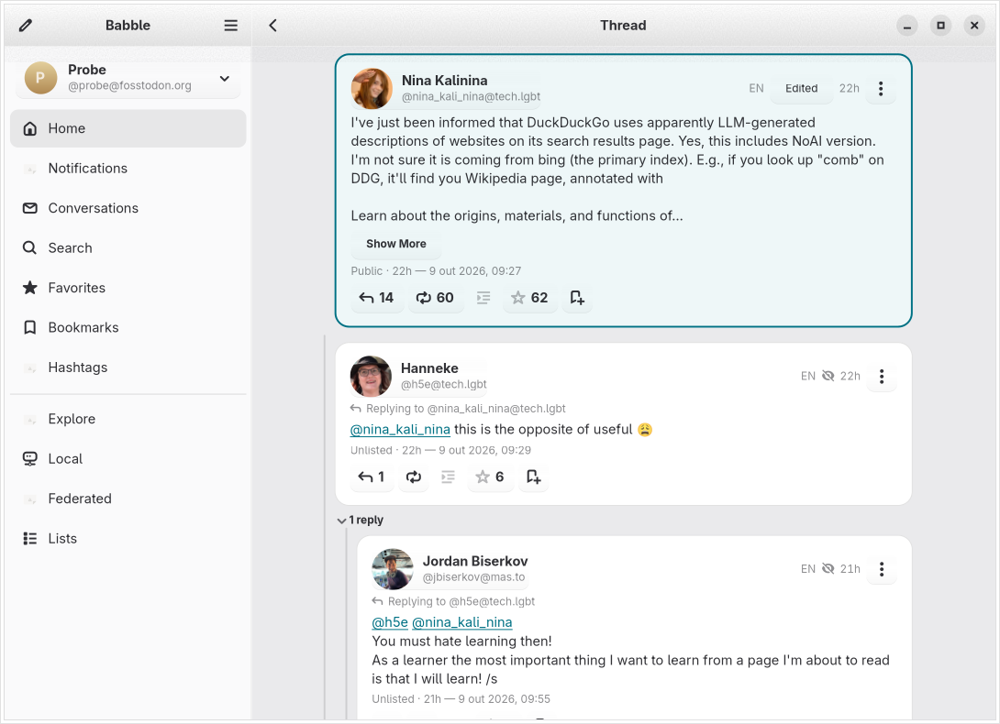

# O que o Babble faz

O inventário completo de recursos. O [README](../README.md) traz a versão curta.

## Leitura

- As timelines Início, Local e Federada, atualizadas ao vivo por streaming; uma
  publicação que chegou por uma hashtag que você segue diz isso acima do
  cabeçalho.
- Explorar: publicações, hashtags e notícias em alta, além de pessoas que talvez
  você queira seguir.
- Fios com a publicação em foco no meio, e perfis com as publicações.
- Notificações, com um filtro de Menções para quando só interessa quem fala com
  você.
- Mensagens diretas, itens salvos, favoritos, listas, hashtags seguidas e
  timelines salvas de múltiplas hashtags.
- Citações, histórico de edições e quem impulsionou ou favoritou alguma coisa.
- Emoji personalizado em linha onde aparecer um `:shortcode:`, e um visualizador
  de mídia com zoom, vídeo, áudio e texto alternativo.
- Anúncios da instância, com reações.
- O seu #Wrapstodon do ano, se o seu servidor tiver um para você.

## Catch Up

- Do seu próprio lugar na barra lateral: escolha um intervalo de tempo, volte
  pela timeline inicial até ele e leia o resultado de duas maneiras — uma grade
  bento com as publicações, links e hashtags mais relevantes, ou uma lista
  compacta de todas as publicações.
- Cada execução é salva como um instantâneo imutável, que só é refeito quando
  você escolhe um novo período.

## Escrita

- Envio de mídia (cole, arraste ou tire uma captura de tela direto do
  compositor), avisos de conteúdo, enquetes, citações e seleção de idioma.
- Verificação ortográfica enquanto você digita.
- Sugestões de `@mention` e `#hashtag` enquanto você digita. As hashtags que
  você usou recentemente, que mantém no seu perfil ou que segue vêm primeiro. O
  que você digita depois do `#` é enviado à sua própria instância para buscar
  hashtags correspondentes, como acontece com `@mention`.
- Rascunhos e publicações agendadas para quando você preferir falar amanhã.
  Editar uma publicação agendada preserva as escolhas da enquete, a duração
  exata, os sinalizadores da enquete, o idioma, a sensibilidade e a política de
  citação. Configurações não suportadas são recusadas antes de alterar o
  compositor ou o registro no servidor.
  O tratamento dos campos segue o
  [contrato ScheduledStatus](https://docs.joinmastodon.org/entities/ScheduledStatus/).
- Edições agendadas criam uma substituta antes de remover a original. Se a
  remoção falhar, o compositor bloqueia o envio e mostra **Tentar remover
  novamente**, que tenta de novo apenas a exclusão original. Fechar exige um
  aviso de publicação duplicada; reabrir o compositor em cache mantém esse
  estado de recuperação. Depois de sair ou de remover a conta, use a lista de
  publicações agendadas do servidor para resolver qualquer duplicata que
  tenha sobrado.
- Cancelar uma resposta restaura o texto e o modo de publicação do rascunho
  anterior. Citações não herdam o alvo de atualização de uma edição inacabada, e
  trechos de fio não repetem uma citação anterior nem anexos já usados.
- Fios: com **Manter aberto para um fio** ligado, o título conta a publicação que
  você está escrevendo ("Conversa · Publicação 2") e uma faixa esmaecida mostra o
  fim da anterior. Responder à última das suas próprias publicações retoma o
  fio com o número certo, e editar uma delas mostra a sua posição ("Editar
  publicação · 2/5"). O fio é lido da sua instância; se isso falhar, o compositor
  se comporta como sempre.
- Uma resposta a uma publicação com aviso de conteúdo começa atrás do mesmo
  aviso. Editar uma publicação marcada como sensível mantém a marcação. A
  marcação não pode ser removida pelo Babble (a API de edição do Mastodon só a
  transporta em um sentido, e o compositor não tem controle para isso); remova-a
  pela interface web do servidor, se precisar.
- Uma colagem cujo conteúdo inteiro é um link para uma publicação anexa a
  publicação como citação em vez de inserir o link; o aviso informa isso, e
  desfazer desanexa a citação e devolve o link como texto.

## Wallabag

O plugin opcional Wallabag só informa o login depois que as credenciais chegam
ao chaveiro do sistema, e só informa a saída depois que a exclusão delas
funciona. Uma gravação inicial que falha deixa a sessão anterior intacta. Se
gravar um token de atualização rotacionado falhar, as gravações pendentes
param e o login explica a falha do chaveiro; ele não afirma que as credenciais
antigas, já inutilizáveis, continuam sendo um login duradouro.

## Mantendo tudo em ordem

- Mais de uma conta, mesmo em servidores diferentes.
- Filtros, silenciamentos, bloqueios, domínios bloqueados e pedidos de
  seguimiento do lado do servidor.
- Denunciar contas e publicações.
- Edição de perfil.
- Coleções (recomendações de contas selecionadas) no Mastodon 4.6+.
- Um painel de administração para moderadores (ele pede permissões de
  administração à parte, só quando você o abre).

## Uma observação sobre recursos versionados

Alguns recursos exigem um servidor recente, e o Babble os esconde em vez de
mostrar algo que falharia:

- **Coleções** exigem Mastodon 4.6+.
- **Abas do perfil** (Destaques / Mídia) exigem Mastodon 4.6+; o texto
  alternativo do seu avatar e do cabeçalho exige 4.6.1+.
- **Timelines de links do Explorar** exigem Mastodon 4.3+.
- **Timelines públicas restritas** — os feeds local, federado, de hashtag e de
  links em alta que um servidor pode fechar para a maioria das contas —
  exigem 4.5+, e respeitam a permissão de papel "View live and topic feeds".

Onde um feed existir em um servidor mais antigo, ou o servidor não disser nada,
o Babble o trata como aberto. Veja
[Compatibilidade com a API do Mastodon](mastodon-compat.md) para a lista
completa e o raciocínio por trás dela.
