# Ranked timeline: implementation plan

Turns [the design](timeline-algorithm.md) into slices, user stories and
tasks. The design says *why* and *what*; this document says what to change,
where, in which order, and how to know it is done.

It is written to be executed by coding agents, one task at a time, with the
maintainer deciding at the marked human checkpoints. A task here is meant to
be handed to an agent as it stands: it names what to read, which files it
may touch, what to build, how to prove it works, and when to stop and ask.

## Progress

| Slice | Status | Commits | Notes |
|---|---|---|---|
| H0 Decisions | partly done | `c8d06be` | D1 (the gates file) is frozen. D2-D5 still open |
| S0 Guardrails and affinity | in progress | | T0.1, T0.2 merged; T0.3 (the Elk goldens) is next |
| S1 Evaluation harness | not started | | Ends at gate A (H1) |
| S2 Ranked feed core | blocked by H1 | | |
| S3 Hidden place | blocked by S2 | | |
| S4 Trial instrumentation | blocked by S3 | | Ends at gate B (H2) |
| S5 Release | blocked by H2 | | Starts with H3 |

### The tasks, one by one

| Task | Status | Commit | Notes |
|---|---|---|---|
| T0.1 `module boundary` | merged | `5c3ec10` | The Catch Up boundary is a test now |
| T0.2 `affinity` | merged | `b8584f0`, `7547cbd` | The port; its outputs match Elk's own TypeScript |
| T0.3 `affinity` goldens | not started | | Needs T0.2, which is merged |

### Revision 2 (after the review of 2026-10-21)

An independent review found defects that would have produced broken code
or untrustworthy gates. Each finding was checked against the code before it
was applied.

**Fixed:**
- **T0.1, R3** now splits dotted module names (`collections.abc`,
  `html.parser`).
- **T2.2, `prepare_candidates`** uses the real signatures: `status_filter`
  returns a tuple, and `filter_replies_from_non_follows` takes an id → bool
  map. It separates the pool's boost dedupe from `filter_boosts`.
- **T2.3, the source contract:**
  - `finish()` is skipped for superseded answers, so listing now happens
    only in `finish()`;
  - `forget`/`cancel` are named as new methods;
  - `paging = 'link'` refreshes with `since_id`.
- **T3.2:** `on_stream_delete(status_id)`, and handlers that are added
  beside `ReadingPosition`'s `unmap` handler, never replacing it.
- **T5.0 (new):** the row-menu hook T5.2 and T5.3 need, along the
  `filter_context` path.
- **`po/POTFILES.in`** is in the definition of done and in T3.1.
- **The safe directory name** is now prefixed, since `quote('..')` is
  `..`.
- **The harness:**
  - its `sys.path` bootstrap;
  - the `load_secret_async(instance, kind, callback)` call;
  - no-network proven by never constructing `MastodonClient`.
- **The gates:**
  - the sign test is pinned (one-sided, H0: P(win) = 0.5, ties dropped);
  - `a1_k`/`a2_k` are explicit;
  - the shipped ordering must pass A1 and A2 itself.
- **Label timing** is documented as hourly for favourites and bookmarks.
- **Elk port details:**
  - the `toSignal` weight filter;
  - only the five bootstrapped kinds, with no dead `follow` constant;
  - **D10**: Elk's saturating `authorPenaltyIn`, replacing an invented
    "mute after three dismissals" rule.
- **Every line citation the review listed.**
- **The suite baseline:** 62 passed / 1 skipped, measured under headless
  mutter, now in `CLAUDE.md` and `src/meson.build:146` (both said 49).

**Checked, and not changed as the review proposed:**
- `filter_boosts` was already used only for Home's hide-boosts switch; the
  text now says so plainly.
- `ReadingPosition`'s `unmap` handler does not collide with a second one:
  GObject signals take several handlers. The plan now says to add, never
  override.
- The quoted sign-test p-values were already correct (470/16384 and
  1471/16384).

### Revision 3 (after the review of 2026-10-21, second pass)

A second review of revision 2 found six defects the revision had not
caught, two of which would have shipped a wrong feature or a wrong gate
number. Each was reproduced against the code before it was fixed.

**Fixed:**
- **T2.3, `RankingContext` (blocking).** The call
  `RankingContext(now, mutual_author_ids, affinity=…)` passed the
  mutuals as the **second positional argument**, which is `viewer_id`
  (`catchuprank.py:428-438`). `mutual_author_ids` was therefore `None`,
  and `effective_weights` short-circuits on `bool(mutuals)`
  (`catchuprank.py:985-991`), so the bidirectional-follow boost never
  fired and no test would have noticed. The call now passes
  `mutual_author_ids=mutual` by keyword, as Catch Up does
  (`catchup.py:303-306`).
- **T2.1, the `credited` table (blocking).** Its key was
  `(id, kind)`, while `credit(key, id, kind, team, day)` takes a day and
  writes `counters(day, team, n)`. A post engaged on two days credited
  only the first, because the second day's insert was ignored as a
  duplicate — and gate B counts wins *per day*. The key is now
  `(id, kind, day)`, and T2.1, T4.2 and T4.3 say so.
- **T1.2, `affinity_signal`'s sign classes.** Revision 2's justification
  — "monotonic in the raw value, so it orders authors exactly as the raw
  sum would" — holds only **within one sign class**. `affinity_signal`
  computes a mid-rank CDF among entries of the same sign
  (`catchuprank.py:391-395`), so a raw −4.0 and a raw +1.0 read as about
  −0.5 and +0.75. The order survives; the scale does not. T1.2 now says
  so, and says the two orderings are compared as *orderings*, never as
  numbers.
- **T2.1, `load_listed`.** `team` and `reasons` were written by
  `append_listed` and read by nobody: T4.2 needs the team to credit a
  post, and T5.3 needs the reasons to explain one. The store now has
  `load_listed(key) -> [(id, team, reasons)]`, and T4.2 uses it.
- **§4 and T4.3, gate B's day.** The sign test was pinned, but a day's
  *score* was not. §4 now defines it: a win is a strictly greater
  credited-engagement count for the ranked team; equal counts are a tie
  and are dropped; a day with no credits for either team is **excluded**,
  not tied; a day with only one team's row is excluded, not a win.
- **T5.2, the dismissal retracts positive history.** Elk's
  `applyNotInterestedToSignals` removes the dismissed post's id from
  every engaged kind (`signals.ts:842-847`). Without that, dismissing a
  post the reader had favourited left the positive signal standing and
  the net penalty weaker than Elk's. T5.2 now says so, and says undo
  restores it.

**Added as notes:**
- **T3.4** times the `affinity_chrono` ordering separately from `rank()`:
  `affinity_signal` recomputes its whole CDF on every call, and it is the
  part of an answer that T3.5's caching does not cover.
- **T2.3** says where the viewer id comes from (`account['id']`), which
  `prepare_candidates` and `PoolFetch` both need.
- **T1.1** gives the harness an entry point (`if __name__ == '__main__'`),
  without which the script does nothing when it is run.

**Corrected from revision 2:** the `affinity_chrono` claim above, which
revision 2 made as a checked-and-unchanged item.

### Revision 4 (after W0, 2026-10-21)

T0.1 and T0.2 were implemented by agents and reviewed twice: once against
the tree by the maintainer's judge, and once by an independent reviewer
looking for plan-vs-code contract mismatches. The port's outputs were also
compared against goldens generated by **Elk's own TypeScript** at
`9597db5`, run through vitest — not against a reading of it.

**Found and fixed in the code:**
- **`src/affinity.py`, the NaN weight.** The TypeScript's `if (!weight)
  return` treats NaN as falsy, so such a signal is skipped *before* it
  spends one of `within`'s evidence slots. Python's truthiness lets NaN
  through, and the slots it took did not come back: with a NaN-weight
  signal first, the port returned `{}` where Elk returns `{'A': 1}` —
  confirmed by running Elk's TypeScript. The guard now also rejects NaN.
- **`src/affinity.py`, `muted_ids=None`.** `derive_affinities` and
  `author_penalty_in` tolerated `None`; `to_ranking_signals` and
  `resolver` did not. All four now agree.
- **`src/test-module-boundary.py`, the `violations` signature.** The plan
  spells it as `violations(sources: dict[str, str]) -> list[str]`; the
  annotations were missing. They are there now.
- **`src/meson.build`, the suite comment.** It said "Both give 63
  passed", asserting an Xvfb run that was never taken. It now says the
  mutter run gives 63 and that the Xvfb count has not been re-taken since
  it was 49 — which is what `CLAUDE.md` says.
- **`CLAUDE.md`, the rule count.** It said "Four of those are rules" with
  four listed; `module boundary` is a fifth. The sentence and the list
  now agree.

**Verified, not changed:**
- The boundary test's five import forms, both rule directions, the
  function-local imports, the bench harness, and the `catchuprank`
  exception were each probed independently, and the checker was broken on
  purpose to confirm the self-checks are not vacuous.
- Every constant in the port matches Elk's TypeScript, and the ten
  golden groups (fresh favourite, half-life, mutual, the 12-favourite
  evidence cap, dismissal, muted author, tag and language shares,
  `decayFactor`, `authorPenaltyIn`) match Elk's own output exactly.

---

## 1. How an agent works through this plan

### 1.1 Before starting a task

1. Read `CLAUDE.md`, then the task's **Read first** list, in full.
2. Check the task's **Depends on**. Every dependency must be merged to `main`
   and recorded in the Progress table. If one is not, stop.
3. Branch from `main`: `feat/ranked-<task id, lower case>`, for example
   `feat/ranked-t0.2`.
4. Build: `meson setup build` once, then `meson compile -C build`.

### 1.2 While working

- **Only the task's Touches list.** Edit only the files the task lists under
  **Touches**. If another file seems to need a change, stop and report: do
  not edit it.
- **Never edit**, in any task:
  - Catch Up's files: `src/catchup.py`, `catchupdigest.py`, `catchupgrid.py`,
    `catchupstore.py`, `catchuprank.py`, `src/test-catchup*.py` and their
    fixtures, and `CATCH-UP.md`;
  - anything under `build-aux/flatpak/` (the README's Flathub policy);
  - `po/*.po` by hand. Catalogues are regenerated through the targets in
    §2, never typed;
  - `bench/rank_eval_gates.json`, which only the maintainer writes (H0);
  - the Elk checkout at `../elk`, which is read-only.
- **No new dependencies, and no reinvented helpers.** Use the standard
  library, PyGObject, and Babble's own modules, following the table in
  §3.1. Before writing any helper, check §3.1. If a need is not covered
  there, and seems to call for a package, stop and ask; do not add one.
- **Fixed names.** Use the identifiers in §3 exactly. Do not invent new
  module, test, settings-key or tag names.
- **No guessed numbers.** Where a value comes from a decision (§4) or a
  measurement, read it from there; do not choose one.

### 1.3 Stop and ask when

- A test the task did not touch fails, before or after the change.
- A measurement exceeds its budget (§4, H0).
- The task needs a value §4 does not yet record.
- An instruction here conflicts with `CLAUDE.md` or with the code as it is.
  Report the conflict with `file:line`; do not pick a side.
- `git -C ../elk rev-parse --short HEAD` is not `9597db5` when a task needs
  to *run* Elk code. Reading with `git -C ../elk show 9597db5:<path>` works
  whatever is checked out.
- The boundary check (§2, item 5) prints anything.

### 1.4 Report at the end of a task

The report is posted in the pull request or handed back to the maintainer.
It contains:

1. **Files changed**, one line each.
2. **Every acceptance criterion**, each with its evidence: the command, and
   the relevant tail of its output.
3. **Mutation proofs** (§2, item 9): for each new check, the deliberate
   break, the failing output, and confirmation that it was reverted.
4. **Suite totals**: passed, skipped, failed, and the names of skipped tests.
5. **Open questions**, and anything that deviates from the design doc.

### 1.5 Agent brief template

This is how a task is handed to an agent:

```
Implement task <ID> of Docs/ranked-timeline-plan.md.
Follow §1 (protocol) and §2 (definition of done) of that document.
Read first: CLAUDE.md, the task's "Read first" list.
Touch only the files in the task's "Touches" list.
Stop and report instead of guessing on any §1.3 condition.
End with the §1.4 report.
```

### 1.6 What can run in parallel

Tasks on different branches can run in parallel only where the dependency
graph (§5) allows it. Each needs its own worktree, because the build tree
is per checkout. These pairs are independent: T0.1 and T0.2; T2.1 and T2.2;
T4.1 and T3.3.

---

## 2. Definition of done (every agent task)

A task is done when all of these hold, and the §1.4 report shows each:

1. **Acceptance criteria.** Every one of the task's acceptance criteria is
   met, with evidence.
2. **Build.** `meson compile -C build` succeeds.
3. **Suite.** The full suite passes under headless mutter:

   ```sh
   XDG_RUNTIME_DIR=$(mktemp -d) dbus-run-session -- \
     mutter --headless --wayland --no-x11 --virtual-monitor 1280x1024 -- \
     meson test -C build -j1 --print-errorlogs
   ```

   No test fails. The only skip is `streaming helpers` (no secret service),
   unless the task names another. The baseline on `main` on 2026-10-21 was
   **62 passed, 1 skipped, 0 failed**, measured under headless mutter. Until
   this plan's closeout, `CLAUDE.md` said 49, which was stale. Before
   starting a task, run the suite on `main` once, and use that run as the
   baseline, not any number written down. `thread profile render` and
   `oauth callback` start their own Xvfb, so `Xvfb` must be installed.
4. **Lint.** `ruff check src/` passes. A task that touches `bench/` also
   passes `ruff check bench/rank_eval.py bench/ranked_stall.py` for the files
   it touched.
5. **Catch Up boundary.** This prints nothing:

   ```sh
   git diff --stat main -- 'src/catchup*' 'src/test-catchup*' CATCH-UP.md
   ```

   Once T0.1 is merged, the `module boundary` test also passes.
6. **Modules.** Every new `src/*.py` module is in `install_data` in
   `src/meson.build`, and is under 800 lines. A module that calls `_(` or
   `ngettext(` is also listed in `po/POTFILES.in`. Both lists are kept by
   hand, and the `file size rule` test checks both
   (`src/test-file-size.py:150` and `:180-196`). So a task that adds the
   first string to a module touches `po/POTFILES.in`, even if its Touches
   list forgets to say so. Every new file starts with
   `# SPDX-License-Identifier: GPL-3.0-or-later`, and imports after
   `gi.require_version` carry `# noqa: E402`.
7. **Tests.** Every new test is a standalone script that prints
   `ok - …` / `FAIL - …` and exits non-zero on failure. It is registered in
   `src/meson.build` with `test_env`, or with `fatal_test_env` if it builds
   widgets. A test that needs a display exits 77 without one. Its name is
   added to the test list in `CLAUDE.md`. The pass/skip totals in `CLAUDE.md`
   and in the comment at `src/meson.build:146` are set to what the full run
   actually printed: the §1.4 report's numbers, never arithmetic on the old
   ones.
8. **Strings.**
   - Every user-visible string goes through `from .i18n import gettext as _`,
     with `ngettext` for counts and a `# Translators:` comment above terse or
     format strings.
   - `ui strings` passes.
   - After a string change, run `meson compile -C build babble-pot`, then
     `meson compile -C build babble-update-po`; the `po check <lang>` tests
     must pass.
9. **Mutation proof.** Every new or changed check has been seen to fail: the
   agent breaks the code under test on purpose (or feeds the checker a
   violating input), runs the test, records the `FAIL` line, and reverts.
10. **Memory.** A widget that connects a signal on something it owns to one
    of its own methods uses `pages.connect_weak` or `pages.weak_method`.
    `timeline memory` passes.
11. **Docs.** If the behaviour differs from `Docs/timeline-algorithm.md`,
    that document is updated in the same change. `CATCH-UP.md` never is.
12. **Commits.** Messages follow the repository's style, `type: summary`
    (`feat:`, `fix:`, `test:`, `docs:`, `chore:`), in the imperative, as in
    `git log`.

---

## 3. Fixed identifiers

| What | Value |
|---|---|
| Sidebar tag | `ranked` |
| Settings key | `hide-ranked` (boolean) |
| Working title until H3 | `_('Ranked')`. It is changed only in T5.4 |
| Stage 2–4 icon | `view-sort-descending-symbolic` (Adwaita) |
| Affinity module | `src/affinity.py` |
| Store module | `src/rankedstore.py` |
| Feed module | `src/rankedfeed.py` (no widgets) |
| Page module | `src/rankedpage.py` (the one widget module) |
| Harness | `bench/rank_eval.py` |
| Stall probe | `bench/ranked_stall.py` |
| Frozen gates | `bench/rank_eval_gates.json` (maintainer only) |
| App data | `GLib.get_user_cache_dir()/babble/ranked/<'k-' + quote(account key, safe='')>/state.sqlite3` |
| Harness data | `${XDG_CACHE_HOME:-~/.cache}/babble-eval/<'i-' + quote(instance, safe='')>/eval.sqlite3` |
| Tests | `module boundary` (`src/test-module-boundary.py`), `affinity` (`src/test-affinity.py`), `rank eval` (`bench/rank_eval.py self-test`), `ranked store` (`src/test-ranked-store.py`), `ranked source` (`src/test-ranked-source.py`), `ranked place` (`src/test-ranked-place.py`) |
| Elk reference | `mauriciobc/elk@9597db5`, checked out at `../elk` (`/home/mauriciobc/Documentos/Code/elk` on the maintainer's machine) |

`rankedpage.py` is a fourth new module that the design's §5.0 table does not
list. It exists so `rankedfeed.py` can stay free of widgets. T3.1 adds it to
the design doc's table.

### 3.1 Libraries: reuse before writing

**Read this table before writing any helper.** Where a row covers the need,
use it; hand-written code for a need listed here is a review finding.

**What can be imported.**
- **App code** (`src/`) runs in the GNOME 51 Flatpak runtime: Python 3.14,
  SQLite 3.53, PyGObject. It has no numpy and no requests [verified
  2026-10-21 with `flatpak run --command=python3 org.gnome.Platform//51`].
  Any other package would have to go into the Flatpak manifest, which,
  under the README's Flathub policy, a person writes. So app code uses
  only the standard library and Babble's own modules.
- **The harness** (`bench/`) is a developer tool. It holds itself to the
  same rule anyway, so that it runs in CI (the `rank eval` self-test) and on
  volunteers' machines with nothing to install.

**Use these:**

| Need | Use | Instead of |
|---|---|---|
| Talking to the Mastodon API from the harness (Link paging, 429 handling, `id[]` lists) | Babble's own `src/mastodon.py` `MastodonClient(instance_url, token=…)`, with `request_async`, `request_finish_paged` and `rate_limited()`. It imports GLib, Soup and Secret, and no GTK. The harness runs a `GLib.MainLoop` around each call. The JSON is byte-for-byte what the app ranks | `urllib` plus a hand-written Link parser and retry logic |
| The harness's token | `BABBLE_EVAL_TOKEN` first. Otherwise, with `--account-id`, Babble's keyring entry through `mastodon.load_secret_async(instance, kind, callback, cancellable=None)` (`mastodon.py:366`), where `kind` is the account id, as the app passes it (`mastodon.py:1003-1005`). The callback runs on the main loop, as `callback(value, error)`. The keyring route only finds entries written by an uninstalled (host) Babble; a Flatpak install keeps its secrets in the sandbox | Asking for the token on the command line |
| The app's store, and the harness's data | `sqlite3` (stdlib): transactions for atomicity, `PRAGMA user_version` for the schema version, `INSERT … ON CONFLICT DO UPDATE` for counters, window functions (`LAG`) for coverage gaps, "last observation at or before T" as one query. Appending listed ids is one `INSERT`, not a rewrite of a 400-post JSON file on every page | JSON or JSONL files, temporary file plus `os.replace`, hand-written scans |
| Relationship batches of 40 | `itertools.batched(ids, 40)` (3.12+) | Slicing loops |
| Timestamps | `catchuprank.parse_timestamp_ms` (public; the boundary allows `catchuprank`) and `datetime.fromisoformat` (accepts `Z` since 3.11) | `strptime` formats, python-dateutil |
| Median, mean, quantiles | `statistics.median`, `statistics.fmean`, `statistics.quantiles(gaps, n=100)[98]` for p99 | Hand-written sorting maths |
| The exact sign test | `math.comb` (a binomial tail is three lines) | scipy's `binomtest` |
| The deterministic coin | `hashlib.blake2b` | The built-in `hash()`, which is salted per process |
| The worker thread | `Gio.Task.run_in_thread`, in the 15-line pattern of `catchup.run_in_thread` (copied, since Catch Up must not be imported) | `threading` with manual `GLib.idle_add` plumbing |
| Filters and Home's hide rules | `timelinebase.status_filter(data, context, now)`, which returns `(action, title)` or `None`; `timelinedata.filter_boosts(statuses)`, which drops **every** boost (Home's hide-boosts switch, not a dedupe); `timelinedata.filter_replies_from_non_follows(statuses, viewer_id, following_ids)`, where `following_ids` maps an account id to a bool | Re-implementing filter matching |
| A safe directory name from an account key | `'k-' + urllib.parse.quote(key, safe='')`. `quote` leaves `.` unescaped, so a bare `quote('..', safe='')` is still `..`. The prefix makes `.` and `..` impossible, and `quote` removes `/`. `catchupstore.safe_name` has the same gap; that is Catch Up's to fix, and it is not a model here | Custom escaping, or a bare `quote` |
| CLI | `argparse` | Hand parsing |
| Fake servers in tests | A duck-typed fake client, written for the test, with `request_async`, `request_finish_paged` (returning the 3-tuple `(data, next_params, prev)`), `rate_limited` and `retry_after_seconds`. Read `FakeClient` in `src/test-catchup.py:136` as a model, and copy what applies; never import it. `src/test-timeline-memory.py`'s `_ApiClient` is **not** a model: its `__getattr__` returns `None` for `request_finish_paged` | `http.server`, `responses`, `vcrpy` |

**Evaluated and rejected** (do not add these):

| Package | What it would have given | Why not |
|---|---|---|
| Mastodon.py 2.3.3 (MIT), which BYOTA uses | Typed endpoints, paging, rate-limit waiting | It returns converted objects, not Mastodon's JSON: dates become `datetime`, ids are wrapped, fields are renamed, and `_mastopy_*` metadata is added. Raw JSON is reachable only through the private, name-mangled `_Mastodon__api_request`. Evaluating on converted data means testing a different input from the app's. It also needs requests, python-dateutil and decorator. `MastodonClient` already does the job |
| requests | Simpler HTTP | Not in the runtime; not needed once `MastodonClient` is reused |
| numpy, scipy | Vector maths, `binomtest` | Not in the runtime; the arithmetic involved is a few lines |
| ranx 0.3.21, ir-measures | recall@k, significance tests | They pull in numpy, numba, pandas, scipy and ir-datasets for about 40 lines of maths |
| `interleaving` (PyPI) | Team-draft interleaving | The only release is a `0.0.0.dev0` placeholder. The algorithm is about 20 lines |
| atomicwrites, jsonlines | Atomic JSON files | atomicwrites is archived, and SQLite makes both moot |
| hypothesis 6.170.5 | Property tests of the source's invariants | It would be the suite's first test-only dependency. CI fails on a skipped test, so it cannot be optional, and CI would need it installed. A seeded `random.Random` loop in `ranked source` gives most of the value. Revisit if invariant bugs slip through |
| sentence-transformers, ONNX Runtime | Embeddings | Out of scope (design §7) |

---

## 4. Human checkpoints and decisions

Tasks marked **HUMAN** are the maintainer's. An agent may prepare material
for them, but never records their outcome.

### H0: freeze the decisions (before S1's verdicts)

| # | Decision | Proposed value | Used by |
|---|---|---|---|
| D1 | Gates file | The JSON below, committed as `bench/rank_eval_gates.json` | T1.2, T4.3 |
| D2 | Volunteers | Two accounts besides the maintainer's: one with under 200 follows, one with over 1,000 | H1, H2 |
| D3 | Evaluation hour | 06:00 local time | T1.2 |
| D4 | Budget: main-loop gap while a ranked page is answered | At most 16 ms in each of 10 runs | T3.4 |
| D5 | Working title | `Ranked` | T3.1 |
| D10 | How "Not interested" penalizes an author | Elk's: port `authorPenaltyIn` (`signals.ts:1256-1278`), a saturating `min(1, 1 − 2^−Σ decay(dismissal age))` over the author's dismissals, with an explicit mute giving 1. It is wired as the resolver's `author_penalty`, the way Elk's `ranking.ts:430-437` says to. There is **no** automatic mute after N dismissals: Elk has none | T0.2, T5.2 |

```json
{
  "version": 1,
  "alpha": 0.05,
  "min_nontied_days": 11,
  "a1_k": 20,
  "a1_min_mean_ratio": 1.25,
  "a2_k": 20,
  "a2_max_author_drop": 2,
  "a2_min_small_share_ratio": 0.8,
  "min_accounts_passing": 2
}
```

**The test behind A1, A3, A4 and B**, pinned so that no task chooses it:
- Each day is one paired comparison between two orderings, scored by
  recall@`a1_k` (A1, A3, A4) or by credited engagements (B).
- Days where both score the same are ties, and are dropped.
- With n non-tied days and w wins for the candidate ordering, the test is
  the one-sided exact binomial sign test of H0: P(win) = 0.5 against
  H1: P(win) > 0.5, with p = Σ_{i=w}^{n} C(n, i) / 2^n.
- It passes when n ≥ `min_nontied_days` and p ≤ `alpha`.
- `min_nontied_days` is a minimum sample size, separate from the p
  threshold. With 14 non-tied days, 11 wins give p = 0.0287 (470/16384);
  with 11 days, 9 wins give p = 0.0327 (67/2048).

**What a day scores for gate B**, pinned so that no task chooses it:
- A day's score is the **count of credited engagements** the `ranked` team
  collected on that day, against the count the `chrono` team collected on
  the same day. The counters are `rankedstore.counters`: one row per
  `(day, team)`.
- The `ranked` team **wins** the day when its count is strictly greater
  than the `chrono` team's; the `chrono` team wins when its count is
  strictly greater. **Equal counts are a tie**, and a tied day is dropped,
  exactly as for A1, A3 and A4.
- A day with **no credits at all** for either team is not a tie and not a
  win: it is **excluded**, not counted as a tie. A tie is dropped from the
  sample; an empty day is not evidence of equality, it is absence of
  evidence, and counting it as a tie would inflate n with days that
  cannot distinguish the two teams.
- A day is only comparable when **both** teams have a row for it. A day
  with a `ranked` row and no `chrono` row is excluded, not a win: the
  chrono team was not shown, so it cannot have lost.
- The engagement kinds counted are `favourite`, `reblog`, `bookmark` and
  `reply`, one credit each per post per kind per day (T4.2, T2.1 item 4).

`recall@50` is computed and reported, and gates nothing.

### H1: gate A (after S1)

1. Run `collect` hourly for 14 days on the three accounts.
2. Run `evaluate` per account, then `aggregate` over the three summaries.
3. Write the result into `Docs/timeline-algorithm.md` as a new section,
   "§9 Results", ending in this decision record:

   ```
   Gate A: PASS | FAIL | INCONCLUSIVE
   ORDERING: rank | affinity_chrono      (from A4)
   USE_AFFINITY: true | false            (from A3)
   ```

   **The ordering that ships must pass A1 and A2 itself.** `aggregate` checks
   this:
   - If A4 selects `affinity_chrono`, Gate A is PASS only when
     `affinity_chrono` passes A1 and A2 against `chrono` on its own.
   - If A3 sets `USE_AFFINITY: false` with `ORDERING: rank`, then
     `rank_null` must pass them.

   A record whose ordering did not pass A1 and A2 is Gate A: FAIL.

A FAIL or INCONCLUSIVE stops the plan (the design's kill rule): S0's and
S1's modules are removed in a final `chore:` commit.

### H2: gate B (after S4)

1. Turn the place on with
   `gsettings set io.github.mauriciobc.Babble hide-ranked false`.
2. Use it for 14 days on the three accounts.
3. Run `rank_eval.py credits`, then `aggregate`.
4. Record `Gate B: PASS | FAIL | INCONCLUSIVE` in "§9 Results".

A FAIL stops the plan: S0–S4 are removed.

### H3: release decisions (before S5)

| # | Decision | Used by |
|---|---|---|
| D6 | Final user-visible name. Not "For You" (X's product), and not "Highlights" (Catch Up's grid) | T5.4, T5.5 |
| D7 | Final icon: drawn, or an agent's draft approved | T5.4 |
| D8 | Shown by default or not (the `hide-ranked` default) | T5.4 |
| D9 | Wording of the "Not interested" and "Why is this here?" strings, from T5.2/T5.3 drafts | T5.2, T5.3 |

---

## 5. Order and dependencies

```mermaid
flowchart LR
  H0[H0 decisions] --> T12
  T01[T0.1 boundary test] --> T02
  T02[T0.2 affinity port] --> T03[T0.3 affinity goldens]
  T03 --> T11[T1.1 collect]
  T11 --> T12[T1.2 evaluate]
  T12 --> T13[T1.3 self-test, bench]
  T13 --> H1{{H1 gate A}}
  H1 --> T21[T2.1 store]
  H1 --> T22[T2.2 pool fetch]
  T21 --> T23[T2.3 source]
  T22 --> T23
  T23 --> T31[T3.1 wiring]
  T31 --> T32[T3.2 page behaviour]
  T32 --> T33[T3.3 memory]
  T32 --> T34[T3.4 stall probe]
  T34 -.over budget.-> T35[T3.5 mitigation]
  T33 --> T41[T4.1 interleaver]
  T34 --> T41
  T41 --> T42[T4.2 credits]
  T42 --> T43[T4.3 credits report]
  T43 --> H2{{H2 gate B}}
  H2 --> H3[H3 decisions]
  H3 --> T50[T5.0 row menu hook]
  H3 --> T51[T5.1 slots]
  T50 --> T52[T5.2 not interested]
  T50 --> T53[T5.3 why]
  T51 --> T54[T5.4 name, icon, prefs]
  T52 --> T54
  T53 --> T54
  T54 --> T55[T5.5 help]
  T55 --> T56[T5.6 closeout]
```



T0.1 has no dependency, and can start before H0.

---

## 6. Slices, stories and tasks

### S0: guardrails and affinity

**Slice goal.** The Catch Up boundary is enforced by a test, and affinity
can be computed from server data, before anything uses it.

**Slice exit.** T0.1–T0.3 are merged, and `module boundary` and `affinity`
are in the suite.

#### US-0.1: the boundary is enforced

> As the maintainer, I want the separation between Catch Up and the ranked
> timeline checked by a test, so that no change to the new code can
> silently alter Catch Up.

- **Given** a new module that imports `catchupdigest`, **when** the suite
  runs, **then** `module boundary` fails, naming the file, the line and the
  import.
- **Given** a Catch Up module that imports `rankedfeed`, **then** it fails.
- **Given** `catchuprank` importing anything outside the standard library,
  **then** it fails.
- **Given** the tree as it is today, **then** it passes.

##### T0.1: `module boundary` test

- **Owner:** agent.
- **Depends on:** none.
- **Read first:** `Docs/timeline-algorithm.md` §5.0; `src/test-ui-strings.py`
  (how a rule test reads Python sources with `ast`; its `.ui`, desktop and
  XML checks use regular expressions instead, and are not a model here);
  `src/meson.build:366-380`, three rule tests registered with `test_env`.
  Registrations are spread through the file; add the new one beside them.
- **Touches:** `src/test-module-boundary.py` (new), `src/meson.build`,
  `CLAUDE.md` (the test list).

**Spec.**

1. **Inputs.** Parse every `src/*.py`, and `bench/rank_eval.py` and
   `bench/ranked_stall.py` when they exist, with `ast`. Walk the whole tree,
   so imports inside functions count (`catchup.compute()` imports inside a
   function).
2. **Normalize imports to a module name in `src`.** All of these forms
   count:
   - `import src.x`
   - `from src import x`
   - `from src.x import y`
   - `from . import x`
   - `from .x import y`
3. **Sets.**
   - `CATCHUP = {catchup, catchupdigest, catchupgrid, catchupstore, catchuprank}`,
     plus every `test-catchup*` file as an importer;
   - `NEW = {affinity, rankedstore, rankedfeed, rankedpage}`, plus
     `test-affinity`, `test-ranked-*`, `rank_eval` and `ranked_stall` as
     importers.
4. **Rules.**
   - **R1**: a `NEW` importer imports nothing from `CATCHUP` except
     `catchuprank`.
   - **R2**: a `CATCHUP` importer imports nothing from `NEW`.
   - **R3**: for every module `catchuprank.py` imports, its top-level name
     (`name.split('.')[0]`) is in `sys.stdlib_module_names`, and it has no
     relative imports. The split matters: `catchuprank.py` imports
     `collections.abc` and `html.parser`, and `sys.stdlib_module_names` holds
     only `collections` and `html`, so the unsplit check fails on today's
     tree.
5. **Self-check.** The checker is a function,
   `violations(sources: dict[str, str]) -> list[str]`. Before scanning the
   tree, the test feeds it a synthetic violating source for each of R1–R3
   and asserts that each is reported. Without this, the test passes
   vacuously until the new modules exist.
6. **Output.** One `ok`/`FAIL` line per rule and per self-check, and exit 1
   on any failure. No display is needed. Register it as
   `test('module boundary', python, args: [files('test-module-boundary.py')], env: test_env, timeout: 60)`.

**Acceptance criteria.**

- [ ] `meson test -C build 'module boundary'` passes on the current tree.
- [ ] The self-checks print one `ok` per rule.
- [ ] Mutation proof: a temporary `src/affinity.py` containing
      `from . import catchupdigest` makes R1 fail with the file and line.
      Removed afterwards.
- [ ] Mutation proof: a temporary `from . import rankedfeed` added inside a
      function in a scratch copy fed to `violations()` is reported. No Catch
      Up file is edited.

**Out of scope:** any check on other modules.

#### US-0.2: affinity from what the server already knows

> As the maintainer, I want affinity maps derived from my favourites,
> bookmarks, boosts and replies, exactly as Elk derives them, so that the
> ranker's affinity heads get real input without recording anything on my
> machine.

- **Given** a favourite of a post by author A, made just now, **when**
  affinity is derived, **then** A's author affinity is 1 × the favourite
  strength, and the post's tags and language get their shares.
- **Given** the same favourite made 14 days ago, **then** its weight is
  halved, and pruned if it falls below the evidence floor.
- **Given** more than 10 favourites of one author, **then** only the 10
  newest count (the evidence cap).
- **Given** a mutual's post, **then** the strength is tripled.

##### T0.2: port `deriveAffinities` to `src/affinity.py`

- **Owner:** agent.
- **Depends on:** none. It can be built in parallel with T0.1, and is merged
  after it.
- **Read first:**
  - `git -C ../elk show 9597db5:app/composables/for-you/signals.ts`:
    - the kinds, lines 60–80;
    - the constants, lines 252–414: `ENGAGEMENT_STRENGTH`,
      `MUTUAL_MULTIPLIER`, `NOT_INTERESTED_STRENGTH`, `TAG_SHARE`,
      `LANGUAGE_SHARE`, `BOOSTER_SHARE`, `MAX_TAGS_PER_SIGNAL`,
      `MAX_SIGNALS_PER_KIND`, `EVIDENCE_CAP`, `DISMISSAL_EVIDENCE_CAP`,
      `MIN_EVIDENCE`, `DECAY_HALF_LIFE_MS`, `MAX_DECAY_HALF_LIVES`,
      `PRUNE_BELOW`;
    - `sortDedupTruncate`, line 625;
    - `getEngagementTarget`, line 727, and `toSignal`, line 741;
    - `decayFactor`, line 942; `add` and `prune`, lines 950–970;
    - `deriveAffinities`, lines 979–1066;
    - `authorPenaltyIn`, lines 1256–1278 (decision D10).
  - `git -C ../elk show 9597db5:app/composables/for-you/ranking.ts`, lines
    420–445: why the author penalty is injected through the resolver.
  - `src/catchuprank.py:327-428`: `AffinityResolver`, `ForYouSignals`,
    `signals_affinity_resolver`.
  - `CATCH-UP.md` §4.8, read only: the bootstrap requests, and `created_at`
    as the timestamp proxy.
  - `catchuprank.py`'s module docstring, for how a port keeps Elk's MIT
    notice.
- **Touches:** `src/affinity.py` (new), `src/meson.build` (`install_data`).

**Spec.**

1. **Imports.** The module imports only the standard library and
   `from . import catchuprank`. No GLib, no GTK.
2. **Public API.** Exactly this. Names are snake_case, values are the Elk
   originals:

   ```python
   KINDS = ('favourite', 'reblog', 'reply', 'quote', 'bookmark')

   @dataclass(frozen=True)
   class Signal:
       status_id: str
       author_id: str | None
       booster_id: str | None
       tags: tuple[str, ...]
       language: str | None
       at_ms: int
       mutual: bool = False
       weight: float | None = None

   @dataclass(frozen=True)
   class Affinities:
       author: dict[str, float]
       booster: dict[str, float]
       tag: dict[str, float]
       language: dict[str, float]

   def signal_from_status(status, at_ms, mutual=False) -> Signal | None
   def decay_factor(age_ms, half_life_ms=DECAY_HALF_LIFE_MS) -> float
   def sort_dedup_truncate(signals, max_count) -> list[Signal]
   def derive_affinities(engaged, dismissed, muted, now_ms) -> Affinities
   def bootstrap_engaged(favourites, bookmarks, own_statuses,
                         viewer_id, mutual_ids) -> dict[str, list[Signal]]
   def to_ranking_signals(affinities, not_interested_ids=(),
                          muted_ids=()) -> catchuprank.ForYouSignals
   def author_penalty_in(dismissed, muted_ids, author_id, now_ms) -> float
   def resolver(affinities, not_interested_ids, dismissed, muted_ids,
                now_ms) -> catchuprank.AffinityResolver
   ```

3. **`signal_from_status`** ports `getEngagementTarget` and `toSignal`. The
   target is `status['reblog']` when present, and `booster_id` is then the
   wrapper's author. Tags are lower-cased, deduplicated in order, and kept to
   the first `MAX_TAGS_PER_SIGNAL`. `weight` is kept only when it is a
   number, at least 0 and not 1, exactly as `toSignal` filters it; otherwise
   it is `None`, which counts as 1.
4. **`derive_affinities`** ports `deriveAffinities`:
   - the same iteration order (kinds in `KINDS` order, then dismissed);
   - the same `within` evidence counting, keyed `map|bucket|key`;
   - the same `mutual` multiplier and the same pruning.

   **Only the five kinds the bootstrap produces are ported.** `KINDS` is
   Elk's `ENGAGEMENT_KINDS` order restricted to them, and
   `ENGAGEMENT_STRENGTH` and `EVIDENCE_CAP` carry only their entries.
   `follow` (and its 180-day half-life) and the passive kinds (`open`,
   `dwell` and the rest) are not ported: a constant nothing reads is not
   added. Each kind is its own `within` bucket, so no two kinds share a
   cap.
5. **`bootstrap_engaged`** maps server lists to kinds:
   - each favourite → `favourite`, at the status's `created_at`;
   - each bookmark → `bookmark`, the same way;
   - each own status that is a `reblog` → `reblog` of the reblogged post, at
     the own status's `created_at`;
   - each own status with `in_reply_to_account_id` not equal to `viewer_id`
     → `reply`, with `author_id` set to that id, no tags and no language, at
     the own status's `created_at`;
   - each own status whose `quote.quoted_status` is a dict → `quote` of
     that post.

   `mutual` is true when the target author is in `mutual_ids`. Each kind's
   list then goes through `sort_dedup_truncate(…, MAX_SIGNALS_PER_KIND)`.
6. **`to_ranking_signals`** fills `catchuprank.ForYouSignals` as follows:
   - `author_affinity`, `tag_affinity`, `language_affinity` and
     `booster_affinity` from the maps;
   - `not_interested` from the ids, as a list;
   - `muted_for_you` from `muted_ids`, as a list.
7. **`author_penalty_in`** ports `authorPenaltyIn` (decision D10):
   - 1 for an author in `muted_ids`;
   - otherwise `min(1, 1 − 2 ** −s)`, where `s` is the sum of
     `decay_factor(now_ms − d.at_ms)` over the dismissals of that author;
   - 0 when there are none.

   There is no automatic mute after a number of dismissals.
8. **`resolver`** returns
   `dataclasses.replace(catchuprank.signals_affinity_resolver(to_ranking_signals(…)), author_penalty=lambda i: author_penalty_in(dismissed, muted_ids, i, now_ms))`.
   This is how Elk wires the penalty (`ranking.ts:430-437`), and it changes
   nothing in `catchuprank`: `AffinityResolver` is a plain dataclass of
   callables (`catchuprank.py:327`).
9. **Docstring.** It names the Elk commit and file it ports, and carries
   Elk's MIT notice the way `catchuprank.py` does.

**Acceptance criteria.**

- [ ] `module boundary` passes, and `grep -n "^from\|^import" src/affinity.py`
      shows only standard-library modules and `catchuprank`.
- [ ] Every constant listed under **Read first** exists in `affinity.py`
      with Elk's value. T0.3 asserts this.
- [ ] `src/affinity.py` is under 800 lines, and is in `install_data`.
- [ ] `ruff check src/` passes.

**Stop and ask if** Elk's behaviour depends on Vue state that cannot be
ported as a pure function.

##### T0.3: `affinity` test with goldens from Elk

- **Owner:** agent.
- **Depends on:** T0.2.
- **Read first:**
  - `git -C ../elk show 9597db5:tests/unit/for-you-signals.test.ts`: the
    cases that call `deriveAffinities`, `decayFactor` or
    `sortDedupTruncate`;
  - the docstring of `src/test-catchup-rank.py`, for how goldens computed by
    the TypeScript are documented.
- **Touches:** `src/test-affinity.py` (new), `src/meson.build`, `CLAUDE.md`
  (the test list).

**Spec.**

1. Port the `deriveAffinities`, `decayFactor` and `sortDedupTruncate` cases
   of Elk's `for-you-signals.test.ts`, with the same inputs and
   expectations.
2. **Golden values from the TypeScript itself**, for at least these four
   sequences:
   - a mixed sequence of favourites, reblogs, replies and bookmarks over 30
     days, with mutuals;
   - an evidence-cap sequence: 12 favourites of one author;
   - a pruning boundary: a single favourite at 0, 13.9, 14 and 14.1 days;
   - a dismissal sequence, through `deriveAffinities` and through
     `authorPenaltyIn`;
   - a signal with `weight` 1, 0, 0.5 and −1, to pin the `toSignal` weight
     filter.

   Produce them by writing a temporary
   `../elk/tests/unit/__babble_golden.test.ts` that prints JSON, and running
   it with `npx vitest run tests/unit/__babble_golden.test.ts` from `../elk`.
   Copy the numbers into the test, then delete the temporary file.
   `git -C ../elk status --porcelain` must be empty afterwards. Record the
   method and the Elk commit in the test's docstring, as `test-catchup-rank`
   does.
3. Assert every golden to 1e-9. Assert every ported constant against Elk's
   value. Assert that `resolver(…)` returns an `AffinityResolver` whose
   `author` is positive for an author with positive affinity, and whose
   `author_penalty` matches `authorPenaltyIn` goldens for 1, 2 and 3
   dismissals at ages 0 and 14 days, and is 1 for a muted author.
4. Register it as `test('affinity', …, env: test_env, timeout: 60)`. No
   display is needed.

**Acceptance criteria.**

- [ ] `meson test -C build affinity` passes.
- [ ] The docstring states the Elk commit, the vitest command, and that the
      temporary file was removed.
- [ ] `git -C ../elk status --porcelain` is empty.
- [ ] Mutation proof: changing `EVIDENCE_CAP['favourite']` to 11 fails at
      least one golden; reverted.
- [ ] Mutation proof: dropping the mutual multiplier fails; reverted.

**Stop and ask if** `../elk` is not at `9597db5`, or vitest cannot run
there (missing `node_modules`). Do not install packages in `../elk`.

---

### S1: evaluation harness

**Slice goal.** A volunteer can record their own feed for two weeks and get
a mechanical, shareable verdict on whether ranking beats chronological
order, without any post leaving their machine.

**Slice exit.** T1.1–T1.3 are merged; the `rank eval` self-test is in the
suite; H1 can start.

#### US-1.1: record my feed privately

> As a volunteer, I want to record my home timeline and my engagement flags
> hourly on my own machine, so that the ranker can be judged on my real
> feed without my posts going anywhere.

- **Given** a read-only access token in `BABBLE_EVAL_TOKEN`, **when** I run
  `python3 -I bench/rank_eval.py collect --instance https://my.server`,
  **then** the data is appended under the harness data directory, which is
  mode `0700`, with files `0600`.
- **Then** the run uses at most 30 requests, and prints one summary line,
  with no post text and no token.
- **Given** the server returns 429 (the client's `rate_limited()` is set),
  **then** the run stops, records itself as partial, and exits 0.

#### US-1.2: a mechanical verdict

> As the maintainer, I want the five orderings compared day by day, against
> gates frozen before the data came in, so that go or no-go is not a
> judgment call.

- **Given** 14 days of data and the frozen gates file, **when** I run
  `evaluate`, **then** I get a per-day table, a verdict per gate
  (`PASS`, `FAIL` or `INCONCLUSIVE`), and a summary JSON that contains only
  numbers.
- **Given** no gates file, **then** `evaluate` prints the metrics and
  refuses to print a verdict.
- **Given** three summaries, **when** I run `aggregate`, **then** I get the
  overall verdict, the A3 decision (affinity on or off) and the A4 decision
  (ordering).

##### T1.1: harness skeleton and `collect`

- **Owner:** agent.
- **Depends on:** T0.3.
- **Read first:**
  - `Docs/timeline-algorithm.md` §3, and §3.1 of this plan;
  - `bench/timeline_bench.py:1-40` (how a bench script finds `src`);
  - `src/mastodon.py`: `MastodonClient.__init__` (line 529),
    `request_async` / `request_finish_paged` (line 779 on), `rate_limited`,
    `load_secret_async` (line 366);
  - `src/catchup.py:573-610` (a paging loop over `request_finish_paged`, to
    mirror, not import).
- **Touches:** `bench/rank_eval.py` (new).

**Spec.**

1. **Structure.** An `argparse` CLI with the subcommands `collect`,
   `evaluate`, `aggregate`, `credits`, `self-test` and `bench`. Those not
   built in this task exit 2 with "not implemented yet".
   The module ends with an entry point, or it is a library that does
   nothing when run:
   ```python
   if __name__ == '__main__':
       sys.exit(main())
   ```
   `main()` parses the arguments and returns the exit code, so
   `self.exit(2)` is reachable and every subcommand's exit code is
   testable without a subprocess.
2. **Finding `src`.** Before any `from src import …`, insert the repository
   root (the parent of `bench/`) at the front of `sys.path`, as
   `bench/timeline_bench.py:30` does. `python3 -I` drops the environment, and
   `BABBLE_SRCDIR` (`src/meson.build:148`) points at `src/`, not at the root,
   so neither can be relied on. The script must work as
   `python3 -I bench/rank_eval.py …` from any working directory.
3. **API access** goes through `src.mastodon.MastodonClient(instance, token=…)`,
   never `urllib`.
   - **Construction.** The client is made by a `make_client(instance, token)`
     factory that `collect` receives as a parameter. `MastodonClient.__init__`
     creates a `Soup.Session` at once (`mastodon.py:545`), so tests replace
     the factory: they never construct the real class.
   - **Calls.** One helper, `call(client, path, params) -> (data, next_params)`,
     issues `request_async('GET', …)`, runs a `GLib.MainLoop` until the
     callback fires, and returns the first two items of
     `request_finish_paged`'s 3-tuple.
   - **List parameters** are passed as `{'id[]': [...]}`, as
     `catchup.py:699` does.
   - **The token** comes from `BABBLE_EVAL_TOKEN` if set. Otherwise, with
     `--account-id ID`, it comes from
     `mastodon.load_secret_async(instance, ID, callback)`. The second
     parameter is named `kind`; the app passes the account id there
     (`mastodon.py:1003-1005`). The callback is `callback(value, error)`, on
     the main loop, so run a `GLib.MainLoop` until it fires. If neither route
     gives a token, exit 2.
   - **The docstring** explains both routes. It says that Flatpak installs
     keep their secrets inside the sandbox, so volunteers using the Flatpak
     create a token with only the `read` scope: Preferences → Development →
     New application.
4. **`collect` runs, in order:**
   1. `/accounts/verify_credentials`, for the viewer id;
   2. `/timelines/home`, `limit=40`, paged with the returned `next_params`
      until a page is empty or 20 pages are done (Mastodon keeps at most 800
      entries);
   3. own statuses, `limit=40`, page 1;
   4. `/favourites`, `limit=40`, page 1;
   5. `/bookmarks`, `limit=40`, page 1;
   6. `/accounts/relationships` over `itertools.batched(unknown_ids, 40)`,
      for authors, boosters and `in_reply_to_account_id` not yet stored.

   Before each request, check `client.rate_limited()`. If it is set, or a
   request fails, stop and record the run as partial. Every other step
   keeps what it already gathered.
5. **Storage** is one SQLite database, `eval.sqlite3` (§3), written in one
   transaction per run, with `PRAGMA user_version = 1`. Tables:

   ```sql
   meta(key TEXT PRIMARY KEY, value TEXT)            -- instance, viewer_id
   runs(ts TEXT PRIMARY KEY, requests INT, partial INT, error TEXT)
   posts(id TEXT PRIMARY KEY, first_seen TEXT, json TEXT)
   observations(run_ts TEXT, post_id TEXT, favourites INT, reblogs INT,
                replies INT, favourited INT, reblogged INT, bookmarked INT,
                PRIMARY KEY (run_ts, post_id))
   own(id TEXT PRIMARY KEY, first_seen TEXT, json TEXT)
   favourites(id TEXT PRIMARY KEY, first_seen TEXT, json TEXT)
   bookmarks(id TEXT PRIMARY KEY, first_seen TEXT, json TEXT)
   relationships(account_id TEXT PRIMARY KEY, following INT,
                 followed_by INT, fetched TEXT)
   ```

   - For a boost, the counters and flags come from `reblog`.
   - `ts` is UTC ISO-8601.
   - `json` is the raw status, exactly as `request_finish_paged` returned
     it, re-encoded with `json.dumps`.
   - The directory is created `0700`. The database file is created with
     `os.open(path, os.O_CREAT | os.O_WRONLY, 0o600)` before the first
     `sqlite3.connect`; SQLite gives its journal the same mode.
6. **Output.** One line:
   `<ts> posts=<n> new=<n> requests=<n> partial=<bool>`. Never print content
   or tokens.

**Acceptance criteria.**

- [ ] `cd /tmp && python3 -I <repo>/bench/rank_eval.py collect --instance https://example.invalid`,
      with no token and no `--account-id`, exits 2 with a clear message,
      and not with an `ImportError`.
- [ ] Against a duck-typed fake client (written for this check; it moves
      into T1.3's self-test): one run creates every table with the right
      file and directory modes, and a second run adds one `runs` row and no
      duplicate `posts` row.
- [ ] `grep -n "urllib.request\|http.client\|import requests" bench/rank_eval.py`
      prints nothing.
- [ ] `ruff check bench/rank_eval.py` passes.
- [ ] `module boundary` passes. From `src`, the harness imports only
      `mastodon` (shared) and what R1 allows.

##### T1.2: `evaluate` and `aggregate`

- **Owner:** agent.
- **Depends on:** T1.1. The gates file from H0 is not needed to build this:
  tests use a fixture file.
- **Read first:**
  - `Docs/timeline-algorithm.md` §3.1–§3.5 and §4;
  - `src/catchuprank.py:429-490` (`RankingContext`,
    `candidate_from_status`) and `:2132` (`rank`);
  - `src/affinity.py`.
- **Touches:** `bench/rank_eval.py`.

**Spec.**

1. **Evaluation times.** For each local day with coverage, T is that day at
   the D3 hour. A day has coverage when no gap between consecutive runs in
   [T − 24 h, T + 24 h] exceeds 2 h. Compute the gaps in SQL with
   `LAG(ts) OVER (ORDER BY ts)` on `runs`, not in Python. Days without
   coverage are reported as `no-coverage` and are not counted.
2. **Candidates at T.** Posts with `created_at` in [T − 24 h, T), not
   engaged in any observation at or before T. Each candidate's counters are
   replaced, in a copy, by the last observation at or before T: one query,
   taking the row with the greatest `run_ts <= T` per post.
3. **Labels.** Candidates first observed as engaged in (T, T + 24 h], from
   the flags, plus own statuses created in that window that reply to them
   or boost them.
   - **"First observed as engaged"** is the smallest `run_ts` whose
     `observations` row has a flag set, ordered by `runs.ts`.
   - **Favourites and bookmarks are only known to the hour.** The flags are
     the server's current state at each run, so an engagement is placed
     between two runs, not at a time. An engagement made between the last
     run before T and T counts as before T. One made before the day's first
     run cannot be told from one made at the previous run.
   - **Boosts and replies are exact**, from the reader's own statuses.

   The harness reports how many labels fall within an hour of T, so the
   size of this blur is visible.
4. **Affinity at T.** `affinity.bootstrap_engaged` over the favourites,
   bookmarks and own statuses first seen before T, then
   `derive_affinities(…, now_ms=T)`, then `affinity.resolver(…)`. Mutuals
   and following come from the `relationships` table.
5. **The five orderings:**
   - `chrono`: newest first;
   - `rank_null`: `rank()` with no affinity;
   - `rank_affinity`: `rank()` with the resolver;
   - `engagement`: `favourites_count + reblogs_count` descending, ties
     newest first;
   - `affinity_chrono`: `catchuprank.affinity_signal(signals.author_affinity, author_id)`
     descending, ties newest first. That is the same author signal
     `rank()`'s resolver reads (`catchuprank.py:381-407`). For a boost, the
     author is the boosted post's author.

     **What that signal is.** `affinity_signal` is a mid-rank empirical
     CDF computed **within one sign class**: positive entries are ranked
     against positive entries, negative against negative
     (`catchuprank.py:391-395`). So it is monotone in the raw value
     *within* a class, and it preserves the sign, but the magnitudes of
     the two classes are not on one scale — a raw −4.0 reads as about −0.5
     next to a raw +1.0 reading as +0.75. Two consequences:
     - the *order* of two authors is the same as the raw sum's order, so
       this ordering is comparable with the ranker's own;
     - a dismissal (T5.2) writes a negative author affinity and so
       creates a second sign class. The order still holds; the scale does
       not, so an `affinity_chrono` score is not comparable in magnitude
       with a `rank()` score, and the two are compared as *orderings*, in
       the sign test, never as numbers.

     Gate A4 compares `rank_affinity` against `affinity_chrono` as two
     orderings over the same signal, so it stays valid. It is the
     *ordering* that A4 selects, not a score.

   `in_network` is false only for a non-boost whose author is not followed.
6. **Metrics per ordering per day:** recall@20, recall@50, distinct authors
   in the top 20, small-account share in the top 20 (author
   `followers_count` below the day's candidate median, from
   `statistics.median`), and overlap of the top 20 with `engagement`'s
   top 20. Means use `statistics.fmean`.
7. **Gates**, read from `--gates` (default
   `bench/rank_eval_gates.json`), all from the summary per account:
   - **A1**: the §4 sign test of `rank_affinity` against `chrono` on
     recall@`a1_k`. PASS needs non-tied days ≥ `min_nontied_days`, p ≤
     `alpha`, and mean recall@`a1_k` ratio ≥ `a1_min_mean_ratio`. Too few
     non-tied days is INCONCLUSIVE.
   - **A2**, in the top `a2_k`: mean distinct authors ≥ chrono's −
     `a2_max_author_drop`, and mean small-account share ≥
     `a2_min_small_share_ratio` × chrono's.
   - **A3**: the same sign test, `rank_affinity` against `rank_null`. It
     decides `USE_AFFINITY`.
   - **A4**: the same sign test, `rank_affinity` against `affinity_chrono`.
     If it is not significant, `ORDERING` is `affinity_chrono`.
   - **The selected ordering** (after A3 and A4) is run through A1 and A2
     against `chrono` again, in its own right. Gate A is PASS only if it
     passes both (§4, H1).

   The sign test is exactly the one pinned in §4 (one-sided, H0:
   P(win) = 0.5, ties dropped), computed with `math.comb`.
8. **Outputs.**
   - `evaluate --json PATH` writes a summary with only numbers, dates and
     verdicts: no ids, no content, no handles.
   - `aggregate S1.json S2.json …` applies `min_accounts_passing`, and
     prints the H1 decision record lines (§4).
   - Without a gates file, no verdict is printed.

**Acceptance criteria.**

- [ ] On T1.3's synthetic world, every metric matches hand-computed values.
      T1.3 asserts this; until then, the report shows the comparison.
- [ ] The summary JSON contains no key named `content`, `id`, `acct` or
      `url`, at any depth.
- [ ] `evaluate` without a gates file prints metrics, then "gates not frozen,
      no verdict", and exits 0.
- [ ] `module boundary` passes. The harness imports `catchuprank` and
      `affinity` only.

##### T1.3: self-test, `bench`, and the `rank eval` test

- **Owner:** agent.
- **Depends on:** T1.2.
- **Read first:** `Docs/timeline-algorithm.md` §6.1, which describes the
  synthetic posts to generate: random text of 8–60 words, one tag, one
  link, 150 authors, 48 h of ages, no media.
- **Touches:** `bench/rank_eval.py`, `src/meson.build`, `CLAUDE.md` (the test
  list).

**Spec.**

1. **`self-test`** builds a synthetic world in a temporary directory, with no
   network: four days of hourly observations, and labels planted on posts by
   one "liked" author. It asserts:
   - recall@k on hand-made orderings, exactly;
   - temporal split: a post engaged before T is not a candidate, and an
     engagement after T does not change affinity at T. Plant a case where
     leakage *would* change the top 20, and assert it does not;
   - the sign-test p for 11 of 14 is 0.02869 (± 1e-5), and for 10 of 14 is
     0.08978;
   - gate verdicts on a fixture gates file, covering PASS, FAIL and
     INCONCLUSIVE;
   - the privacy rule on the summary;
   - `collect` with a fake `make_client` factory returning a duck-typed fake
     client (§3.1), including the `rate_limited()` stop, a failed request in
     the middle of a run, and the file modes;
   - the A4 → shipped-ordering rule: a fixture where `affinity_chrono` wins
     A4 but fails A1 gives Gate A: FAIL;
   - `affinity_chrono` and `rank_affinity` read the same author signal for
     the same author.

   It prints `ok`/`FAIL` lines.
2. **`bench`** times `catchuprank.rank()` on 400 and 800 synthetic posts, 3
   runs each, and prints every run (no medians).
3. **Registration.**
   `test('rank eval', python, args: [files('../bench/rank_eval.py'), 'self-test'], env: test_env, timeout: 120)`.

**Acceptance criteria.**

- [ ] `meson test -C build 'rank eval'` passes with no network. The
      self-test replaces `src.mastodon.MastodonClient` with a class whose
      `__init__` raises, and still passes. That proves no real client, and
      so no `Soup.Session`, is ever constructed. Patching `socket.socket`
      would prove nothing, because libsoup does not use Python's sockets.
- [ ] `python3 -I bench/rank_eval.py bench` prints six timings.
- [ ] Mutation proof: off-by-one in the label window (`>=` T instead of
      `>` T) fails the leakage check; reverted.
- [ ] Mutation proof: an `id` key added to the summary fails the privacy
      check; reverted.

#### H1: gate A (HUMAN)

See §4. It needs D1–D3 frozen, and T1.3 merged.

---

### S2: ranked feed core (no UI)

**Slice goal.** A timeline source that ranks what is left of the last day's
home posts, persists what it has shown, and never repeats or reorders,
exercised entirely without a display.

**Slice exit.** T2.1–T2.3 are merged, and `ranked store` and `ranked source`
are in the suite.

#### US-2.1: best of what is left, never twice

> As a reader, I want each page of the ranked timeline to be the best of
> the last day's posts I have not been shown yet, so that scrolling and
> refreshing never show me a post twice or move what I have already passed.

- **Given** a pool of 60 posts, **when** three pages of 20 are requested,
  **then** they are disjoint, and together they hold every post that passed
  the filters.
- **Given** a fourth request, **then** it returns an empty batch.
- **Given** a refresh after 5 new posts arrive, **then** the refresh page
  holds only posts not yet shown, in ranked order.
- **Given** a post the server marks `hide` in the home context, **then** it
  never reaches the ranker.
- **Given** Babble restarts, **then** the shown posts come back in the same
  order, and are not served again.

##### T2.1: `rankedstore.py` and account cleanup

- **Owner:** agent.
- **Depends on:** H1 = PASS.
- **Read first:** §3.1 (why SQLite); `src/catchupstore.py` (its privacy
  rules, `0700`/`0600`, to carry over; not its file format);
  `src/accounts.py:141-160`; the `sqlite3` module documentation on
  transactions (`with connection:`) and `autocommit`.
- **Touches:** `src/rankedstore.py` (new), `src/test-ranked-store.py` (new),
  `src/accounts.py`, `src/meson.build`, `CLAUDE.md` (the test list).

**Spec.**

1. **Location.** `set_root(path)` (for tests) and `cache_root()`
   (`GLib.get_user_cache_dir()/babble/ranked`). `db_path(key)` is
   `<root>/k-<urllib.parse.quote(key, safe='')>/state.sqlite3`. The `k-`
   prefix is required, not cosmetic: `quote` leaves `.` alone, so without it
   a key of `..` would name the parent directory (§3.1).
2. **Connections.** One per call: `open_db(key)` creates the directory
   `0700` and, the first time, the file `0600` (`os.open` with that mode,
   before `sqlite3.connect`). It runs the migrations, and is used as
   `with closing(open_db(key)) as db, db:`. Calls happen on the worker
   thread, never the main thread. No connection is shared between threads.
3. **Schema**, `PRAGMA user_version = 1`. An unknown version deletes the
   file and starts fresh:

   ```sql
   meta(key TEXT PRIMARY KEY, value TEXT)  -- affinity_fetched_at, request_number
   pool(id TEXT PRIMARY KEY, created_at_ms INT, json TEXT)
   listed(pos INTEGER PRIMARY KEY AUTOINCREMENT, id TEXT UNIQUE,
          team TEXT, reasons TEXT)
   engaged(kind TEXT, status_id TEXT, json TEXT,
           PRIMARY KEY (kind, status_id))
   relationships(account_id TEXT PRIMARY KEY, following INT,
                 followed_by INT)
   credited(id TEXT, kind TEXT, day TEXT, PRIMARY KEY (id, kind, day))
   counters(day TEXT, team TEXT, n INT, PRIMARY KEY (day, team))
   not_interested(id TEXT PRIMARY KEY, author_id TEXT, at_ms INT)
   ```

4. **API**, each call one transaction:
   - `load_pool(key)` and `replace_pool(key, statuses, now_ms)`. Replacing
     drops rows outside the window, and the `listed` and `credited` rows of
     posts no longer in the pool;
   - `listed_ids(key)` and `append_listed(key, [(id, team, reasons)])`.
     `append_listed` is `INSERT OR IGNORE`, so re-recording a restored id is
     a no-op;
   - `load_listed(key) -> [(id, team, reasons)]`, in `listed` order. The
     team and the reasons are written by `append_listed` but **read back**
     by two later tasks: T4.2 needs the team of every listed post to
     credit it, and T5.3 needs the reasons to explain a post.
     `listed_ids(key)` alone is not enough — it returns ids only;
   - `load_engaged(key)` and `merge_engaged(key, kind, signals)`;
   - `load_relationships(key)` and `merge_relationships(key, rows)`;
   - `get_meta(key, name)` and `set_meta(key, name, value)`;
   - `credit(key, id, kind, team, day)`: an `INSERT OR IGNORE` into
     `credited`, then, only when a row was inserted, an
     `INSERT … ON CONFLICT DO UPDATE SET n = n + 1` into `counters`.
     **The key is `(id, kind, day)`, not `(id, kind)`.** A post the reader
     favourites on day 1 and boosts on day 2 is credited on *both* days:
     with `(id, kind)` as the key, day 2's insert would be ignored as a
     duplicate and that day's counter would never move, and gate B counts
     wins *per day*. The `day` is part of the identity of a credit;
   - `counters(key)`;
   - `add_not_interested`, `remove_not_interested` and
     `clear_not_interested` (S5);
   - `delete_account(key)`, which removes the directory.
5. **Account removal.** `accounts.forget_account` calls
   `rankedstore.delete_account(account_key(account))` next to the existing
   `catchupstore.delete_account` call (`accounts.py:157`), which is left
   unchanged.
6. **Test.** `ranked store` (no display, `test_env`) covers:
   - a round trip of every call, including `load_listed` returning the
     team and the reasons it was given, in `listed` order;
   - the file and directory modes;
   - an unknown `user_version` resets the store;
   - an exception raised inside a transaction leaves the previous state;
   - `credit` counting once per `(id, kind, day)`, and counting again for
     the same post and kind on a different day;
   - `replace_pool` dropping orphaned `listed`/`credited` rows;
   - the keys `.`, `..`, `a/../b` and `../x` each giving a directory
     directly inside the root;
   - `delete_account`;
   - `forget_account` removing the directory, with `GSETTINGS_BACKEND=memory`.

**Acceptance criteria.**

- [ ] `meson test -C build 'ranked store'` passes.
- [ ] `grep -n "os.replace\|json.dump(" src/rankedstore.py` prints nothing:
      no hand-rolled file atomicity.
- [ ] The Catch Up boundary diff (§2, item 5) is empty. `accounts.py` is not
      Catch Up code, and only one call is added there.
- [ ] Mutation proof: committing `credited` and `counters` in separate
      transactions, with a failure injected between them, fails the
      once-per-kind case; reverted.

##### T2.2: pool fetch and candidate preparation (`rankedfeed.py`)

- **Owner:** agent.
- **Depends on:** H1 = PASS. It can run in parallel with T2.1.
- **Read first:**
  - `Docs/timeline-algorithm.md` §5.1;
  - `src/catchup.py:573-610` and `:690-710`: how `CatchUpRun` pages and
    batches relationships. Mirror it; do not import it;
  - `src/mastodon.py`: `request_async`, `request_finish_paged`,
    `rate_limited`;
  - `src/timelinebase.py:186` (`status_filter`);
  - `src/timelinedata.py:253-280` (`filter_boosts`, which drops every
    boost; `filter_replies_from_non_follows`, which needs an id → bool map);
  - `src/homefilters.py:25-47` (`_remember_follows`, how Home builds that
    map) and `:48-96` (`_with_home_reply_filter`, how Home applies both);
  - `src/timelinepage.py:186-196` (the model's own boost settings,
    `boosts-carousel` and `dedupe-boosts`);
  - `src/test-catchup.py:136` (`FakeClient`): the model for this task's fake
    client. Read it and copy what applies; never import it.
- **Touches:** `src/rankedfeed.py` (new), `src/test-ranked-source.py` (new),
  `src/meson.build`, `CLAUDE.md` (the test list).

**Spec.**

1. **`POOL_WINDOW_HOURS = 24`, `POOL_CAP = 400`.** No pause between pages.
2. **`class PoolFetch`**, constructed as
   `PoolFetch(client, viewer_id, now, snapshot, mode, done)`.
   - `snapshot` is an in-memory `PoolSnapshot` dataclass: `pool`,
     `relationships`, `engaged` and `affinity_fetched_at`, as loaded from
     `rankedstore` by the source.
   - `mode` is either `'fill'` or `'refresh'`.
   - It owns a `Gio.Cancellable`, and `cancel()` silences `done`.
   - `PoolFetch` never touches the store. `RankedSource` persists the result
     (T2.3).

   What it does:
   - **Fill**: `GET /timelines/home`, `limit=40`, paged with the returned
     `next_params`. Stop when a page's oldest post is outside the window,
     when 400 posts are kept, when a page is empty, after 10 pages, or when
     `client.rate_limited()` is set. Ages come from
     `catchuprank.parse_timestamp_ms`.
   - **Refresh**: page with `min_id` from the newest pooled id until a page
     is empty (at most 10 pages). Then drop pooled posts outside the window,
     and keep the 400 newest.
   - **Relationships**: `GET /accounts/relationships` with `{'id[]': batch}`
     for each `batch` in `itertools.batched(unknown_ids, 40)`. The unknown
     ids are authors, boosters and `in_reply_to_account_id` values not yet
     known.
   - **Affinity**: on fill, or when `affinity_fetched_at` is more than 24 h
     old, fetch favourites (2 pages), bookmarks (1) and own statuses (2). On
     refresh, fetch favourites and own statuses, page 1 each. Turn them into
     signals with `affinity.bootstrap_engaged`, and merge them into
     `snapshot.engaged`, deduplicated by kind and status id.
   - **Result**: `done(snapshot, stopped)`, where `stopped` is
     `'complete'`, `'rate-limited'`, `'error'` or `'cancelled'`. Every step
     degrades: an error in the affinity or relationships requests keeps
     what was gathered.
3. **`prepare_candidates(pool, relationships, viewer_id, flags, now) -> list[Candidate]`**
   is pure.
   - `relationships` maps an account id to `{'following': bool, 'followed_by': bool}`.
   - `flags` is a small frozen dataclass, `Flags(hide_boosts, hide_replies)`,
     that `RankedPage` fills from Home's settings `hide-boosts-home` and
     `hide-replies-non-follows`.

   In order:
   1. **Server filters.** `hit = status_filter(s, filterrules.HOME, now)`
      returns `(action, title)` or `None`. Drop the post when `hit` is not
      `None` and `hit[0] == 'hide'`. Keep `warn` and `blur`: the row shows
      them, as on Home.
   2. **One candidate per boosted post.** When several wrappers boost the
      same post, keep only the newest. This always happens, whatever the
      `dedupe-boosts` setting says: a ranked list must not hold the same post
      twice. That setting governs the model's own deduplication on insert
      (`timelinepage.py:190-191`), which still applies to the rows. This step
      is a dedupe, not the hide-boosts switch.
   3. **Hide all boosts**, only when `flags.hide_boosts`:
      `timelinedata.filter_boosts(statuses)`, which drops every boost.
   4. **Hide replies from accounts not followed**, only when
      `flags.hide_replies`:
      `timelinedata.filter_replies_from_non_follows(statuses, viewer_id, following)`,
      with `following = {account_id: bool(rel['following']) for account_id, rel in relationships.items()}`.
   5. **Wrap** each post with
      `catchuprank.candidate_from_status(s, in_network=…)`. `in_network` is
      false only for a non-boost whose author is not followed.
4. **Tests**, the first part of `ranked source` (no display, `test_env`).
   They use a fake client written for the test after `src/test-catchup.py:136`,
   with `request_finish_paged` returning the 3-tuple. They cover:
   - the fill stop rules;
   - refresh with `min_id`;
   - the window and cap;
   - relationship batching (85 ids gives 3 calls);
   - the 429 / `rate_limited` stop;
   - affinity merge deduplication;
   - each `prepare_candidates` rule;
   - a `hide`-filtered post never being wrapped, and a `warn` post being
     kept;
   - two boosts of one post giving one candidate with `flags.hide_boosts`
     false, and no candidate with it true;
   - a reply by an unfollowed author dropped only when `flags.hide_replies`
     is set, and the viewer's own reply always kept.

**Acceptance criteria.**

- [ ] `meson test -C build 'ranked source'` passes.
- [ ] `rankedfeed.py` imports no `Gtk` or `Adw` (`module boundary`, plus a
      grep in the report).
- [ ] Mutation proof: removing the `hide` filter fails its case; reverted.
- [ ] Mutation proof: comparing `hit == 'hide'` (the whole tuple) instead of
      `hit[0]` fails its case; reverted.
- [ ] Mutation proof: `since_id` instead of `min_id` fails the refresh case;
      reverted.

##### T2.3: `RankedSource`

- **Owner:** agent.
- **Depends on:** T2.1, T2.2, and the H1 decision record (`ORDERING`,
  `USE_AFFINITY`).
- **Read first:**
  - `Docs/timeline-algorithm.md` §5.2;
  - `src/timelinepage.py:95-150` (`ApiTimelineSource`, the contract to
    match), `:196-209` (link sources refresh with `since_id`), `:402-426`
    (how the page calls the source), `:508-581` and `:595-640` (how first and
    older pages land). Note the early `return` at `:509-510` when a
    generation is superseded: `finish()` is then never called;
  - `src/timelinedata.py:394-427` (`insert_new`, `append_old`);
  - `src/pages.py:220-240` (`load_older`) and `:291-300` (`refresh`);
  - `src/catchup.py:217-235` (the thread helper, to mirror).
- **Touches:** `src/rankedfeed.py`, `src/test-ranked-source.py`.

**Spec.**

1. **Constants.** `ORDERING` and `USE_AFFINITY`, set from the H1 decision
   record, with a comment citing "§9 Results" in the design doc.
2. **`class RankedSource`**, with class attributes set explicitly:
   - `paging = 'link'`, so the page refreshes with `since_id`
     (`timelinepage.py:207-209`);
   - `paginated = True`, which the page reads unconditionally
     (`timelinepage.py:558`);
   - **no** `path` attribute, so `filter_context_for` returns `HOME`.

   Constructor: `RankedSource(client, account, store=rankedstore)`.
   The **viewer id** is `account['id']`: it is the account's own id, and
   `prepare_candidates` needs it (T2.2, item 3) so the reader's own
   replies stay visible through `filter_replies_from_non_follows`, and
   `PoolFetch` needs it for the same reason. It is read once, at
   construction, and never guessed.
   - **The contract the page uses:** `fetch(params, callback)` and
     `finish(result)`, as `ApiTimelineSource` has.
   - **New methods** that `TimelinePage` never calls: `cancel()` and
     `forget(status_id)`. They are called only by `RankedPage` (T3.2) and by
     the window's account switch (T3.1).
3. **Request kinds:**
   - `max_id` in `params` → **older**;
   - `since_id` or `min_id` → **refresh**;
   - neither → **first**.
4. **First.** On a worker thread, load the `PoolSnapshot` and the listed ids
   with `rankedstore.load_pool`, `listed_ids`, `load_engaged`,
   `load_relationships` and `get_meta`.
   - If there are listed posts still in the pool, answer with all of them,
     in stored order. That is the restore.
   - Otherwise, if the pool is empty, run `PoolFetch('fill')`, then answer.
5. **Refresh.** Run `PoolFetch('refresh')`, then answer.
6. **Persisting a fetch.** After every `PoolFetch`, on the worker, store its
   result with `rankedstore.replace_pool`, `merge_engaged`,
   `merge_relationships`, and `set_meta('affinity_fetched_at', …)`.
7. **Answer**, on a worker thread with its own copy of the thread helper:
   1. `remaining` = `prepare_candidates(pool …)` minus `listed` minus
      `not_interested`;
   2. order them by `ORDERING`:
      - `rank`: `catchuprank.rank(remaining, RankingContext(now, mutual_author_ids=mutual, affinity=…))`.
        **Keyword arguments, not positional.** `RankingContext`'s fields are
        `now, viewer_id, viewer_languages, viewer_following_count,
        viewer_follower_count, viewer_account_age_ms, mutual_author_ids,
        affinity` (`catchuprank.py:428-438`), so a second positional
        argument lands in `viewer_id` and leaves `mutual_author_ids` as
        `None`. `effective_weights` short-circuits on `bool(mutuals)`
        (`catchuprank.py:985-991`), so the bidirectional-follow boost
        would never apply, and no test would notice. Catch Up passes the
        same field by keyword (`catchup.py:303-306`);
      - `affinity_chrono`: author affinity, then newest. The signal is
        `catchuprank.affinity_signal(signals.author_affinity, author_id)`,
        the same one `rank()`'s resolver reads (T1.2, item 5). See the note
        on its sign classes there;
   3. take `timelinebase.PAGE_SIZE`;
   4. return the status dicts through
      `Gio.Task.new(self.client, None, wrapper)` with a `PYOBJECT` value.
      Nothing is recorded on the worker: a page is listed only once the
      page applies it (item 8).

   For `affinity_chrono`, the author signal is
   `catchuprank.affinity_signal(signals.author_affinity, author_id)`, the
   same one `rank()`'s resolver reads (T1.2, item 5). An empty `remaining`
   returns `[]`. A page never consists only of ids already listed.
8. **Listing happens in `finish()`, and only there.** `TimelinePage` calls
   `finish()` synchronously, inside the callback, and does not call it at
   all when the generation was superseded (`timelinepage.py:509-510`, and the
   older-page path at `:595-610`). So:
   - `finish(result)` returns the statuses, appends their ids to the
     in-memory listed list, and queues `rankedstore.append_listed` on the
     worker;
   - the source passes the page's callback to `Gio.Task` through its own
     `wrapper`. The wrapper calls the page's callback, then checks whether
     `finish()` ran for that task;
   - if it did not, the answer was superseded. Its ids stay unlisted, and
     come back in the next request's `remaining`.
9. **Serialization.** One answer is computed at a time. A request that
   arrives while another is in flight waits in a queue of one; a newer
   refresh replaces a queued one. The queue is released when the `wrapper`
   returns, after `finish()` has run or been skipped. Never release it in
   `finish()`, which may never run.
10. **`forget(status_id)`** drops the post from the in-memory pool and,
    through `rankedstore.replace_pool`, from the store. `RankedPage` calls it
    from its `on_stream_delete(status_id)` override (T3.2).
11. **Tests** extend `ranked source`:
   - the US-2.1 scenarios;
   - `filter_context_for(source) == filterrules.HOME`;
   - restore order after a reload from the store;
   - serialization, with two requests in flight;
   - **superseded answers**: a callback that does not call `finish()` (as
     the page does for a stale generation) leaves its ids unlisted, and the
     next request returns them;
   - a restore re-recording already-listed ids changes nothing in the store;
   - a pool with only listed posts returns `[]`, not a repeat;
   - an `affinity_chrono` ordering case;
   - the source works when `ORDERING` is either value.

**Acceptance criteria.**

- [ ] `meson test -C build 'ranked source'` passes, every US-2.1 scenario
      included.
- [ ] Mutation proof: not excluding `listed` fails "disjoint pages";
      reverted.
- [ ] Mutation proof: recording listed ids on the worker, instead of in
      `finish()`, fails the superseded-answer case; reverted.
- [ ] Mutation proof: defining `path = '/timelines/home'` on the class fails
      the filter-context case; reverted.
- [ ] The report shows `rank()` running off the main thread, by asserting
      the worker's thread id in a test.

---

### S3: hidden place

**Slice goal.** The source is a real sidebar place, hidden by default, that
a dogfooder turns on with one command and reads like Home.

**Slice exit.** T3.1–T3.4 are merged (T3.5 only if needed); `ranked place`
is in the suite; the stall probe is within budget.

#### US-3.1: turn it on and read

> As a dogfooder, I want to turn on the ranked place with one command and
> read it like Home, with full cards and actions, so that I can use it for
> two weeks.

- **Given** a fresh install, **then** the sidebar has no ranked place, and
  Preferences has no switch for it.
- **When** I run `gsettings set io.github.mauriciobc.Babble hide-ranked false`,
  **then** it appears right after Home, without a restart.
- **When** I open it, **then** it shows full post cards, with the same
  actions as Home.
- **When** I press Ctrl+R or F5, **then** new picks appear above, and the
  rows I was reading stay where they are.
- **When** I come back after 15 minutes or more, **then** it refreshes by
  itself.
- **Given** a post is deleted on the server while it is listed, **then** it
  disappears from the list.
- **When** I switch accounts, **then** an in-flight fetch is cancelled, and
  nothing from the previous account appears.

##### T3.1: settings key and window wiring

- **Owner:** agent.
- **Depends on:** T2.3.
- **Read first:**
  - `src/window.py`:
    - `:44-95`: `PLACES`, `HIDE_KEYS`, `place_title`;
    - `:375-392`: setting changes;
    - `:606-614`: the account switch. The `catch-up` lookup is at `:610`,
      `catch_up.cancel()` at `:612`;
    - `:181`: `_place_children` is created;
    - `:1202`: `_build_place`;
    - `:1256-1268`: `_place_page`, which fills `_place_children`;
    - `:1542`: `_refresh_sidebar`, which builds the sidebar from `PLACES`;
  - `data/io.github.mauriciobc.Babble.gschema.xml:74-77`.
- **Touches:** the gschema, `src/window.py`, `src/rankedpage.py` (new),
  `src/test-ranked-place.py` (new), `src/meson.build`, `po/POTFILES.in` (add
  `src/rankedpage.py`; `src/window.py` is already listed), `CLAUDE.md`,
  `Docs/timeline-algorithm.md` (§5.0's module table, adding `rankedpage.py`).

**Spec.**

1. **Settings key.** Add `hide-ranked`, default `true`, with the summary
   "Hide the ranked timeline from the sidebar", next to `hide-catch-up`.
2. **`src/window.py`**, five changes and nothing else:
   - `('ranked', 'view-sort-descending-symbolic', 0)` right after `home` in
     `PLACES`;
   - `'ranked': 'hide-ranked'` in `HIDE_KEYS`;
   - `'ranked': _('Ranked')` in `place_title`, with a `# Translators:`
     comment;
   - a `_build_place` branch returning `rankedpage.RankedPage(client, account=self.account)`;
   - in the account-switch block, a lookup of `self._place_children.get('ranked')`
     and a call to its `cancel()`, if present, next to (not replacing) the
     Catch Up lines at `window.py:610-612`.
3. **`src/rankedpage.py`**: `class RankedPage(TimelinePage)` builds its
   `RankedSource`, has a `cancel()` that calls the source's `cancel()`, and
   configures the empty page with
   `pages.configure_empty_page`, the stage icon, title
   `_('No Posts in the Last Day')` and description
   `_('Posts from people you follow will appear here')`. Behaviour comes in
   T3.2.
4. **Not added:** no Preferences switch, no `_apply_auto_refresh` entry, no
   stream `update` routing.
5. **Test.** `ranked place` (display, `fatal_test_env`, exits 77 without a
   display) checks:
   - `PLACES` order (`ranked` right after `home`);
   - the `HIDE_KEYS` entry and the gschema default `true`;
   - the icon exists in the display's icon theme;
   - a `RankedPage` with a fake client shows `StatusRow` cards for a fixture
     pool.

**Acceptance criteria.**

- [ ] `meson test -C build 'ranked place'` passes under headless mutter.
- [ ] `git diff main -- src/window.py | grep '^[+-]' | grep -v '^[+-][+-]'`
      shows only the five listed changes. Paste it in the report.
- [ ] `ui strings` and the `po check` tests pass after regenerating the
      catalogues.
- [ ] Manual check, in the report: the uninstalled run (`CLAUDE.md`), with
      `hide-ranked` set to false, shows the place after Home. Attach a
      screenshot taken under headless mutter, or say that it was not
      possible.

##### T3.2: page behaviour (restore, refresh, re-entry, deletes)

- **Owner:** agent.
- **Depends on:** T3.1.
- **Read first:**
  - `src/timelinepage.py`: `:289` `ensure_loaded`, `:336`
    `_on_auto_refresh`, `:356` `_show_new_pill`, `:394` the pill's click
    handler, `:749` `on_stream_delete(self, status_id)`;
  - `src/pages.py:291` (`refresh`);
  - `src/readingposition.py:93-112`: every `TimelinePage` already connects
    its own `unmap` handler there, `_on_resume_unmap`;
  - `src/window.py:869-910` (`_timeline_pages`, `_on_stream_event`: a stream
    `delete` calls `page.on_stream_delete(<status id>)`).
- **Touches:** `src/rankedpage.py`, `src/test-ranked-place.py`.

**Spec.**

1. **Re-entry.** A `map` handler, connected with `pages.connect_weak`, calls
   `refresh()` when the last refresh is more than 15 minutes old. Any
   handler this page adds, `map` here and `unmap` in T4.2, is an
   *additional* handler: GObject signals take several. Never override or
   disconnect `ReadingPosition._on_resume_unmap`.
2. **Deletes.** Override `on_stream_delete(self, status_id)`, with the base
   signature (`timelinepage.py:749`), not a payload. Call
   `super().on_stream_delete(status_id)`, then
   `self.source.forget(status_id)`.
3. **Restore first.** The first load shows the stored list before any
   network request. The test asserts that the fake client received no
   request before the first rows were present.
4. **Reload.** Ctrl+R and F5 work through the existing `refresh()`. No new
   accelerator is added.

**Acceptance criteria.**

- [ ] `ranked place` covers the four points above, plus: a refresh while
      scrolled shows the new-posts pill, and the rows already shown keep
      their order (compare the ids before and after).
- [ ] Mutation proof: removing the `forget` call fails the delete case;
      reverted.
- [ ] `reading position` passes unchanged, which shows the inherited `unmap`
      handler still runs.

##### T3.3: memory

- **Owner:** agent.
- **Depends on:** T3.2.
- **Read first:** `MEMORY-LEAKS.md`; `src/test-timeline-memory.py:140-170`
  and `:540-560`.
- **Touches:** `src/test-timeline-memory.py`.

**Spec.** Add a `RankedPage` with a fake source to the pages the test
checks are freed after being dropped.

**Acceptance criteria.**

- [ ] `meson test -C build 'timeline memory'` passes.
- [ ] Mutation proof: a plain `connect` in place of `pages.connect_weak` for
      the `map` handler fails the freed check; reverted.

##### T3.4: main-loop stall probe

- **Owner:** agent.
- **Depends on:** T3.2, and D4.
- **Read first:** `Docs/timeline-algorithm.md` §6.1; `CLAUDE.md`'s note on
  measuring ("Report every run, not a median").
- **Touches:** `bench/ranked_stall.py` (new).

**Spec.**

1. Generate a 400-post synthetic pool, with `rank_eval.py`'s generator,
   imported.
2. Run a `GLib.MainLoop` with a 1 ms timeout source that records the gap
   between its calls. Have `RankedSource` answer one page from that pool,
   on its worker thread.
3. Record the largest gap and the 99th percentile
   (`statistics.quantiles(gaps, n=100)[98]`) for each of 10 runs, and the
   time `rankedstore.load_pool` takes for a saved 400-post pool.
   The probe also times the `affinity_chrono` ordering separately from
   `rank()`: `catchuprank.affinity_signal` recomputes its whole CDF on
   every call (`catchuprank.py:381`), so it is O(authors) per candidate.
   It runs on the worker, so it does not consume the main-loop budget
   directly, but it is pure-Python CPU that holds the GIL in 5 ms slices,
   and it is the part of an answer that T3.5's "rank once per pool
   version" does not cache.
4. Print every run, with no medians, and exit 1 if any run's largest gap
   exceeds D4.

**Acceptance criteria.**

- [ ] `python3 -I bench/ranked_stall.py` prints 10 runs and exits 0. The
      output goes in the report and in the design doc's §6.1, under
      "Measured in S3".
- [ ] If it exits 1: stop, report, and open T3.5.

##### T3.5: mitigation (only if T3.4 is over budget)

- **Owner:** agent.
- **Depends on:** T3.4 failing.
- **Touches:** `src/rankedfeed.py`, `src/test-ranked-source.py`,
  `bench/ranked_stall.py`.

**Spec.** Rank once per pool version: cache the order, and serve later
pages from it, minus what is listed. Re-run T3.4. If it is still over
budget, stop and ask. The next options (a subprocess, chunked ranking)
change the architecture, and are the maintainer's call.

**Acceptance criteria.**

- [ ] T3.4 passes.
- [ ] `ranked source` still passes. The cache is invalidated on refresh and
      on `forget`, each with a case.

---

### S4: trial instrumentation

**Slice goal.** During the trial, every page mixes ranked and chronological
picks deterministically, and engagements are credited to the side that
supplied the post, so that gate B is measured, not felt.

**Slice exit.** T4.1–T4.3 are merged; H2 can start.

#### US-4.1: a fair comparison while I read

> As the maintainer, I want each page made by team-draft interleaving of the
> ranked and the chronological order, with my engagements credited to the
> team that supplied each post, so that the trial measures ranking against
> chronological order without the position bias of the offline test.

- **Given** a request, **then** its page holds picks from both teams,
  alternating per round. Which team starts each round follows a
  deterministic coin.
- **Given** the same state, account and request number, **then** the same
  page comes back, every time.
- **When** I favourite, boost, bookmark or reply to a listed post, **then**
  that day's counter for its team goes up by one per kind, once.
- **Given** a post that leaves the pool, **then** its team and credits are
  dropped from the state.

##### T4.1: team-draft interleaver

- **Owner:** agent.
- **Depends on:** T3.3, T3.4.
- **Read first:** Radlinski, Kurup and Joachims, "How Does Clickthrough Data
  Reflect Retrieval Quality?" (CIKM 2008), §4, team-draft interleaving;
  `Docs/timeline-algorithm.md` §5.3.
- **Touches:** `src/rankedfeed.py`, `src/test-ranked-source.py`.

**Spec.**

1. **`team_draft(ranked_ids, chrono_ids, size, coin) -> list[tuple[str, str]]`**
   is pure. Each round, the team with fewer picks picks next; on a tie,
   `coin(round)` decides. Each team picks its highest id not already picked.
2. **The coin** is
   `hashlib.blake2b(f'{account_key}|{request_number}|{round}'.encode()).digest()[0] & 1`.
   Never the built-in `hash()`: it is salted per process, so pages would not
   be reproducible.
3. **In `RankedSource`**: `chrono_ids` is `remaining`, newest first.
   `request_number` is kept with `rankedstore.get_meta`/`set_meta`, and
   incremented on the worker for every answer computed. A superseded answer
   still uses up its number, which keeps the coin sequence reproducible.
   Each pick's team travels with the answer, and `finish()` writes it with
   `append_listed` (T2.3, item 8).

**Acceptance criteria.**

- [ ] Tests cover:
  - determinism across two processes (run a subprocess);
  - a balanced split (team sizes differ by at most 1);
  - no duplicates when both orders share ids;
  - one order exhausted early.
- [ ] Mutation proof: the built-in `hash()` makes the cross-process case
      fail; reverted.

##### T4.2: credits

- **Owner:** agent.
- **Depends on:** T4.1.
- **Read first:** `src/timelinedata.py:126-140` (`favourited`,
  `reblogged`, `bookmarked`); `src/statusactions.py` (how a flag changes on
  an item).
- **Touches:** `src/rankedpage.py`, `src/rankedfeed.py`,
  `src/test-ranked-place.py`.

**Spec.**

1. **When credits are counted.** On refresh and on `unmap`, `RankedPage`
   scans its model's items. The `unmap` handler is an additional one,
   connected with `pages.connect_weak`, beside `ReadingPosition`'s own
   (T3.2, item 1). The team of a listed post comes from
   `rankedstore.load_listed(key)` (T2.1, item 4), which returns the team
   and the reasons as well as the id; `listed_ids` alone carries no team.
   For each listed post with a team, each of
   `favourited`, `reblogged` and `bookmarked` that is true is passed to
   `rankedstore.credit(key, id, kind, team, day)`. That counts it once per
   `(id, kind, day)`, in one transaction, so repeated scans of the same day
   are harmless. The day is part of the key: a post engaged on two days is
   credited on both, because gate B counts wins per day (T2.1, item 4).
2. **Replies.** Own statuses fetched by `PoolFetch` on refresh, whose
   `in_reply_to_id` is a listed id, credit `reply` the same way.
3. **Cleanup.** When a post leaves the pool, `rankedstore.replace_pool`
   drops its `listed` and `credited` rows (T2.1). Nothing to add here.
4. **No new hooks** into `StatusActions` or `StatusRow`: only the scan.

**Acceptance criteria.**

- [ ] Tests:
  - a favourite toggled on a listed item credits once, even after two
    scans;
  - the same post credited again on a second day lands in that day's
    counter, not the first's;
  - un-favouriting does not remove a credit;
  - a reply credits through the own-statuses path;
  - a post leaving the pool drops its entries.
- [ ] Mutation proof: incrementing `counters` without the `credited`
      insert succeeding makes a double scan count twice; reverted.

##### T4.3: credits report and gate B

- **Owner:** agent.
- **Depends on:** T4.2.
- **Touches:** `bench/rank_eval.py`.

**Spec.**

1. **`credits --state PATH`** reads the `counters` table of a
   `rankedstore` database directly with `sqlite3`, opened read-only
   (`file:…?mode=ro`, `uri=True`). No `src` import is needed. It prints
   the per-day ranked and chrono counts, the wins, and the gate B sign test
   (`alpha` and `min_nontied_days` from the gates file).
   The day-by-day rules are the ones pinned in §4: a win is a strictly
   greater count for the ranked team, equal counts are a tie and are
   dropped, a day with no credits for either team is **excluded** rather
   than tied, and a day with only one team's row is excluded rather than a
   win. The printed table shows every day's two counts and which of those
   four verdicts it got, so the exclusions are visible rather than
   silently dropped from n.
2. **`--json`** writes a numbers-only summary.
3. **`aggregate`** accepts gate B summaries, and prints
   `Gate B: …` with `min_accounts_passing` applied.

**Acceptance criteria.**

- [ ] The self-test covers PASS, FAIL and INCONCLUSIVE for gate B on fixture
      databases, and the privacy rule.
- [ ] The self-test covers a day with no credits for either team (excluded,
      not a tie), a day with only one team's row (excluded, not a win), and
      a day with equal counts (a tie, dropped).
- [ ] Mutation proof: counting ties as wins fails a case; reverted.
- [ ] Mutation proof: counting an excluded day as a tie fails the
      excluded-day case; reverted.

#### H2: gate B (HUMAN)

See §4.

---

### S5: release

**Slice goal.** The place stops being an experiment: chronological slots
replace the interleaving, the reader can push back and see why a post is
there, and it has a name, an icon, a switch and a help section.

**Slice exit.** T5.0–T5.6 are merged; the design doc's status reads
"implemented".

All of S5 depends on H2 = PASS and H3.

##### T5.0: a per-page hook for row menu items (enabler, no story)

T5.2 and T5.3 each add an item to the overflow menu of the ranked place's
rows. No route for that exists today:
- `StatusRow` builds its menu as `StatusMenuButton()`, with no arguments
  (`statusrow.py:185`);
- `TimelineFactory(client, filter_context)` carries only the filter context
  down to the rows (`timelinepage.py:34-46`).

This task adds one opt-in hook along the path `filter_context` already
takes.

- **Owner:** agent.
- **Depends on:** H3.
- **Read first:**
  - `src/timelinepage.py:34-55` (`TimelineFactory`) and `:225-232` (where
    `TimelinePage` builds it into `self.list_view`);
  - `src/statusrun.py:228-236`, `:400-408` and `:480-488` (how
    `filter_context` reaches each `StatusRow`);
  - `src/statusrow.py:60-66` and `:180-190`;
  - `src/statusmenu.py:31-110` (`StatusMenuButton`, its `bind`, and how the
    menu model is built);
  - `src/catchupgrid.py:377`: Catch Up's own `StatusMenuButton(actions=…)`
    call, which must not change.
- **Touches:** `src/timelinepage.py`, `src/statusrun.py`, `src/statusrow.py`,
  `src/statusmenu.py`, `src/test-ranked-place.py`.

**Spec.**

1. **A `row_extras` attribute**, default `None`, added at each hop:
   `TimelineFactory`, `StatusRunRow` and `StatusRow`. Each copies it to the
   next exactly where `filter_context` is copied.
2. **What it holds.** `row_extras` is `None`, or a callable
   `extras(item) -> list[tuple[str, Callable[[StatusItem], None]]]` giving
   menu entries (label and handler) for that item.
3. **`StatusMenuButton.set_extra_items(provider)`** is a new method, not a
   constructor argument. When the provider is set and returns entries,
   they appear as one extra section at the end of the menu, built when the
   menu opens, as the rest of the menu is. `StatusRow` calls it when its
   `row_extras` is not `None`.
4. **`RankedPage` installs it** by setting
   `self.list_view.get_factory().row_extras` right after
   `super().__init__()`. That is before any page can land, because the
   first page arrives asynchronously. No `TimelinePage` constructor
   signature changes.
5. **No cycles.** The provider holds the page through a weak reference
   (`pages.weak_method`), so `timeline memory` still frees the page and its
   rows.

**Acceptance criteria.**

- [ ] With `row_extras` unset, nothing changes. These pass unchanged:
      `timeline render`, `notifications render`, `thread profile render`,
      `catchup page`, `catchup grid`, `timeline memory`, `undo actions`.
- [ ] `git diff main -- src/catchupgrid.py` is empty, and so is the Catch Up
      boundary diff (§2, item 5).
- [ ] `ranked place` shows that a `RankedPage` row's menu has the extra
      section, and that a plain `TimelinePage` row's menu does not.
- [ ] Mutation proof: a non-empty default provider fails the
      plain-`TimelinePage` case; reverted.
- [ ] Mutation proof: a strong reference to the page in the provider fails
      `timeline memory`; reverted.

#### US-5.1: I still see what is new

> As a reader, I want one post in five to be the newest from someone not
> already on the page, so that ranking never hides fresh posts or quiet
> accounts.

- **Given** any page of 20, **then** positions 5, 10, 15 and 20 (counting
  from 1) hold the newest remaining posts by authors not already on that
  page, and the rest follow the ordering.

##### T5.1: fixed chronological slots

- **Owner:** agent.
- **Touches:** `src/rankedfeed.py`, `src/test-ranked-source.py`.

**Spec.** Replace `team_draft` in the answer path with the slot rule. Slots
are recorded as team `chrono`, the rest as `ranked`, so the counters keep
running. If no author qualifies for a slot, use the newest remaining post.
Keep `team_draft` and its tests; they are used again if a later trial is
run.

**Acceptance criteria.**

- [ ] Tests:
  - slot positions;
  - the author-not-on-page rule;
  - the fallback when every remaining author is on the page;
  - pages shorter than 20.
- [ ] Mutation proof: 0-based positions fail; reverted.

#### US-5.2: less of this

> As a reader, I want to say "not interested" on a post in the ranked
> timeline, so that it goes away and similar posts rank lower, and I want to
> be able to undo it and to clear all such choices.

- **When** I choose "Not Interested" in a ranked row's menu, **then** the
  row disappears, with an Undo toast.
- **When** I undo, **then** it comes back in the same place.
- **Then** the post is excluded from later pages, and the author's affinity
  drops by Elk's dismissal strength.
- **Then** each dismissal also raises a penalty on all of that author's
  posts, saturating as Elk's `authorPenaltyIn` does: about half after one
  dismissal, nearly total after three, fading with the 14-day half-life.
  The author is never muted automatically (D10).
- **Given** a Catch Up tile or any other timeline, **then** its menu has no
  such item.
- **When** I use "Clear Not Interested Choices" in Preferences, **then**
  every dismissal is forgotten.

##### T5.2: "Not interested"

- **Owner:** agent; the strings are confirmed in D9.
- **Depends on:** T5.0.
- **Read first:**
  - `git -C ../elk show 9597db5:app/composables/for-you/signals.ts`, lines
    829–935 (`applyNotInterestedToSignals`, `forgetNotInterestedToSignals`)
    and 1256–1278 (`authorPenaltyIn`);
  - `src/affinity.py` (`author_penalty_in` and `resolver`, from T0.2);
  - `src/timelinedata.py:483-505` (`take_status`, `put_back`);
  - the `undo actions` test.
- **Touches:** `src/rankedpage.py`, `src/rankedfeed.py`, `src/rankedstore.py`
  (the S5 calls listed in T2.1), `src/preferences.py`,
  `src/test-ranked-place.py`, `src/test-ranked-source.py`,
  `src/test-ranked-store.py`.

**Spec.**

1. **The menu item** is an entry in `RankedPage`'s `row_extras` provider
   (T5.0). No other menu changes.
2. **Storing it.** `rankedstore.add_not_interested(key, id, author_id, at_ms)`.
   The rows feed three things, as in Elk:
   - `ForYouSignals.not_interested`, the post penalty;
   - dismissal signals for `derive_affinities`, which lower the author's
     affinity at `NOT_INTERESTED_STRENGTH`;
   - `affinity.author_penalty_in`, the saturating author penalty (D10),
     through `affinity.resolver`.

   **And a dismissal retracts that post's positive history**, as Elk's
   `applyNotInterestedToSignals` does (`signals.ts:842-847`): the status
   id is removed from every engaged kind (`favourite`, `reblog`, `reply`,
   `quote`, `bookmark`) before the affinities are re-derived. Without
   that, dismissing a post the reader had favourited leaves the positive
   signal standing and the net penalty is weaker than Elk's. The
   retraction applies to the **post**, not to the author: the author's
   other posts keep their signals.

   Undo puts the positive history back, which is why the retraction is
   not a deletion: `remove_not_interested` restores the dismissed post's
   signals from the store, the way Elk's `forgetNotInterestedToSignals`
   removes the dismissal from the sequence rather than adding a
   compensating positive record (`signals.ts:855-871`).

   Nothing is added to `muted_for_you`: an explicit mute is a different
   command, and is not part of this task.
3. **Undo** follows the existing undo-toast pattern.
4. **Preferences.** A "Clear Not Interested Choices" row, in the group T5.4
   adds.

**Acceptance criteria.**

- [ ] Tests:
  - the item exists on ranked rows only;
  - excluded from the next page;
  - undo restores the row and the state;
  - dismissing a post the reader had favourited retracts that positive
    signal, and undo puts it back;
  - the author penalty after 1, 2 and 3 dismissals equals
    `author_penalty_in` (0.5, 0.75, 0.875 at age 0), and the author is never
    in `muted_for_you`;
  - clearing.
- [ ] `catchup page`, `catchup grid` and `undo actions` pass unchanged.
- [ ] Mutation proof: adding the author to `muted_for_you` on the third
      dismissal fails the penalty case; reverted.

#### US-5.3: why am I seeing this?

> As a reader, I want to see in one sentence why a post is in the ranked
> timeline, so that the ordering is something I can understand and correct.

- **When** I open "Why This Post?" on a ranked row, **then** I see up to two
  reasons in plain language, built from what actually lifted it (author,
  tag or booster affinity, a mutual, engagement), or "One of the newest
  posts" for a chronological slot.
- **Then** a screen reader reads the button's accessible label and the
  reasons.

##### T5.3: explanations

- **Owner:** agent; the strings are confirmed in D9.
- **Depends on:** T5.0.
- **Read first:** `src/catchuprank.py:612-763` (`extract_ranking_features`,
  public and read-only); how libadwaita dialogs are made accessible (the
  `gtk4-libadwaita-ui` skill, where the agent has it).
- **Touches:** `src/rankedfeed.py`, `src/rankedpage.py`,
  `src/test-ranked-place.py`.

**Spec.**

1. **Computing the reasons.** `rankedfeed.py` computes them with
   `catchuprank.extract_ranking_features` and the same context the page was
   ranked with, when the page is answered. It stores them as reason *keys*
   (no text) with the post's team, in `listed.reasons`. No change to
   `catchuprank`.
2. **Showing them.** `RankedPage` maps the keys to at most five sentence
   templates, each with a `# Translators:` comment. That keeps every string
   in `rankedpage.py`, which is already in `po/POTFILES.in`.
3. **The entry point** is a "Why This Post?" entry in the `row_extras`
   provider (T5.0), which opens an `Adw.AlertDialog` with the sentences.

**Acceptance criteria.**

- [ ] Tests:
  - each template is reachable from a fixture;
  - chronological slots get their own sentence;
  - the button has an accessible label.
- [ ] `ui strings` passes; the catalogues are regenerated.

#### US-5.4: a real place

> As a reader, I want the place to have its name and icon, and a switch in
> Preferences → Sidebar, so that I can find it and turn it off like any
> other place.

##### T5.4: name, icon, Preferences switch, default

- **Owner:** agent; the values come from D6–D8.
- **Read first:** `src/preferences.py:201` (the `_switch` helper) and
  `:498-515` (the Sidebar group that calls it); `src/babble.gresource.xml:7-20`
  (the icon aliases; Catch Up's is at `:12`).
- **Touches:** `src/window.py` (the title and icon in `PLACES` and
  `place_title` only), `src/rankedpage.py`, the gschema (the default, per
  D8), `src/preferences.py`, the gresource XML,
  `data/icons/hicolor/symbolic/actions/babble-ranked-symbolic.svg` (new),
  `src/test-ranked-place.py`.

**Spec.**

1. Replace the working title with D6 everywhere it appears.
2. Install the D7 icon, the same way `babble-catch-up-symbolic.svg` is.
3. Add `self._switch(sidebar, 'hide-ranked', _('<D6 with an access key>'), _('<description>'), invert=True)`
   next to Catch Up's switch, with an access key no other row in the dialog
   uses.
4. Set the gschema default per D8.

**Acceptance criteria.**

- [ ] `ranked place` asserts the D6 title and the D7 icon.
- [ ] `a11y readback` and `dialog behaviour` pass unchanged.
- [ ] The access key is unique: the report lists the dialog's access keys.

##### T5.5: help

- **Owner:** agent.
- **Read first:** `data/help/C/io.github.mauriciobc.Babble/index.page`;
  `data/meson.build:40-55`.
- **Touches:** `data/help/C/io.github.mauriciobc.Babble/index.page`, or a
  new page plus the `install_data` list in `data/meson.build`.

**Spec.** A help section that says:
- what the place shows (the last day of posts from people you follow);
- how it orders them, in two sentences;
- that one post in five is simply the newest;
- how "Not interested" and "Why this post" work;
- how to hide it.

**Acceptance criteria.**

- [ ] The `validate …` help test passes.
- [ ] No claim in the page contradicts the design doc.

##### T5.6: closeout

- **Owner:** agent.
- **Touches:** `CLAUDE.md`, `Docs/README.md`, `Docs/features.md`,
  `Docs/timeline-algorithm.md` (status), this document (the Progress table).

**Acceptance criteria.**

- [ ] `CLAUDE.md` lists every new test, and the suite totals match a fresh
      full run, pasted in the report.
- [ ] `Docs/features.md` describes the place.
- [ ] The design doc's status line reads "implemented", and links to "§9
      Results".
- [ ] The Progress table here is complete, with commit hashes.

---

## 7. Traceability

| Design (`timeline-algorithm.md`) | Plan |
|---|---|
| §0, §5.0 Catch Up boundary | §1.2, §2 item 5, T0.1 |
| §3 Evaluation, §4 gates A | T1.1–T1.3, H0, H1 |
| §5.1 Pool | T2.2 |
| §5.1 Store | T2.1 |
| §5.2 Requests | T2.3, T3.2 |
| §5.3 Interleaving, slots | T4.1, T5.1 |
| §5.4 Affinity, "Not interested" | T0.2, T0.3, T2.2, T5.2 |
| §5.5 Changes to existing files | T2.1 (`accounts.py`), T3.1 (`window.py`, gschema) |
| §5.6 Tests | every task's acceptance criteria |
| §6 Cost | T1.3 (`bench`), T3.4, T3.5 |
| §8 Decisions | H0, H3 |
