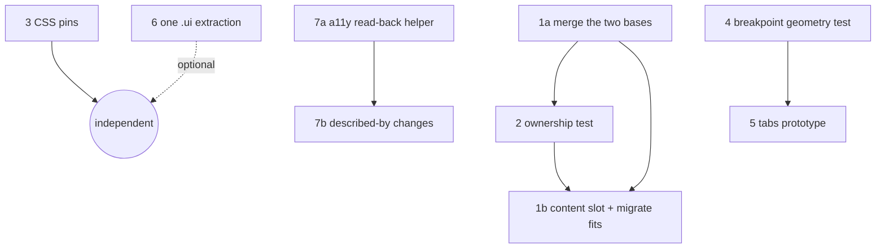

# Implementing the UI proposals: a study

This study takes the seven proposals at the end of
[gtk4-ui-patterns.md](gtk4-ui-patterns.md) and works out how to implement each
one. Nothing here changes application code. Where a claim needed evidence, a
throwaway spike was run against the current tree (build dir recompiled, GTK
4.24.1, libadwaita 1.10.0); the results are in each section and the snippets
that matter are reproduced. Anything not run is marked **not established**.

The proposals are suggestions from the benchmark report, not roadmap items.
Decisions already on record (`CLEAN-03`, `DEF-03`, the `window.py` size
exception) are respected throughout.

## 1. What the spikes established

| # | Question | Result | Method |
|---|---|---|---|
| S1 | Where do the dialogs stand today? | 21 `Adw.Dialog` classes: 2 bases, 9 concrete dialogs on a base, 10 hand-built. Two modules define a class called `ReportDialog` | AST walk over `src/*.py` |
| S2 | Does an AST ownership check work? | Flags exactly two classes today, both legitimate exceptions (see 3.2) | Prototype run |
| S3 | Do the sidebar and web-column breakpoints behave as written? | Yes. 70 widths scanned (590–624 and 1090–1124): `split_view.collapsed == (width <= 600)` and `web_split.collapsed == (width < 1100)` with 0 mismatches. Realised width is always requested − 10 under Xvfb/X11 | `BabbleWindow` built in a script, resized, main loop pumped |
| S4 | Does Xvfb's default screen matter? | Yes. At 640×480 the window clamps to 630×470 and the breakpoints never exercise their wide branch. 1280×1024 is required, as `AGENTS.md` says | Same script, two screen sizes |
| S5 | Do tabs, split views and per-column breakpoints compose? | `Adw.BreakpointBin` per tab page collapses its own split view independently of the window. `transfer_page` moves a page with a split view to a second window without warnings. A page that was never mapped is **not** collapsed until it is first shown | Standalone `AdwTabView` script |
| S6 | Can a template be imported without its resource? | No. `Gtk.Template(resource_path=…)` reads the resource when the class is defined; an unregistered bundle raises `GLib.Error` at import | Probe class |
| S7 | Can a test read accessibility state back? | Yes, with `GTK_A11Y=test`: `Gtk.test_accessible_has_property/relation/role`. A list-valued relation (`DESCRIBED_BY`) is silently dropped unless wrapped as `GObject.Value(Gtk.AccessibleList, Gtk.AccessibleList.new_from_list([w]))`, the form `catchup.py:1774-1779` already uses | Probe widgets |
| S8 | Is Orca available here? | No (`orca` and `accerciser` not installed). Speech output cannot be verified in this environment | `which` |
| S9 | How is the CSS today? | 0 hits for `shade(`, `alpha(`, `@define-color`, `.dim-label`, `overlay-split-view`, `widget.background`, `style-dark` | grep |
| S10 | Do the dialog candidates have tests? | `CollectionEditDialog`, `NotificationPolicyDialog`, `WrappedDialog`, `ProfileEditDialog` and `report.py`'s `ReportDialog` have none. `ComposeDialog`, `SchedulePickerDialog` and (via the memory test) `PrivateNoteDialog` do | grep over `src/test-*.py` |

### Correction to the benchmark report

S1 showed that the benchmark report's F1 ("a shared dialog base exists but four
dialogs use it") understated the position. There are **two** bases with the
same shape, `ToastDialog` (`lists.py:127`, four users) and `AdminDialogBase`
(`admin.py:251`, five users). Both create a header, an `Adw.PreferencesPage`
and an `Adw.ToastOverlay`; they differ in attribute name (`overlay` against
`toasts`), toast timeout (4 s against 5 s) and one helper
(`add_header_buttons`, admin only). The report has been updated.

## 2. Dependencies between the proposals



- **3** and **7a** touch no production code and can go first.
- **2** is cheaper after **1a** (it reduces to "subclasses the base or is
  listed"), but works today with a two-entry allowlist.
- **4** must exist before **5**, because the prototype's main risk is layout
  state the current matrix test cannot see.
- **6** is independent and optional.

## 3. Proposal by proposal

### 3.1 Proposal 1: one dialog base

**Current state.** Two bases with identical structure (S1). Ten dialogs
repeat the scaffold by hand. Five use different attribute names for the same
overlay (`overlay`, `toasts`, `toast_overlay`), and no test references any of
them (grep of `src/test-*.py`), so renaming is safe.

**Options**

| Option | What it is | For | Against |
|---|---|---|---|
| A. Do nothing | Keep two bases | Zero risk | Two copies drift (timeout already differs) |
| B. Merge, then add a slot | One base in `pages.py`; content is a slot, default a `PreferencesPage` | Mechanical for nine dialogs; matches Fractal's `ToastableDialog` | Needs a characterization test first (S10) |
| C. Move to templates | A `.ui` per dialog | Declarative | Triggers S6 for every importer; large change for little shared logic |

**Recommendation: B, in two stages.**

*Stage 1a: merge.*
1. Add `ToastDialog` to `pages.py` with the union of the two APIs:
   `title`, `width`, `height`, `.header`, `.page`, `.toasts` (decided), `toast(text)`,
   `error(heading, error)`, `add_header_buttons(...)`.
2. Delete `ToastDialog` from `lists.py` and `AdminDialogBase` from `admin.py`;
   migrate the nine subclasses. Per the repo's clean-cutover rule there is no
   alias or re-export.
3. Decide the timeout once (4 s or 5 s; see the open questions). Today the same
   user action toasts for 4 s in a list editor and 5 s in an admin dialog.

*Stage 1b: slot, then migrate fits.* Make the content replaceable
(`set_content(widget)`) and let the header suppress title buttons. Fit
analysis from the code:

| Dialog | Content | Header | Fits a slot base? |
|---|---|---|---|
| `CollectionEditDialog` | `PreferencesPage` | Cancel/Save | Yes |
| `NotificationPolicyDialog` | `PreferencesPage` | plain | Yes |
| `WrappedDialog` | `Gtk.Stack` | buttons both sides | Yes, with a slot |
| `ProfileEditDialog` | `PreferencesPage` | Cancel/Save, title buttons off, `close-attempt` | Yes, with the header flag |
| `PrivateNoteDialog` | `Gtk.Box` | Cancel/Save + counter, title buttons off | Yes, with a slot and the header flag |
| `ReportDialog` (`report.py`) | `NavigationView`, per-page headers | none at dialog level | No |
| `ProfileDialog` | `NavigationView`, bottom sheet | none | No |
| `AdminDialog` | `NavigationSplitView` | own | No |
| `ComposeDialog` | custom view, `follows_content_size` | own | No; `CLEAN-03` |
| `SchedulePickerDialog` | `Box` | own; raises no toasts | No need |

Five candidates migrate; five stay as they are.

**Order and safety net.** Because four of the five candidates have no test
(S10), write a characterization test **before** each migration, in the style of
`test-lifecycle.py`: construct the dialog under the display guard, assert it has
an `Adw.ToastOverlay` ancestor of its content and that `pages.show_toast` lands
a toast there. Run under `G_DEBUG=fatal-criticals` (the meson `fatal_test_env`).
Then migrate, then run `timeline memory` (it constructs `PrivateNoteDialog`).

**Risks.** Overlay placement differs today (inside the toolbar for the bases,
outside for `ProfileEditDialog`, `PrivateNoteDialog` and `ReportDialog`).
`show_toast` finds the overlay with `get_ancestor`, so placement does not
affect routing, but the toast is then drawn over the header on the outer
variant. Pick the inner placement and check it visually once.

**Done when:** one `ToastDialog` class exists, `lists.py` and `admin.py` define
none, nine plus up to five dialogs subclass it, and the tests above pass.

### 3.2 Proposal 2: a toast-ownership test

**Design.** Static, not behavioural: an AST walk like `test-ui-strings.py`.
It needs no display, so no skip path.

1. Collect every class in non-test `src/*.py` that derives, directly or
   transitively, from `Adw.Dialog`.
2. Key classes by **(module, name)**. A name-only key is wrong today:
   `admin.py` and `report.py` both define `ReportDialog`.
3. A class passes if its source, or the source of a class it inherits from,
   contains `Adw.ToastOverlay`, **or** it is on a named allowlist with a reason.

**Prototype result (S2).** Of 21 classes the check flags two:

| Class | Why it is a legitimate exception |
|---|---|
| `ComposeDialog` | The overlay is created by the child view `BabbleComposeView` (`compose.py:454`) and the composer routes toasts through its own `_add_toast` (`compose.py:1359`); `CLEAN-03` records why it cannot use `pages.show_toast` |
| `SchedulePickerDialog` | Raises no toasts; its callback runs after the dialog closes and errors are reported by the page behind it (`scheduled.py:452` onward) |

Both go on the allowlist with those reasons. After Stage 1a the rule
simplifies to "subclasses `ToastDialog`, or is listed".

**Registration.** A new `src/test-dialog-toasts.py` printing `ok - …` /
`FAIL - …`, registered in `src/meson.build` with `test_env`. Check that the
reason text is non-empty so an exception cannot be added silently, the same
pattern as `file size rule`.

**Limit.** This proves an overlay exists, not that a given toast reaches it.
Routing is covered by the per-dialog characterization tests from 3.1.

### 3.3 Proposal 3: pin the CSS conventions

**Design.** Add checks to the existing `src/test-style-css.py`, which already
has `check()` and the stylesheet text. Strip `/* … */` comments before
matching, because this file's comments name the deprecated forms
(`style.css:438-441` mentions hard-coded colours).

Pin as absent (all true today, S9): `@define-color`, `shade(`, `alpha(`,
`.dim-label`, `overlay-split-view`, `widget.background`. Also assert
`style-dark.css` and `style-hc.css` are not in `src/babble.gresource.xml`
(deprecated since libadwaita 1.9).

**Do not** pin `listview` or `row` selectors. They are public GTK CSS nodes
and the stylesheet legitimately uses them (`style.css:16-17`).

**Risk.** Near zero; failure means someone added a deprecated form. Scope is
one test file.

### 3.4 Proposal 4: breakpoint geometry test

**What S3 showed.** The behaviour is correct today and can be asserted as an
invariant rather than as literals:

```python
width = win.get_width()                      # realised, not requested
assert win.split_view.get_collapsed() == (width <= 600)
assert win.web_split.get_collapsed()  == (width < 1100)
```

Requested and realised width differ by a backend-dependent constant (10 under
X11, shown as a single value across 70 samples), so the test must read
`get_width()` and must not hard-code `w + 10`.

**Design.** New `src/test-breakpoints.py`, modelled on `test-lifecycle.py`:
register the bundle (skip 77 if absent), build `BabbleWindow(application=app)`
with the application registered, show the `shell` page, then for each width in
a window around 600/601 and 1100 call `set_default_size`, `present`, pump the
main context until `get_width()` is stable, and assert the two invariants.
Include a sample at each side of the `max-width: 600sp` and
`min-width: 601sp` pair, because those two conditions are the only
compact-first pair in the project.

**Requirements.** The display must be at least 1280×1024 (S4). **Decision:
the test skips (exit 77) when the screen is smaller**; the project is
desktop-first for now. Under the project's headless mutter command it runs as
is. Run with `fatal_test_env`. Read the screen size from the default
display's monitor geometry before building the window.

**Not established.** (a) Whether the transient first-frame state the
`window.ui` comment describes (the wide sidebar painting as an overlay for one
frame) can be observed from a script; the spike checked settled state only.
(b) Behaviour at non-default text scale, where `sp` and `px` differ.

### 3.5 Proposal 5: tabs for deck mode, prototyped first

**Facts from S5 and the code**

- A window-level `AdwBreakpoint` evaluates against the *window* width. A deck
  column lives in the main split view's content pane, which is narrower than
  the window, so columns need `Adw.BreakpointBin` (or a manual size check),
  as Fractal's Explore view does. The spike confirmed per-page
  `BreakpointBin`s collapse independently.
- Hidden tab pages are not collapsed until first mapped (S5). A column that
  starts on a background tab will report the wide layout until shown;
  anything that reads its collapsed state before then gets the wrong answer.
- `transfer_page` (tear-off) works with split-view content and emits no
  warnings (S5). Text Editor wires `create-window` for this
  (`editor-window.ui:64`).
- `pages.window_of()` treats any root without a `navigation_view` attribute as
  "a dialog" and substitutes the *active* window (`pages.py:312-321`). A
  torn-off window must expose `navigation_view`, or `window_of` must change,
  otherwise `push_page` and `show_toast` from a torn-off column resolve to
  whichever window is active.
- `StatusRunRow` keeps built cards for only `CARD_SHELLS_KEPT` unmapped shells
  application-wide (`statusrun.py`, class-level `_kept`). Several visible
  columns will share that cap; its effect on N columns is **not established**.

**Options**

| Option | Shape | For | Against |
|---|---|---|---|
| A. Tabs of columns | `AdwTabView` page = one timeline | Proven in Text Editor/Nautilus; tear-off built in | Not side-by-side |
| B. Scrolling row of columns | `Gtk.Box` in a scrolled window | True deck layout | No corpus precedent; hand-built focus and DnD |
| C. Tab = workspace of 1–3 columns | A tab hosts a `BreakpointBin` over a `Gtk.Paned`/box of columns, collapsing to one column when narrow | Matches the roadmap wording ("tabs with split views") and saved workspaces | Combination has no precedent in the eight |

**Recommendation: prototype C on a branch, behind a preference, in this order.**
1. Build one tab with two `TimelinePage` columns and a `BreakpointBin`
   at roughly 700 px, in a standalone script first (as S5 did), checking
   `G_DEBUG=fatal-criticals`.
2. Run `timeline memory` with two columns open to see the shell cap in
   practice, then decide whether the cap becomes per-column.
3. Resolve `window_of` for torn-off windows before adding tear-off.
4. Only then connect it to the sidebar.

Proposal 4's test comes first, so a regression in the existing sidebar or
web-column breakpoints is caught while the deck is added to the same shell.

**Done when** the prototype answers three questions with evidence: do two
columns pass `timeline memory`, does the narrow collapse work inside the
content pane, and does tear-off keep navigation working.

### 3.6 Proposal 6: one template extraction, with a stop rule

**Cost found (S6).** Templates bind at import. If a dialog becomes a
`Gtk.Template`, every test and tool that imports its module must register
`babble.gresource` first or fail with a `GLib.Error`. Today
`test-scheduled-dialog.py` imports `src.scheduled` directly and has no bundle
step. Extracting `SchedulePickerDialog` (a 152-line class) would force it onto
the `load_bundle()` pattern of `test-lifecycle.py` and a skip-77 when the
bundle is absent.

**Other mechanical requirements:** add the file to `src/babble.gresource.xml`
and to `po/POTFILES.in` (the `ui strings` test reads `.ui` files through
`POTFILES.in`, so wording rules apply for free), and keep it XML. The project
has no Blueprint dependency; `blueprint-compiler` is present on this machine
but is not a build requirement, and three of the eight corpus apps also use XML.

**Choice of candidate.** `SchedulePickerDialog` has a test that reads rows
back, so it can prove nothing regressed. The dialogs with no tests (S10) are a
poor first experiment because nothing would catch a mistake.

**Stop rule, decided before starting.** Compare, for the one dialog: lines of
Python removed, lines of XML added, tests that had to change, and whether the
import coupling is acceptable. Abandon if the Python removed is less than the
XML added plus the new bundle dependency in tests. The corpus does not require
a UI-file count.

### 3.7 Proposal 7: an accessibility pass

**What the documentation says (checked).**

- GTK's accessibility reference and GNOME's coding guidelines give the same
  rules: name icon-only widgets with `GTK_ACCESSIBLE_PROPERTY_LABEL`; use
  `LABELLED_BY` when a visible label names a control; and, where there is no
  tooltip, use `GTK_ACCESSIBLE_PROPERTY_DESCRIPTION` for a description.
  GTK also fills the accessible name from a widget's label or tooltip when
  none is set, but calls explicit properties "good practice and project
  hygiene".
- **Revision to the proposal.** `DESCRIPTION` is a plain translatable string.
  For media attachments and boost strips it is simpler than a `DESCRIBED_BY`
  relation, and it avoids the PyGObject list-marshalling pitfall (S7). Use
  `DESCRIBED_BY` only when the description already exists as a visible widget.
- GTK says application developers **should** check accessibility during
  development and names two tools: the **GTK Inspector**, which shows each
  widget's accessible attributes and has an overlay that highlights
  accessibility issues, and the "ad hoc" test backend (`GTK_A11Y=test`), which
  GTK describes as being for its own testsuite.

**Validation against Orca is required, not optional.** Orca is the screen
reader GNOME users run, and GTK's own documentation names it as the consumer of
the accessibility information (`GtkAccessible` "conveys this information to
users" through ATs "like Orca"). Automated checks confirm that attributes are
set; only a run with Orca shows what is spoken, in what order, and how often.
No Orca-driven *automated* test framework was found, so the Orca step is a
manual, repeatable protocol rather than a CI job. The automated tools are
there to make that manual run short and targeted.

| Tool | Role | Verifies |
|---|---|---|
| `GTK_A11Y=test` + `Gtk.test_accessible_has_*` | Automated read-back in `src/test-*.py` (S7) | Attributes are set |
| GTK Inspector accessibility view and overlay | Manual inspection | Attributes are set; highlights issues |
| AT-SPI inspectors (Accerciser) and automation (dogtail) | See the tree as an assistive technology does | What is exposed over AT-SPI |
| **Orca** | Manual listening | What a user actually hears |

**What the two official guides add.** GTK's accessibility reference links
Orca's "Tips for Application Developers" as its companion, so the two are
read together. Checked against Babble:

| Guidance | Source | Babble today |
|---|---|---|
| Orca presents the accessible **name and, by default, the description**; the description is spoken last. Static explanatory text should go in `description` or `described-by` | Orca guide | `DESCRIPTION` is already used in six places (`accounts.py:247`, `catchup.py:1038`, `hashtags.py:582`, `profile.py:685`, `scheduled.py:207`, `thread.py:307`). Preferring it for media tiles matches house style |
| Do **not** put a focusable list item's full content in its accessible name; Orca (v47+) already reads descendants of a focused `ListItem`, and duplicate filtering is imperfect | Orca guide | `StatusRow` sets a short name, "Post by X" or "Post by X, boosted by Y" (`statusrow.py:408-431`), not the post text. Consistent with the advice; whether descendants are then spoken sensibly is exactly what the Orca run in scenario 1 checks |
| A label with no relation may be treated as **static text** and read automatically; give real labels a `labelled-by` relation | Orca guide | Not audited. Candidate check for 7a: labels in dialogs and rows that name a control but carry no relation |
| Ancestors' descriptions are spoken only on **Orca v47.alpha or later**; `error-message` support is global from v49; `details` is not global | Orca guide | Record the Orca version in every test run |
| `widget.announce(text, priority)` is the supported way to speak news that has no focus change (GTK 4.14+) | Orca guide | `pages.announce` wraps it; two call sites outside the helper |
| `GTK_ACCESSIBLE_PROPERTY_HELP_TEXT` (GTK 4.16+) for non-standard keyboard behaviour; not for mnemonics | Orca guide, GTK reference | Not used anywhere. Babble has non-default keys (for example app-level page scrolling), so this is a candidate; the floor (GTK 4.24) allows it |
| `PRESENTATION` role hides purely decorative widgets; it is distinct from the transient `HIDDEN` state | GTK reference | Used for decorative images (`window.ui`, `statusrow.py:194`) |
| Anything that behaves like a button needs role `BUTTON` and a parameterless action | GTK reference | Tiles use `accessible_role=BUTTON` (`mediabox.py:514`) |
| Tab-based custom UI needs `TAB_LIST`/`TAB` roles, `CONTROLS` relations and `SELECTED` | GTK reference | Relevant to deck mode only if tabs are hand-built; stock `AdwTabView`/`AdwTabBar` should be used so this is inherited (not tested here) |
| Report presentation bugs that no technique fixes against Orca | Orca guide | Process note |

**Orca's own command-line tools make a repeatable, speech-free check.**
`tools/dump-tree.py` (full accessibility tree of an application),
`dump-focused-object.py` (each newly focused object and its ancestors) and
`dump-window-events.py` come with Orca, and Accerciser's event monitor shows the
accessible events an app fires. A before/after tree dump per scenario would
show *what Orca is given* without anyone listening, leaving the listening run
to judge wording. Whether these tools run in CI (they need a real AT-SPI bus,
not `GTK_A11Y=test`) is **not established**: the first attempt to register an
app in this sandbox failed on the missing `org.a11y.atspi.Registry`.

**Orca validation protocol (to be run by someone with Orca installed).**
From Orca's help: toggle Orca in GNOME with `Super`+`Alt`+`S`; `orca -l`
lists applications Orca can see (a quick check that Babble is exposed over
AT-SPI); `orca -u <dir>` uses a separate preferences directory, so every run
starts from the same settings; `orca --debug-file=<file>` records Orca's own
debug output; Orca also has a Learn Mode, listed in its help contents (not
read for this study). Run each scenario below before and after a change, with
the same account and the same fixture content, and record what was spoken:

1. Tab through a timeline row: name, role (`article`), then each control.
2. A post with a content warning: is the warning announced before the body?
3. A post with image attachments: tile names and alt text.
4. A boost strip and the boost/favourite counts.
5. The new-posts announcement (`pages.announce`); then a focused item whose
   description changes (`thread.py:307`).
6. Open and close a dialog: where focus lands, and whether the title is read.
7. A toast with Undo: is it announced, and can Undo be reached by keyboard?
8. A dialog with unrelated labels (preferences, report): is any label read as
   static text it should not be?

Pass criteria are the owner's to set; the useful output is a before/after
transcript per scenario. Fixtures can come from `bench/fixture_server.py`, which
already serves fake timelines, so the run does not depend on live data.

**Plan.**

*7a: read-back helper (no product change).* Use the test backend (existing
tests set `GTK_A11Y=none`, so a separate env entry is needed in meson). Walk a
built `StatusRow` with media and list interactive widgets without a `LABEL`.
Run the same widget once in the GTK Inspector overlay to compare.

*7b: change only what 7a or an Orca session shows.* Prefer `DESCRIPTION`
for the media tiles and boost strip. Do not accept 7b on the strength of
automated checks alone; they cannot say whether a description is useful. The
Orca protocol is the acceptance test.

**Not available here (S8).** Orca is not installed on this machine, and no
AT-SPI tooling beyond what GTK ships was run, so none of the manual rows were
exercised. 7a can be built and run here; the Orca protocol above needs a
machine with Orca.

## 4. Suggested order

1. **3.3** CSS pins: one file, no product risk.
2. **3.7a** read-back helper: informs everything under accessibility.
3. **3.2** ownership test with the two-entry allowlist.
4. **3.1a** merge the two bases; the ownership test then guards it.
5. **3.4** breakpoint geometry test.
6. **3.1b** slot and migrate the five fits, each behind a characterization test.
7. **3.5** deck prototype, only after 3.4.
8. **3.6** one extraction with the stop rule, whenever convenient.

## 5. Decisions

| # | Question | Status |
|---|---|---|
| 1 | Toast duration on the merged base | **Open.** Libadwaita's `Adw.Toast:timeout` defaults to 5 s and the HIG gives no number, so 5 s (the `AdminDialogBase` value, and the library default) is the documentation-backed choice. `ToastDialog`'s explicit 4 s is the deviation |
| 2 | Attribute name on the merged base | **Decided: `toasts`** |
| 3 | Deck mode: optional or replacing the shell? | **Decided: optional**, a preference, with the single-column layout staying the default |
| 4 | Breakpoint test on a small screen | **Decided: skip (exit 77).** Desktop-first for now |
| 5 | Orca validation for 3.7b | **Decided in principle: required.** Who runs it, and on what machine, is open; protocol in 3.7 |

**Consequence of decision 3 (optional deck).** The prototype in 3.5 stays as
planned. Concretely: a GSettings key gates the feature (the key must be added
to `data/io.github.mauriciobc.Babble.gschema.xml` first, per `CLAUDE.md`); the
default shell and its tests are untouched; and deck code lives in its own
module, so the `window.py` size exception does not grow. It also removes the
"release blocker" status from the open risks in 3.5 (shared row cache,
torn-off windows): they limit the feature, not the app.

## 6. Reproducing the spikes

The spike scripts were throwaway and are not committed. The two that matter:

- **S3/S4:** register `build/src/babble.gresource`, create
  `BabbleApplication`, register it, build `BabbleWindow`, call
  `main_stack.set_visible_child_name('shell')`, then loop
  `set_default_size(w, 800); present(); pump main context` and read
  `get_width()` and the two `get_collapsed()` values. Run under
  `xvfb-run -s "-screen 0 1280x1024x24"`.
- **S5:** two `Adw.Window`s each with an `Adw.TabView`; pages that are
  `Adw.BreakpointBin(child=Adw.OverlaySplitView)` with a
  `max-width: 500px` breakpoint setting `collapsed`; resize, then
  `tv1.transfer_page(page, tv2, 0)`.
