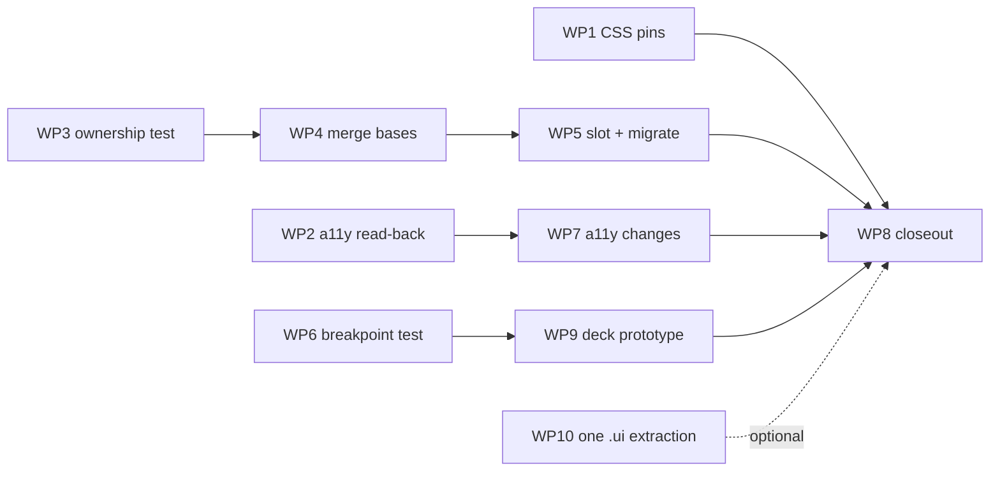

# UI proposals: task-level plan

Turns [the implementation study](ui-proposals-implementation-study.md) into
work packages (WP) and tasks (T). Evidence and reasoning live in the study;
this document says what to change, where, and how to know it is done.

## Progress

| WP | Status | Commit | Notes |
|---|---|---|---|
| WP1 CSS pins | done | see log | T1.1 already satisfied by the existing `strip_comments`; T1.2-T1.4 added and the negative proof was run |
| WP2 a11y read-back | done | see log | `a11y readback` test and its own `GTK_A11Y=test` environment; inventories: 4 unnamed buttons on a post row, 0 unrelated labels in preferences/report |
| WP3 toast ownership | pending | | |
| WP4 merge dialog bases | pending | | |
| WP5 content slot | pending | | |
| WP6 breakpoints | pending | | |
| WP7 a11y changes | pending | | |
| WP8 closeout | pending | | |
| WP9 deck prototype | pending | | optional |
| WP10 one `.ui` extraction | pending | | optional |

## Decisions this plan assumes

| # | Decision | Value |
|---|---|---|
| 1 | Merged dialog base toast timeout | **5 s**, the libadwaita default and the `AdminDialogBase` value. Not yet confirmed by the owner; T1.3 is the only task that depends on it |
| 2 | Overlay attribute name | `toasts` |
| 3 | Deck mode | Optional, behind a preference; single-column stays the default |
| 4 | Breakpoint test on a screen below 1280×1024 | Skip (exit 77) |
| 5 | Orca validation | Required for accessibility changes. Machine and person to run it are not yet named (T7.5) |

The **Acceptance** column in each table is a summary. The binding, checkable
criteria and the definitions of done are in the last part of this document
("Acceptance criteria and definition of done").

## Rules that apply to every task

- New files carry `# SPDX-License-Identifier: GPL-3.0-or-later`; imports after
  `gi.require_version` carry `# noqa: E402`; `ruff check src/` must pass.
- A new test is a standalone `src/test-*.py` printing `ok - …` / `FAIL - …`,
  registered in `src/meson.build` with `test_env` (or `fatal_test_env` when it
  builds widgets). It exits 77 when there is no display, if it needs one.
- A new production module is added to the `install_data` list in
  `src/meson.build`; the `file size rule` test checks that list.
- User-visible strings use `from .i18n import gettext as _`, `ngettext` for
  counts, and obey `ui strings` (no "OK"/"Yes"/"No"/"Done" labels, US
  spelling, `…` not `...`).
- Clean cutover: when a class or attribute is renamed or moved, every caller is
  migrated in the same task. No alias, re-export or shim.
- Verification command for any task:
  `XDG_RUNTIME_DIR=$(mktemp -d) dbus-run-session -- mutter --headless --wayland --no-x11 --virtual-monitor 1280x1024 -- meson test -C build -j1`,
  or one test by name. Run `meson compile -C build` first; the compiled
  gresource goes stale otherwise.
- Test environments set `GTK_A11Y=none` and `NO_AT_BRIDGE=1`
  (`src/meson.build:145-168`). Anything that reads accessibility state needs its
  own environment (T7.1).

## Order and dependencies

Independent starting points: WP1, WP2, WP3, WP6.

---

## WP1: CSS conventions pinned (proposal 3)

Files: `src/test-style-css.py` only.

| Task | Change | Acceptance |
|---|---|---|
| T1.1 | Add a `strip_comments(css)` helper (remove `/* … */`, non-greedy, multiline) and use it for the new checks only | Existing checks unchanged and still pass |
| T1.2 | Add `check()` lines asserting the stripped CSS contains none of: `@define-color`, `shade(`, `alpha(`, `.dim-label`, `overlay-split-view`, `widget.background` | `style css` passes today (all absent, verified) |
| T1.3 | Add a check that `src/babble.gresource.xml` lists no `style-dark.css`, `style-hc.css` or `style-hc-dark.css` | Passes today |
| T1.4 | Negative proof: temporarily add `.dim-label {}` to a scratch copy of the CSS and confirm the check fails, then discard | Failure line is printed with the offending token |

Do not pin `listview` or `row` selectors (`style.css:16-17` uses them
legitimately). Verify: `meson test -C build 'style css' -v`.

## WP2: accessibility read-back helper (proposal 7a)

Files: new `src/test-a11y.py`, `src/meson.build`.

| Task | Change | Acceptance |
|---|---|---|
| T2.1 | In `src/meson.build` add `a11y_test_env`: a copy of `fatal_test_env` with `GTK_A11Y` set to `test` and `NO_AT_BRIDGE` unset-safe (keep `1`; the test backend does not use the bridge) | `meson setup` still configures |
| T2.2 | Write `src/test-a11y.py` with helpers `has_label(w)` (`Gtk.test_accessible_has_property(w, LABEL)`), `has_role`, and `walk(widget)` over `get_first_child()/get_next_sibling()` | Helper unit-checked against a hand-built `Gtk.Button` with and without a label |
| T2.3 | Build a `StatusRow` with media and a boost, bind it to a fixture status (reuse fixtures from `bench/fixtures.py` or the existing `test-boost-card.py`), and assert it has role `ARTICLE` and a `LABEL` | Passes against current code |
| T2.4 | Report (as `note`, not failure) every interactive widget (`Gtk.Button`, `Gtk.ToggleButton`, `Gtk.MenuButton`, focusable widgets) under that row with no `LABEL` and no tooltip | Output lists real gaps, if any; this is the inventory for T7.2 |
| T2.5 | Add a second pass for **static-text candidates**: `Gtk.Label`s in `ReportDialog`, `PreferencesDialog` with no `LABELLED_BY` relation and no ancestor row; report as `note` | Inventory for T7.3 |
| T2.6 | Register `test('a11y readback', python, args: [files('test-a11y.py')], env: a11y_test_env, timeout: 60)` | Appears in `meson test --list` |

Pitfall to cover in the helper docs: list-valued relations need
`GObject.Value(Gtk.AccessibleList, Gtk.AccessibleList.new_from_list([w]))`
(`catchup.py:1774-1779`); the plain call drops the relation silently.

## WP3: toast-ownership test (proposal 2)

Files: new `src/test-dialog-toasts.py`, `src/meson.build`.

| Task | Change | Acceptance |
|---|---|---|
| T3.1 | AST-walk non-test `src/*.py`; collect classes keyed by **(module, class)**; resolve `Adw.Dialog` descendants transitively across modules via imports of known base names | Finds 21 classes today |
| T3.2 | For each, pass if its own source or an inherited class's source contains `Adw.ToastOverlay` | Flags exactly `ComposeDialog` and `SchedulePickerDialog` |
| T3.3 | Add `ALLOWED = {('compose', 'ComposeDialog'): 'overlay lives in BabbleComposeView (compose.py:454); CLEAN-03', ('scheduled', 'SchedulePickerDialog'): 'raises no toasts'}`; fail on an empty reason, and on an allowlist entry that no longer matches a class or that now owns an overlay (stale) | Passes today; deleting a reason fails |
| T3.4 | Register `test('dialog toasts', python, args: [files('test-dialog-toasts.py')], env: test_env, timeout: 30)`. No display needed, so no skip path | Runs under plain `meson test` |

After WP4 the rule becomes "subclasses `ToastDialog` or is allowlisted" (T4.6).

## WP4: merge the two dialog bases (proposal 1, stage a)

Files: `src/pages.py`, `src/lists.py`, `src/admin.py`, `src/search.py`,
`src/hashtags.py`.

| Task | Change | Acceptance |
|---|---|---|
| T4.1 | Characterization tests first. In a new `src/test-dialog-bases.py` (display guard, `fatal_test_env`) construct one dialog from each base (`ListEditor` or `MultiHashtagEditor` for the lists base, `TakeActionDialog` for the admin base) and assert: an `Adw.ToastOverlay` ancestor of the page exists; `dialog.toast('x')` adds a toast; `pages.show_toast(dialog.page, 'x')` lands on that overlay (observe via `Adw.ToastOverlay` child count or a patched `add_toast`) | Passes against the **old** code, so it proves behaviour is preserved |
| T4.2 | In `pages.py` add `ToastDialog(Adw.Dialog)` with: `__init__(self, title, width=480, height=600, **kwargs)`; `.header` (`Adw.HeaderBar`), `.page` (`Adw.PreferencesPage`), `.toasts` (`Adw.ToastOverlay` wrapping the page), toolbar as the dialog child; `toast(text)`; `error(heading, error)` using `error_text`; `add_header_buttons(cancel_label, action_label, callback, css=None, sensitive=True)` | Class compiles; `ruff` clean |
| T4.3 | Timeout: `Adw.Toast(title=text, use_markup=False, timeout=5)`. If the owner chooses 4 s instead, change this one literal | One value, one place |
| T4.4 | Migrate the four `lists.py`/`search.py`/`hashtags.py` users (`ListEditor`, `_MembershipDialog`, `AdvancedSearchDialog`, `MultiHashtagEditor`): import from `pages`, rename `self.overlay` to `self.toasts` everywhere in those modules; delete `ToastDialog` from `lists.py` | `grep -rn "ToastDialog" src` shows the class defined once, in `pages.py` |
| T4.5 | Migrate the five `AdminDialogBase` users (admin `ReportDialog`, `TakeActionDialog`, `AdminAccountDialog`, `AddFederationBlockDialog`, `AddIPBlockDialog`); delete `AdminDialogBase`; keep `self.toasts` | `grep -rn AdminDialogBase src` is empty |
| T4.6 | Simplify T3's rule: a dialog passes if it subclasses `pages.ToastDialog` or is allowlisted; keep the AST fallback for hand-built ones until WP5 finishes | `dialog toasts` still passes |
| T4.7 | Run `test-dialog-bases`, `dialog toasts`, `admin permissions`, `search helpers`, `timeline memory`, `ui strings`, `file size rule` (`pages.py` is already a declared exception; confirm it stays declared) | All pass |

Risk to watch: `lists.py` and `admin.py` may import each other's helpers; check
for import cycles after moving the class (`pages.py` is imported by both
already, so none is expected).

## WP5: content slot and migration of the five fits (proposal 1, stage b)

Depends on WP3 and WP4.

| Task | Change | Acceptance |
|---|---|---|
| T5.1 | Extend `ToastDialog`: `set_content(widget)` replaces the page as toolbar content (inside the overlay); a constructor flag `title_buttons=True` that, when False, sets `show_start_title_buttons=False` and `show_end_title_buttons=False` on the header | T4.1 still passes; new check that `set_content` keeps the overlay as an ancestor |
| T5.2 | Characterization test for `CollectionEditDialog`: constructs (create and edit modes), has overlay ancestor, Save sensitivity follows the name row. Add to `test-collections.py` or a new test | Passes on old code |
| T5.3 | Migrate `CollectionEditDialog` (`fedicollections.py:664`) | T5.2 passes; no `toasts = Adw.ToastOverlay` left in the class |
| T5.4 | Characterization test + migrate `NotificationPolicyDialog` (`notifications.py:1618`); policy saved on close behaviour unchanged | Test passes before and after |
| T5.5 | Characterization test + migrate `WrappedDialog` (`wrapped.py:183`) using `set_content(self.stack)`; header buttons added through `.header` | Test passes before and after |
| T5.6 | Characterization test + migrate `ProfileEditDialog` (`profileedit.py:195`): `title_buttons=False`, keep `close-attempt` | Test passes before and after |
| T5.7 | Migrate `PrivateNoteDialog` (`profile.py:298`) (already covered by `timeline memory`); `set_content(body)`, `title_buttons=False` | `timeline memory` passes |
| T5.8 | Explicitly leave `ReportDialog` (`report.py`), `ProfileDialog`, `AdminDialog`, `ComposeDialog`, `SchedulePickerDialog` unchanged; add each to a short `ALLOWED`/`HAND_BUILT` list in `test-dialog-toasts.py` with a reason | The test lists every dialog that is not on the base, with a reason |
| T5.9 | Visual check of one migrated dialog in the running app (overlay inside the toolbar; HIG: toasts bottom-centred) | Screenshot or note in the PR |

Each of T5.3 to T5.7 is a separate change so a regression bisects to one dialog.

## WP6: breakpoint geometry test (proposal 4)

Files: new `src/test-breakpoints.py`, `src/meson.build`.

| Task | Change | Acceptance |
|---|---|---|
| T6.1 | Scaffold from `test-lifecycle.py`: display guard, `load_bundle()` with skip-77, `BabbleApplication`, **register the application** (`Gio.Application.register`) before building `BabbleWindow` | Window builds without criticals under `fatal_test_env` |
| T6.2 | Skip (exit 77, message names the required size) when the default monitor geometry is below 1280×1024 | Under `xvfb-run` default screen the test skips; under mutter 1280×1024 it runs |
| T6.3 | Show the `shell` page (`win.main_stack.set_visible_child_name('shell')`); helper `settle(width)` that calls `set_default_size`, `present`, and pumps the main context until `get_width()` is unchanged for several iterations | Deterministic across 10 runs |
| T6.4 | Assert `split_view.get_collapsed() == (width <= 600)` for requested widths 590-624, always using the **realised** `get_width()` | 0 mismatches (matches the spike) |
| T6.5 | Assert `web_split.get_collapsed() == (width < 1100)` for 1090-1124 | 0 mismatches |
| T6.6 | Do not hard-code the 10 px offset | Test passes if the backend offset differs |
| T6.7 | Register `test('breakpoints', python, args: [files('test-breakpoints.py')], env: fatal_test_env, timeout: 120)` | Listed; passes under mutter |

Out of scope, recorded: the first-frame overlay flash and non-default text
scale (study 3.4).

## WP7: accessibility changes (proposal 7b)

Depends on WP2. Nothing here is accepted on automated results alone.

| Task | Change | Acceptance |
|---|---|---|
| T7.1 | Fix the inventory from T2.4 and T2.5: for each reported gap decide label, `DESCRIPTION`, `labelled-by`, or `PRESENTATION` | A short table in the PR: widget, decision, reason |
| T7.2 | Apply labels/`DESCRIPTION` to media tiles and boost strip where T2.4 or Orca scenarios 3 and 4 show a gap; prefer `DESCRIPTION` (house style, six existing uses). Use the wrapped `AccessibleList` form only if a `DESCRIBED_BY` relation is truly needed | `a11y readback` passes with the new properties asserted |
| T7.3 | Give any unrelated label found by T2.5 a `labelled-by` relation to the control it names | Check added to `test-a11y.py` |
| T7.4 | Evaluate `HELP_TEXT` (GTK 4.16+) for non-default key behaviour (for example page-scroll actions); add only where an Orca run shows the behaviour is undiscoverable. Not for mnemonics | Decision recorded per widget |
| T7.5 | **Orca validation.** Run the eight scenarios in study 3.7 before and after, on a machine with Orca (record the Orca version; ancestor descriptions need v47+). Use a clean profile (`orca -u <dir>`), `orca -l` to confirm Babble is visible, fixtures from `bench/fixture_server.py`. Capture `tools/dump-tree.py` output per scenario if the AT-SPI bus is available | A before/after transcript per scenario, attached to the PR. **Owner and machine: to be named** |
| T7.6 | File an Orca bug for any presentation problem no technique fixes (Orca's guide asks for this) | Link recorded |

## WP9: deck mode prototype (optional feature)

Depends on WP6. Gated by a preference; default off.

| Task | Change | Acceptance |
|---|---|---|
| T9.1 | Add GSettings key `deck-mode` (`type="b"`, default `false`, with a `
`) to `data/io.github.mauriciobc.Babble.gschema.xml` **first**; `preferences schema` test covers keys | Schema compiles; test passes |
| T9.2 | Standalone spike script (not committed): `Adw.TabView` page = `Adw.BreakpointBin` (set `width-request` and `height-request`, required by libadwaita) over a box of two `TimelinePage` columns, `max-width` breakpoint collapsing to one column; run with `G_DEBUG=fatal-criticals` | No criticals; collapse verified per page; note that unmapped pages evaluate on first show |
| T9.3 | Measure the row cache: open two columns, run the `timeline memory` workload, read `StatusRunRow._kept` against `CARD_SHELLS_KEPT` | Decision recorded: keep app-wide cap or make it per-column |
| T9.4 | Decide `window_of` for a torn-off window: either the deck window exposes `navigation_view`, or `window_of` stops falling back to the active window. Write the test first (`push_page` from a torn-off column lands in that window) | Test fails on current code, passes after |
| T9.5 | New module `src/deck.py` (add to `install_data`; stays under 800 lines) containing the deck view; `window.py` only gains the preference hook | `file size rule` passes; `window.py` growth is a few lines |
| T9.6 | Wire the preference in Preferences (a switch row, translated, with a `# Translators:` note if terse); re-run `ui strings` | Switch toggles the layout without restart, or says restart is needed |
| T9.7 | Tear-off via `AdwTabView.transfer_page` / `create-window` | Torn-off column keeps working navigation and toasts (T9.4 test) |
| T9.8 | Tests: `deck` constructs with the preference on; closing a tab frees the column (use the `timeline memory` weakref pattern) | Both pass; default-off layout tests unchanged |
| T9.9 | Add Orca scenarios for tabs (tab list role, selected tab announced) and re-run T7.5 for the deck | Transcript attached |

## WP10: one `.ui` extraction (optional, stop rule)

| Task | Change | Acceptance |
|---|---|---|
| T10.1 | Record the baseline for `SchedulePickerDialog` (`scheduled.py:99`, 152 lines): lines of Python, test dependencies | Numbers in the PR |
| T10.2 | Create `src/schedule-dialog.ui` (XML), add it to `src/babble.gresource.xml` and `po/POTFILES.in`; convert to `Gtk.Template` | Dialog behaves the same |
| T10.3 | Update `test-scheduled-dialog.py` to register the bundle before importing (templates bind at import) using the `load_bundle()` pattern, skip-77 if absent | Test passes |
| T10.4 | Apply the stop rule: abandon if Python removed is less than XML added plus the new bundle dependency in tests | Decision recorded; revert if abandoned |

## WP8: closeout

| Task | Change | Acceptance |
|---|---|---|
| T8.1 | Update `CLAUDE.md`: list the new tests (`dialog toasts`, `breakpoints`, `a11y readback`, `dialog bases`), the single `ToastDialog` in `pages.py`, and correct the stale `window.py` line count | Notes match the tree |
| T8.2 | Update `Docs/gtk4-ui-patterns.md` F1/F2 and proposals to reflect what shipped | Report matches code |
| T8.3 | Full suite under headless mutter at 1280×1024 | 0 failures; skips only the known ones |
| T8.4 | Remove scaffolds and throwaway spike scripts | None committed |

## Suggested sequence

1. WP1, WP2 and WP3 (no product change).
2. WP4, then WP6 in parallel with WP5.
3. WP7 as soon as WP2 and an Orca machine exist.
4. WP9 after WP6, as an optional track.
5. WP10 at any time.
6. WP8 last.

## Still open

- Confirm 5 s (T4.3).
- Name who runs Orca and on what machine (T7.5, T9.9).
- Whether CI can reach a real AT-SPI bus for Orca's `dump-tree.py` (not established).

---

# Acceptance criteria and definition of done

## How to read this part

- **AC** are binary: each can be answered yes or no by running a command or
  inspecting a named file. "Run" means the verification command from the rules
  above, scoped to the named test.
- A task is **done** when all of its AC pass **and** the global definition of
  done holds. A work package is done when all its tasks are done **and** its
  package-level definition of done holds.
- AC marked **[manual]** need a human or a machine this repository's CI does not
  have (Orca, a visual check). They are listed so they are not forgotten; they
  cannot be reported as passed from a headless run.
- A negative proof ("it fails when it should") is part of AC for every new
  test. A test that has never been seen to fail is not accepted.

## Global definition of done (every task)

1. `ruff check src/` reports no errors.
2. `meson compile -C build` succeeds with no new warnings.
3. All tests that existed before the task still pass under headless mutter at
   1280×1024; the only allowed skips are the ones documented in `CLAUDE.md`
   (`streaming helpers`, and tests that need a network).
4. New or changed user-visible strings pass `ui strings`, and `po/` is
   regenerated if strings changed (`meson compile -C build babble-pot`).
5. New Python modules are in `install_data` and keep `file size rule` green;
   new test scripts are registered in `src/meson.build`.
6. No dead code: nothing left behind by a rename or move (no alias, re-export,
   old class, unused import, commented-out block).
7. No throwaway spike scripts or scratch files are committed.
8. The change is one reviewable unit: one task or one explicitly named group of
   mechanical edits.
9. Where behaviour changed, `CLAUDE.md` or `Docs/` describes it (batched into
   T8.1/T8.2 for the packages below).

## WP1: CSS conventions pinned

| Task | Acceptance criteria |
|---|---|
| T1.1 | AC1: `strip_comments` exists in `test-style-css.py`. AC2: given `"/* .dim-label */ a{}"` it returns text without `.dim-label`; given an unterminated comment it does not raise. AC3: all previously existing `check()` lines print unchanged results. |
| T1.2 | AC1: six new `ok -` lines, one per forbidden token, each naming the token. AC2: run `style css`: 0 `FAIL`. AC3: negative proof from T1.4 shows each token class can fail. |
| T1.3 | AC1: one `ok -` line stating no dark/high-contrast split stylesheets are bundled. AC2: reads `src/babble.gresource.xml` from `BABBLE_SRCDIR`, not a hard-coded path. |
| T1.4 | AC1: a scratch copy containing `.dim-label {}` makes the test print `FAIL -` naming that token. AC2: scratch file deleted; `git status` shows only `test-style-css.py` changed. |

**WP1 done when:** `style css` passes; the six tokens and the split-stylesheet
rule are each demonstrably enforced; only one file changed.

## WP2: accessibility read-back helper

| Task | Acceptance criteria |
|---|---|
| T2.1 | AC1: `a11y_test_env` exists in `src/meson.build` and sets `GTK_A11Y=test`. AC2: `fatal_test_env` and `test_env` still set `GTK_A11Y=none` (no existing test's environment changes). AC3: `meson setup --reconfigure build` succeeds. |
| T2.2 | AC1: `has_label` returns `False` for a fresh `Gtk.Button()` and `True` after `update_property([LABEL], ['x'])`. AC2: `walk` yields every descendant exactly once for a three-level tree. AC3: both helpers have an `ok -` line. |
| T2.3 | AC1: a bound `StatusRow` for a boosted post with media has role `ARTICLE` and a `LABEL` equal to the expected "Post by …, boosted by …" text under `LANG=C`. AC2: the fixture comes from existing test or bench fixtures, not live network. AC3: run `a11y readback`: passes. |
| T2.4 | AC1: for every `Gtk.Button`, `Gtk.ToggleButton` and `Gtk.MenuButton` under the row, exactly one of {label property, tooltip, visible label child} is checked and either passes or is printed as a `note` with widget type and CSS classes. AC2: the list is deterministic across two runs. AC3: the inventory is pasted into the PR as the input to T7.1. |
| T2.5 | AC1: every `Gtk.Label` in a constructed `ReportDialog` (`report.py`) and `PreferencesDialog` is classified as "has relation", "is a row title/subtitle", or "unrelated (note)". AC2: classification code does not treat `Adw.ActionRow` titles as unrelated. |
| T2.6 | AC1: `meson test -C build --list` includes `babble:a11y readback`. AC2: it passes under headless mutter. AC3: with `GTK_A11Y=none` forced, the test fails loudly or skips with a message (it must not pass vacuously). |

**WP2 done when:** `a11y readback` passes; it cannot pass vacuously; the two
inventories (T2.4, T2.5) exist and are attached for WP7.

## WP3: toast-ownership test

| Task | Acceptance criteria |
|---|---|
| T3.1 | AC1: the walk reports 21 `Adw.Dialog` descendants on the current tree. AC2: the two `ReportDialog` classes (`admin.py`, `report.py`) are both present, not merged. AC3: transitive subclasses across modules (for example `TakeActionDialog` via `AdminDialogBase`) are found. |
| T3.2 | AC1: with an empty allowlist the test lists exactly `ComposeDialog` and `SchedulePickerDialog` as failing. AC2: no other class fails. |
| T3.3 | AC1: with the two-entry allowlist the test passes. AC2: removing a reason string makes it fail. AC3: adding an allowlist entry for a class that does own an overlay makes it fail as stale. AC4: adding an entry for a class name that does not exist makes it fail. |
| T3.4 | AC1: `meson test --list` includes `babble:dialog toasts`. AC2: it passes with no display and no bundle. AC3: adding a new dialog class with no overlay and no allowlist entry (scratch) makes it fail. |

**WP3 done when:** `dialog toasts` passes, and the three failure modes (new
unowned dialog, stale entry, missing reason) are each shown to fail.

## WP4: merge the two bases

| Task | Acceptance criteria |
|---|---|
| T4.1 | AC1: `test-dialog-bases.py` constructs one dialog per old base. AC2: it asserts overlay ancestor, `toast()`, and `pages.show_toast` landing on that overlay. AC3: it passes on the **unmodified** code (record the run). AC4: it runs under `fatal_test_env` with no criticals. |
| T4.2 | AC1: `pages.ToastDialog` exposes `.header`, `.page`, `.toasts`, `toast`, `error`, `add_header_buttons` with the signatures in the plan. AC2: no attribute named `overlay` exists on it. AC3: `ruff` clean. |
| T4.3 | AC1: exactly one numeric toast timeout literal in the class. AC2: a test asserts the toast's `get_timeout()` equals it. AC3: value matches the owner's decision (5 unless changed). |
| T4.4 | AC1: `grep -rn "class ToastDialog" src` returns one hit, in `pages.py`. AC2: `grep -rn "\.overlay\b" src/lists.py src/search.py src/hashtags.py` returns nothing for dialog overlays. AC3: `test-dialog-bases` passes. |
| T4.5 | AC1: `grep -rn AdminDialogBase src` is empty. AC2: the five admin dialogs subclass `pages.ToastDialog`. AC3: `admin permissions` passes. |
| T4.6 | AC1: `dialog toasts` treats `pages.ToastDialog` subclasses as owning an overlay. AC2: the AST fallback still passes for hand-built dialogs. |
| T4.7 | AC1: `test-dialog-bases`, `dialog toasts`, `admin permissions`, `search helpers`, `timeline memory`, `ui strings`, `file size rule` all pass. AC2: `pages.py` is still declared in `EXCEPTIONS` with its reason. |

**WP4 done when:** one `ToastDialog` exists in `pages.py`; both old bases are
gone; nine dialogs are migrated; the characterization test passed before and
after; no alias remains.

## WP5: content slot and five migrations

| Task | Acceptance criteria |
|---|---|
| T5.1 | AC1: `set_content(widget)` leaves the `Adw.ToastOverlay` as an ancestor of `widget`. AC2: `title_buttons=False` yields a header with both title-button properties false; default is unchanged. AC3: T4.1 still passes. |
| T5.2 | AC1: constructs in create and edit modes under `fatal_test_env`. AC2: Save is insensitive for an empty name and sensitive for a valid one. AC3: passes on the unmodified dialog. |
| T5.3 | AC1: `CollectionEditDialog` subclasses `pages.ToastDialog`. AC2: its body contains no `Adw.ToastOverlay(`, `Adw.ToolbarView(` or `Adw.HeaderBar(` construction. AC3: T5.2 passes unchanged. |
| T5.4 | AC1: characterization test passes before and after. AC2: closing with changes still triggers the policy save (asserted with a stub client). AC3: scaffold construction removed from the class. |
| T5.5 | AC1: characterization test passes before and after. AC2: `year_dropdown`, `style_button` and `save_button` remain in the header at the same positions (start/end). AC3: `self.stack` is the slot content. |
| T5.6 | AC1: characterization test passes before and after. AC2: `close-attempt` still fires the discard prompt. AC3: header title buttons are hidden. |
| T5.7 | AC1: `timeline memory` passes. AC2: `PrivateNoteDialog` is garbage-collected after close (existing weakref check). AC3: counter and Save remain in the header. |
| T5.8 | AC1: each of the five unchanged dialogs is listed with a one-line reason. AC2: removing a reason fails `dialog toasts`. |
| T5.9 | **[manual]** AC1: a migrated dialog shows toasts bottom-centred and visible above content. AC2: screenshot or note attached. |

**WP5 done when:** five dialogs migrated and five documented as hand-built;
every migrated dialog had a passing characterization test before its change;
T5.9 is recorded.

## WP6: breakpoint geometry test

| Task | Acceptance criteria |
|---|---|
| T6.1 | AC1: the window builds under `fatal_test_env` with no criticals. AC2: the application is registered before the window. AC3: absent bundle gives exit 77 with a message. |
| T6.2 | AC1: on a 640×480 screen the test exits 77 and the message names 1280×1024. AC2: on 1280×1024 it proceeds. AC3: screen size is read from the display, not an environment variable. |
| T6.3 | AC1: `settle()` returns only after `get_width()` is identical for N consecutive iterations. AC2: ten consecutive runs give identical widths per requested size. |
| T6.4 | AC1: every width 590-624 asserted; 0 failures. AC2: both sides of 600/601 are exercised. AC3: negative proof: changing the condition in a scratch copy of `window.ui` to `max-width: 650sp` makes it fail. |
| T6.5 | AC1: every width 1090-1124 asserted; 0 failures. AC2: negative proof with `min-width: 1000sp` in a scratch copy. |
| T6.6 | AC1: no literal `10` or `+ 10` offset in the test. AC2: the test passes when the helper is fed a fake offset of 0 (unit-level check of the comparison). |
| T6.7 | AC1: `babble:breakpoints` listed and passing under mutter. AC2: timeout is enough for ~70 resizes (observed run time under half the timeout). |

**WP6 done when:** `breakpoints` passes under mutter, skips cleanly below
1280×1024, and fails on both scratch regressions.

## WP7: accessibility changes

| Task | Acceptance criteria |
|---|---|
| T7.1 | AC1: every inventory row from T2.4 and T2.5 has a decision (label, `DESCRIPTION`, `labelled-by`, `PRESENTATION`, or "no change" with a reason). AC2: table attached to the PR. |
| T7.2 | AC1: every widget decided "label/description" now passes `a11y readback` as a hard `check`, not a `note`. AC2: no accessible **name** contains the post body text (Orca guide). AC3: any `DESCRIBED_BY` uses the wrapped `AccessibleList` form and is asserted by `has_relation`. AC4: new strings are translated-ready (`_()`), pass `ui strings`. |
| T7.3 | AC1: each previously unrelated label now has `LABELLED_BY` (asserted). AC2: no label was given a relation to the wrong widget (read the pairing in the test). |
| T7.4 | AC1: each `HELP_TEXT` addition names the key behaviour it documents and does not mention mnemonics. AC2: or the task records "none needed" per widget with Orca evidence. |
| T7.5 | **[manual]** AC1: all eight scenarios have a before and an after transcript. AC2: the Orca version, profile directory and `orca -l` output showing Babble are recorded. AC3: no scenario regressed against its "before". AC4: any `dump-tree.py` output is attached, or its absence explained. AC5: the person and machine are named. |
| T7.6 | **[manual]** AC1: each unresolved Orca presentation problem has an Orca issue link, or the task states there were none. |

**WP7 done when:** the automated assertions pass **and** T7.5 is recorded with
no regression. Without T7.5 the package is "implemented, not validated".

## WP9: deck mode prototype (optional)

| Task | Acceptance criteria |
|---|---|
| T9.1 | AC1: key `deck-mode`, `type="b"`, default `false`, with a `
`, in the gschema. AC2: `preferences schema` passes. AC3: no code reads the key before it exists in the schema. |
| T9.2 | AC1: the spike runs with `G_DEBUG=fatal-criticals` and exits 0. AC2: a collapsed result is observed on the shown page. AC3: the unmapped-page behaviour is recorded as observed. AC4: `width-request` and `height-request` are set. AC5: spike not committed. |
| T9.3 | AC1: a measured number for kept shells with one and two columns is recorded. AC2: a decision (app-wide cap kept, or per-column) is written down with that number. |
| T9.4 | AC1: a test where `push_page` is called from a widget inside a torn-off window fails on the unmodified code. AC2: it passes after the fix. AC3: the existing dialog case (root without `navigation_view` resolving to the main window) still passes. |
| T9.5 | AC1: `src/deck.py` is in `install_data`, under 800 lines. AC2: `window.py` diff is limited to the preference hook. AC3: `file size rule` passes. |
| T9.6 | AC1: the switch row binds to `deck-mode` through the existing settings pattern. AC2: label and subtitle pass `ui strings`. AC3: toggling either applies live or states that a restart is needed. |
| T9.7 | AC1: a tab can be torn into a second window and back. AC2: toasts and navigation from the torn-off column work (T9.4 test). AC3: no GTK warnings under `fatal_test_env`. |
| T9.8 | AC1: with the key off, every pre-existing UI test is unchanged and passes. AC2: with the key on, the deck builds. AC3: closing a tab frees its column (weakref check). |
| T9.9 | **[manual]** AC1: transcripts for tab navigation (tab list role, selected tab) before and after. AC2: recorded with Orca version. |

**WP9 done when:** the feature is off by default, existing tests are untouched,
the three questions from the study (row cache, narrow collapse inside the
content pane, tear-off) are answered with evidence, and T9.9 is recorded.

## WP10: one `.ui` extraction (optional)

| Task | Acceptance criteria |
|---|---|
| T10.1 | AC1: Python lines, test import lines and bundle dependency recorded before any change. |
| T10.2 | AC1: file in `babble.gresource.xml` and `po/POTFILES.in`. AC2: `ui strings` reads it. AC3: behaviour identical (existing spin-row assertions pass). |
| T10.3 | AC1: the test registers the bundle before importing `src.scheduled`. AC2: it exits 77 when the bundle is absent. AC3: it fails, not skips, if the template is broken. |
| T10.4 | AC1: the stop-rule comparison is written down with the four numbers. AC2: if Python removed < XML added + new test dependency, the change is reverted and the result recorded; this counts as done. |

**WP10 done when:** either the extraction is merged with the comparison
recorded, or it is reverted with the comparison recorded.

## WP8: closeout

| Task | Acceptance criteria |
|---|---|
| T8.1 | AC1: `CLAUDE.md` lists the new tests and their purpose. AC2: it names the single `ToastDialog` in `pages.py`. AC3: the `window.py` size note matches `wc -l`. |
| T8.2 | AC1: `Docs/gtk4-ui-patterns.md` F1/F2 and Proposals match the tree. AC2: no claim in it contradicts a merged change. |
| T8.3 | AC1: full suite under headless mutter at 1280×1024 prints 0 failures. AC2: the skip list equals the documented one. |
| T8.4 | AC1: `git status` clean of scratch files. AC2: no `/tmp` paths referenced in committed files. |

**WP8 done when:** the global definition of done holds for the whole branch and
every package above is either done or explicitly deferred with a reason.

## Programme-level definition of done

The programme is done when:

1. WP1, WP2, WP3, WP4, WP5 and WP6 are done.
2. WP7 is done including T7.5, **or** is reported as "implemented, not
   validated" with the missing validation named.
3. WP9 and WP10 are each done, or deferred with a recorded reason (both are
   optional).
4. WP8 is done.
5. The full suite passes under headless mutter at 1280×1024.
6. The two open items (toast duration confirmation and the Orca owner) are
   closed or explicitly carried forward.
