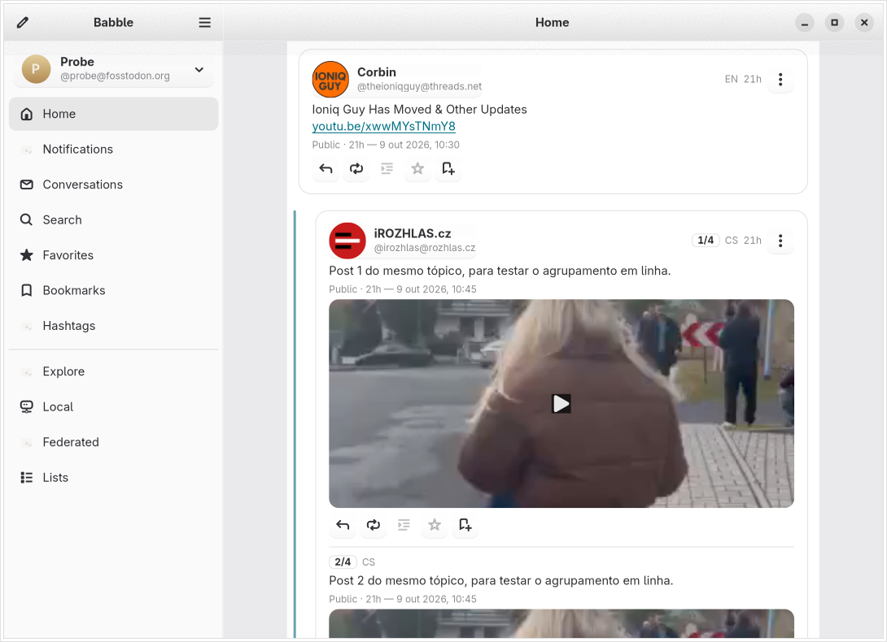

# Babble

*A cozy little Mastodon client for GNOME.*



Babble lets you read the fediverse the way you'd read a good book by the
window: timelines that scroll smoothly, threads that unfold nicely, and a
composer that stays out of your way until you have something to say. It's
built with GTK 4 and libadwaita, so it feels at home on your GNOME desktop.

- **Reading.** Live-updating home, local and federated timelines, threads,
  notifications, direct messages, quotes, edit history, bookmarks, lists,
  followed hashtags, and your yearly #Wrapstodon if your server has one for
  you — all without losing your scroll position.
- **Catch Up.** A separate sidebar place that pages back through the home
  timeline for a window you choose, ranks the posts you missed, and keeps that
  run frozen as a snapshot.
- **Writing.** A composer with spell checking, `@mention` suggestions,
  media uploads, polls, drafts, and scheduled posts.
- **At home on GNOME.** Paste or drag media straight into the composer,
  take a screenshot through the portal, and open posts from Files — Babble
  integrates with the desktop rather than living beside it.

## Getting it

Babble is **not on Flathub yet.** To run it, build it from source:

```sh
meson setup build && meson compile -C build
python3 build/src/babble
```

That needs GTK 4.24+ and libadwaita 1.10+ (GNOME 51). [The full build
guide](Docs/building.md) covers dependencies, the Flatpak manifest, and the
test suite.

## Documentation

The [full feature list](Docs/features.md) covers everything below in detail.

| | |
|---|---|
| [Building and testing](Docs/building.md) | Dependencies, meson, the Flatpak manifest, running the tests |
| [Signing in](Docs/signing-in.md) | What Babble asks for, and how the browser hands the login back |
| [Desktop integration](Docs/desktop-integration.md) | Every GNOME feature Babble uses, and what each needs |
| [Localization](Docs/localization.md) | Languages, and how to add one |
| [Mastodon API compatibility](Docs/mastodon-compat.md) | Where Babble gates on server capabilities, and why |
| [Roadmap](Docs/ROADMAP.MD) | What the project is betting on |
| [Flathub policy](Docs/flathub.md) | Why the manifest is local-only |

Translators: see [po/README.md](po/README.md).

## License

Babble is free software, released under the
[GNU General Public License v3.0 or later](LICENSE).
